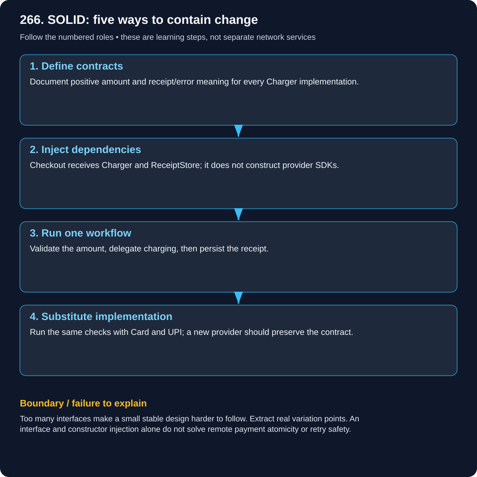
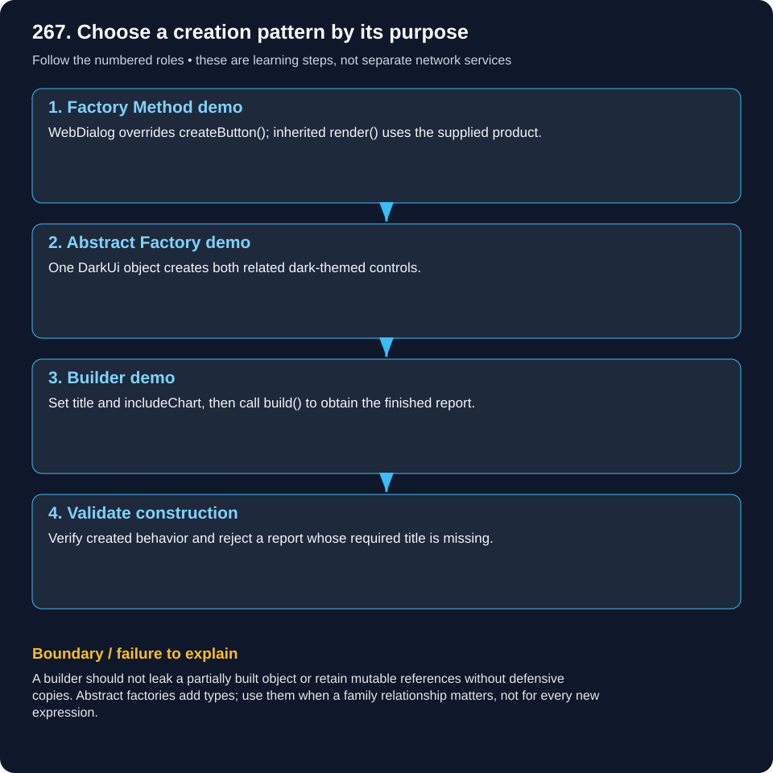
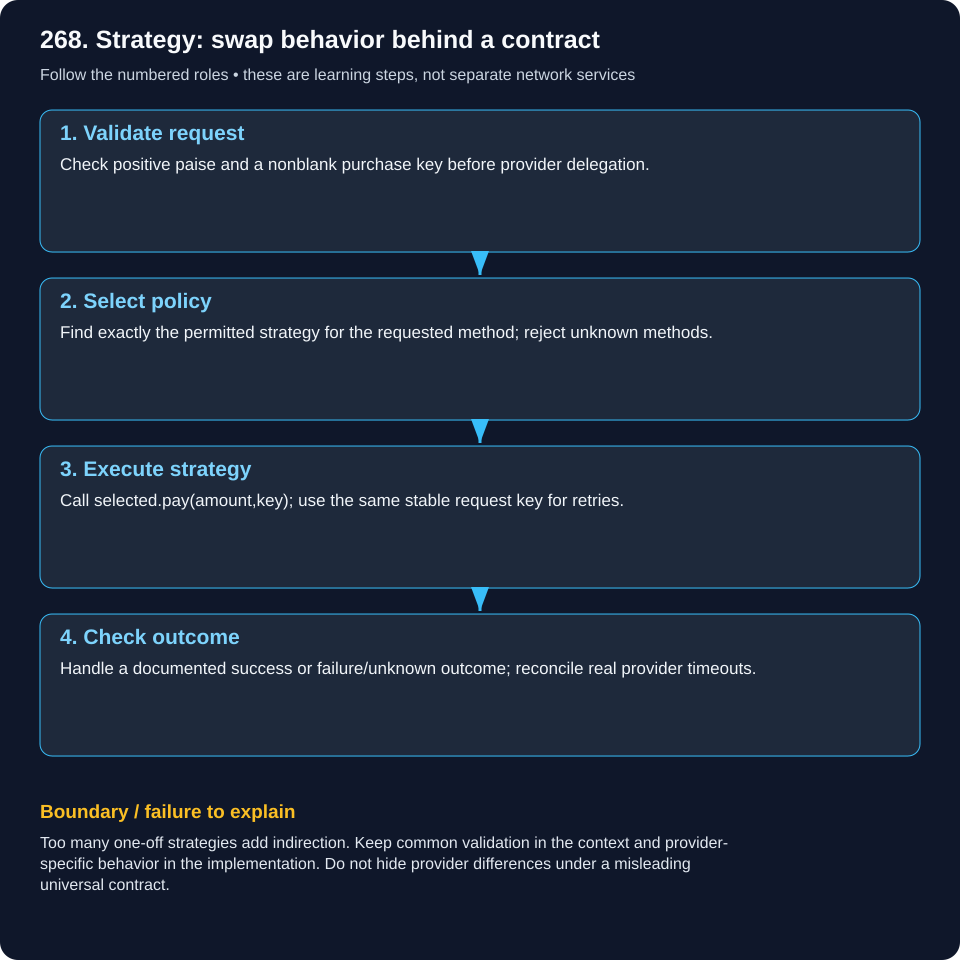
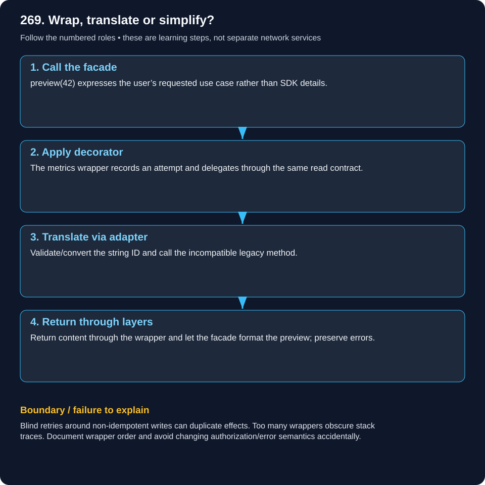
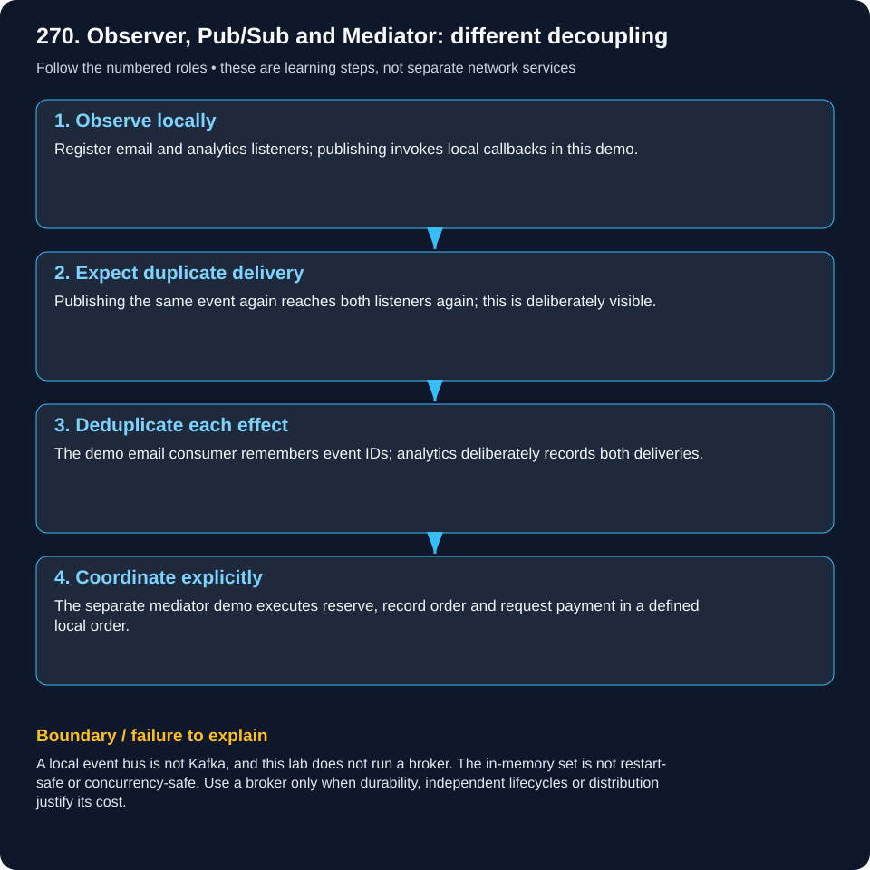
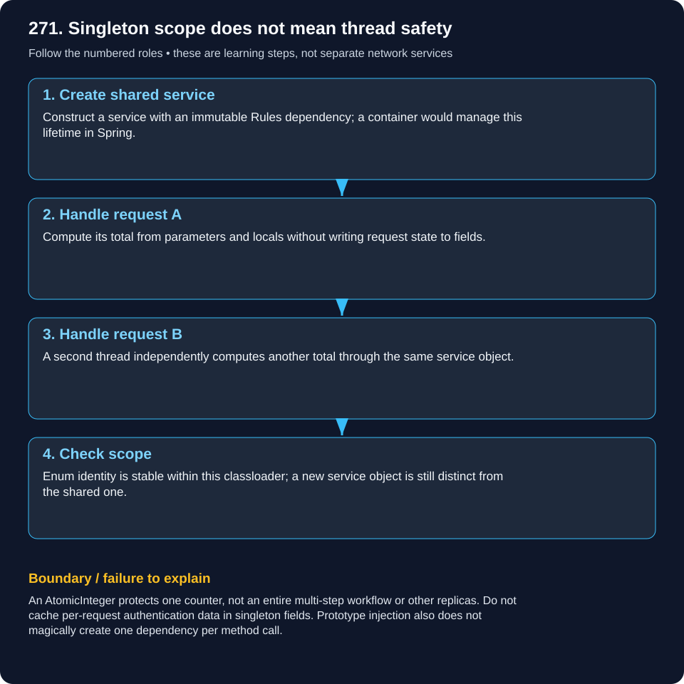
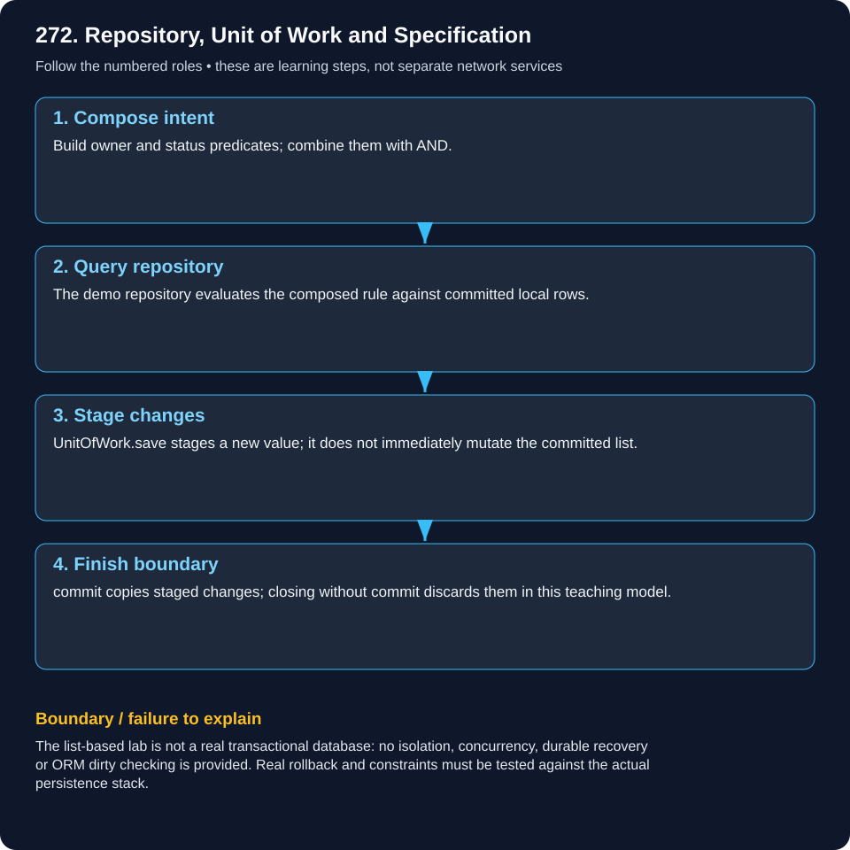
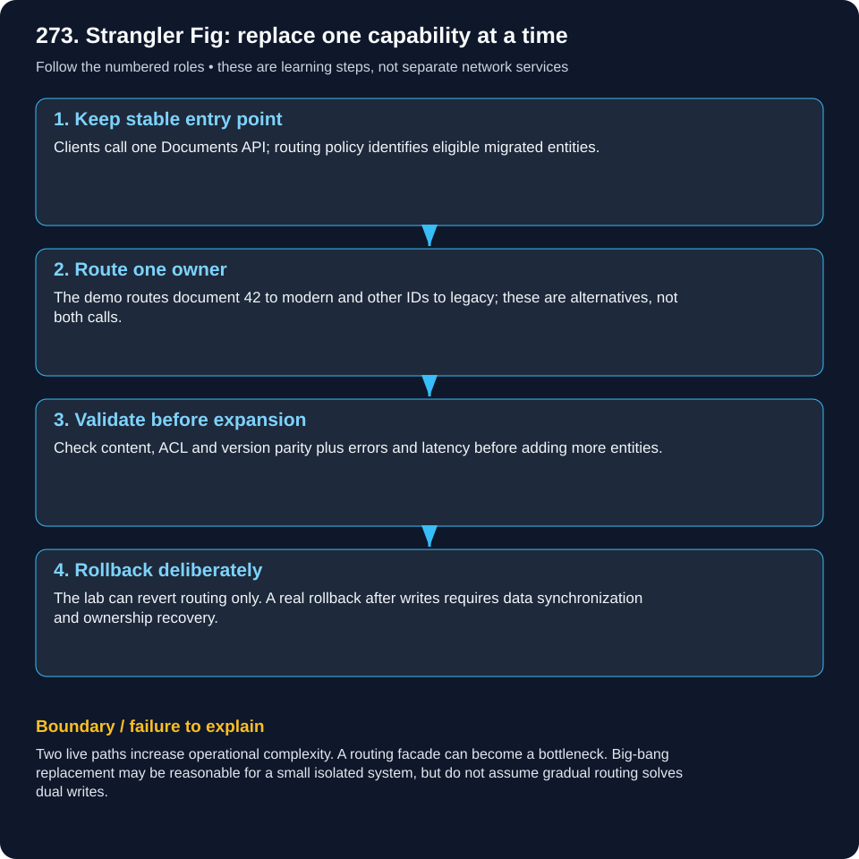

# Design Patterns — Java & Distributed Systems

Eight complete lessons: read the situation, compare the alternatives, follow the diagram, run the Java lab, then explain the failure case.

## Start here

A **pattern** is a named way to organize collaboration for a recurring problem. It is not a mandatory framework or a recipe to apply everywhere. **Interface** means a contract; **implementation** supplies behavior; **composition** connects objects by delegation; **inheritance** defines a subtype relationship; **injection** supplies a dependency from outside.

## Which problem are you solving?

| Need | Principle / pattern |
|---|---|
| Contain unrelated changes | SOLID |
| Defer construction of one product | Factory Method |
| Create compatible related products | Abstract Factory |
| Assemble a complex configured value | Builder |
| Swap an algorithm or provider behavior | Strategy |
| Translate an incompatible interface | Adapter |
| Add behavior through the same contract | Decorator |
| Offer a simpler subsystem entry point | Facade |
| Notify object listeners | Observer |
| Decouple event producers and remote consumers | Broker Pub/Sub |
| Coordinate collaboration explicitly | Mediator |
| Control instance lifetime / scope | Singleton / Spring scopes |
| Express data access, changes and filters | Repository / Unit of Work / Specification |
| Replace legacy capabilities gradually | Strangler Fig |

Examples use original teaching scenarios and Java 21. Plain-Java labs do not start Spring, a broker, a database, or a payment provider. Framework connections and distributed limitations are explained explicitly.

## 266. Explain SOLID principles with Spring Boot examples.

### SOLID: five ways to contain change

A restaurant separates cooking, billing and record keeping. Changing the payment terminal should not require rewriting the kitchen.

### What it means

SOLID is a set of design principles, not a library and not a promise to eliminate every conditional. The goal is to localize changes while preserving clear contracts. A class can use several principles at once.

### Worked real-world example

A checkout initially calculates price, constructs a card SDK, charges and saves receipts in one large method. Adding UPI forces edits throughout it. Separate the workflow from charging and persistence; pass those capabilities into the workflow.

### Single Responsibility — SRP

Give a module one coherent reason to change. Pricing changes with pricing policy; receipt persistence changes with storage policy. SRP does not mean one method per class or one class for every line.

### Open/Closed — OCP

Keep the stable checkout workflow closed to repeated edits by accepting a Charger interface. Add a conforming UPI implementation at the variation point. Registration/configuration may still change; no useful design is closed to every possible change.

### Liskov Substitution — LSP

Every Charger must honor the documented contract: accepted inputs, result meaning and failure semantics. A subclass that suddenly rejects valid card-independent amounts or silently does nothing breaks substitutability. Inheritance alone does not prove a valid subtype.

### Interface Segregation — ISP

A payment-only client should depend on Charger rather than a giant interface that also requires settlement reports and refunds. Do not force an implementation to provide unsupported methods by throwing UnsupportedOperationException.

### Dependency Inversion — DIP

The workflow depends on payment and receipt abstractions. Constructor injection supplies implementations; it does not create a global service locator. Dependency injection is a construction technique; DIP is the direction of dependency.

### Spring Boot connection

Make the coordinator a @Service with constructor parameters for the capabilities. Register implementations as beans; if multiple match, choose explicitly using @Qualifier or a registry. The runnable lab uses plain constructor injection so it needs no Spring dependencies.



### Follow the flow

1. **Define contracts:** Document positive amount and receipt/error meaning for every Charger implementation.

2. **Inject dependencies:** Checkout receives Charger and ReceiptStore; it does not construct provider SDKs.

3. **Run one workflow:** Validate the amount, delegate charging, then persist the receipt.

4. **Substitute implementation:** Run the same checks with Card and UPI; a new provider should preserve the contract.

### Runnable Java 21 example

The lab checks two interchangeable charging implementations, receipt persistence and a rejected zero amount. Charges are simulated; this is not a production payment transaction.

[Source](../examples/design-patterns/Pattern266.java)

```java
import java.util.*;

// SRP: checkout coordinates; gateway charges; receipt store persists.
public class Pattern266 {
 interface Charger { String charge(long paise); } // ISP: narrow capability
 interface ReceiptStore { void save(String receipt); }
 record Checkout(Charger charger, ReceiptStore receipts) { // DIP: depend on contracts
  String pay(long paise) {
   if(paise<=0) throw new IllegalArgumentException("positive amount required");
   String result=charger.charge(paise); receipts.save(result); return result;
  }
 }
 // OCP: another conforming gateway leaves Checkout unchanged.
 static class Card implements Charger { public String charge(long amount){return "card:"+amount;} }
 static class Upi implements Charger { public String charge(long amount){return "upi:"+amount;} }
 static void check(boolean ok){if(!ok)throw new AssertionError();}
 public static void main(String[] args){
  List<String> saved=new ArrayList<>();
  for(Charger gateway:List.of(new Card(),new Upi())) {
   // LSP: either implementation honors the positive-amount charge contract.
   String receipt=new Checkout(gateway,saved::add).pay(5000);
   check(receipt.endsWith(":5000"));
  }
  check(saved.size()==2);
  try{new Checkout(new Card(),saved::add).pay(0);throw new AssertionError();}
  catch(IllegalArgumentException expected){check(saved.size()==2);}
  System.out.println("PASS: gateway substitution, receipt persistence and input guard");
 }
}
```

```powershell
javac -d .pattern-classes examples/design-patterns/Pattern266.java
java -cp .pattern-classes Pattern266
```

Expected: a PASS line; failed invariants throw AssertionError. The .pattern-classes directory holds generated compilation output.

### Trade-offs and mistakes

Too many interfaces make a small stable design harder to follow. Extract real variation points. An interface and constructor injection alone do not solve remote payment atomicity or retry safety.

### Check your understanding

If a new Charger rejects an input that the interface says is valid, which SOLID principle has it violated?

## 267. Factory Method vs Abstract Factory vs Builder?

### Choose a creation pattern by its purpose

Factory Method chooses who makes a product; Abstract Factory chooses a compatible kit; Builder assembles one configured product.

### What it means

All three concern object creation, but they address different problems. Distinguish an actual Factory Method overridden by subclasses from a helper with a switch that is usually called a simple factory.

### Worked real-world example

A UI needs web-specific buttons, a matching dark-themed button and checkbox, and an audit report with optional charts. These are three separate creation decisions, not three names for the same factory.

### Factory Method

A Dialog base class owns render(), but calls an overridable createButton(). WebDialog chooses the concrete Button. The stable algorithm delegates one creation decision to a subclass. A static create(type) switch can be useful without being this specific pattern.

### Abstract Factory

UiFactory exposes button() and checkbox(). DarkUi returns a coherent family; another factory can return a light family. Clients work through product interfaces rather than mixing incompatible concrete families.

### Builder

Report.Builder collects title and optional chart settings, then build() validates and creates the finished immutable value. A builder is useful for many options or multi-stage construction; a record with two obvious fields may be simpler with a constructor.

### How they differ

Factory Method varies creation through subclassing. Abstract Factory provides several related creation operations through a factory object. Builder assembles a product through explicit steps. They can coexist; an abstract factory implementation might internally use builders.

### Spring Boot connection

Spring @Bean methods and configuration can perform application assembly without a custom factory hierarchy. Use a builder for request/report values when useful; use container-managed lifecycle for services that require injection or destruction callbacks.



### Follow the flow

1. **Factory Method demo:** WebDialog overrides createButton(); inherited render() uses the supplied product.

2. **Abstract Factory demo:** One DarkUi object creates both related dark-themed controls.

3. **Builder demo:** Set title and includeChart, then call build() to obtain the finished report.

4. **Validate construction:** Verify created behavior and reject a report whose required title is missing.

### Runnable Java 21 example

The lab separately exercises a subclass creation hook, a compatible product family, and builder validation.

[Source](../examples/design-patterns/Pattern267.java)

```java
public class Pattern267 {
 interface Button { String render(); }
 interface Checkbox { String render(); }
 // Factory Method: subclass supplies one product to a stable workflow.
 static abstract class Dialog {
  abstract Button createButton();
  String render(){return createButton().render();}
 }
 static class WebDialog extends Dialog {Button createButton(){return ()->"web button";}}
 // Abstract Factory: one family produces compatible related products.
 interface UiFactory {Button button();Checkbox checkbox();}
 static class DarkUi implements UiFactory {
  public Button button(){return ()->"dark button";}
  public Checkbox checkbox(){return ()->"dark checkbox";}
 }
 // Builder: assemble one complex value and validate at the boundary.
 record Report(String title,boolean includeChart) {
  static class Builder {
   private String title;private boolean chart;
   Builder title(String value){title=value;return this;}
   Builder includeChart(){chart=true;return this;}
   Report build(){if(title==null||title.isBlank())throw new IllegalStateException("title required");return new Report(title,chart);}
  }
 }
 static void check(boolean ok){if(!ok)throw new AssertionError();}
 public static void main(String[] args){
  check(new WebDialog().render().equals("web button"));
  UiFactory factory=new DarkUi();
  check(factory.button().render().startsWith("dark")&&factory.checkbox().render().startsWith("dark"));
  Report report=new Report.Builder().title("Audit").includeChart().build();check(report.includeChart());
  try{new Report.Builder().build();throw new AssertionError();}catch(IllegalStateException expected){}
  System.out.println("PASS: factory workflow, related family and builder validation");
 }
}
```

```powershell
javac -d .pattern-classes examples/design-patterns/Pattern267.java
java -cp .pattern-classes Pattern267
```

Expected: a PASS line; failed invariants throw AssertionError. The .pattern-classes directory holds generated compilation output.

### Trade-offs and mistakes

A builder should not leak a partially built object or retain mutable references without defensive copies. Abstract factories add types; use them when a family relationship matters, not for every new expression.

### Check your understanding

Would a report with many optional sections need an Abstract Factory, a Builder, or just a constructor—and why?

## 268. Strategy pattern with a Java payment example.

### Strategy: swap behavior behind a contract

A navigation app can choose a walking or driving route while the caller still asks for a route.

### What it means

Strategy encapsulates interchangeable behavior behind a stable interface. The context delegates to a selected strategy. Selection policy and the algorithm itself are separate responsibilities.

### Worked real-world example

Checkout receives payment method upi and amount 5,000 paise. A validated registry selects the UPI strategy and invokes it with the original purchase key. Selecting card changes behavior without duplicating checkout validation.

### Roles

PaymentStrategy is the contract; Card and Upi implement behavior; Checkout is the context; the method-to-strategy map performs selection. Name the roles before discussing frameworks.

### Why it improves a switch

An expanding switch often mixes selection, validation and provider implementation. A registry keeps selection small while each provider can be tested separately. A short stable switch is still reasonable when no meaningful variation exists.

### Strategy versus State

Strategy is selected to perform an interchangeable operation. State represents the context’s lifecycle, such as Pending to Paid, and governs allowed transitions. Both may use interfaces, but their intent and ownership differ.

### Factory versus Strategy

A factory supplies an object. A strategy performs behavior. A factory can create/select a strategy, but creation and execution remain different concerns.

### Spring Boot connection

Inject provider beans and build an immutable registry with explicit keys. Reject duplicate or unknown keys at an appropriate boundary. Keep provider credentials server-side; do not let an arbitrary client choose an unauthorized implementation.

### Distributed-systems limit

An interface does not make providers share the same guarantees. Define supported currencies, timeout interpretation, idempotency and result semantics. A timeout can be an unknown charge outcome rather than a clean failure.



### Follow the flow

1. **Validate request:** Check positive paise and a nonblank purchase key before provider delegation.

2. **Select policy:** Find exactly the permitted strategy for the requested method; reject unknown methods.

3. **Execute strategy:** Call selected.pay(amount,key); use the same stable request key for retries.

4. **Check outcome:** Handle a documented success or failure/unknown outcome; reconcile real provider timeouts.

### Runnable Java 21 example

The lab uses simulated card/UPI responses, checks strategy selection and rejects an unsupported method. It does not send payments or implement durable deduplication.

[Source](../examples/design-patterns/Pattern268.java)

```java
import java.util.*;
public class Pattern268 {
 interface PaymentStrategy {String pay(long paise,String requestKey);}
 record Card() implements PaymentStrategy {public String pay(long a,String k){return "card:"+k+":"+a;}}
 record Upi() implements PaymentStrategy {public String pay(long a,String k){return "upi:"+k+":"+a;}}
 record Checkout(Map<String,PaymentStrategy> strategies) {
  Checkout {strategies=Map.copyOf(strategies);}
  String pay(String method,long paise,String requestKey){
   if(paise<=0||requestKey==null||requestKey.isBlank())throw new IllegalArgumentException("amount/key required");
   PaymentStrategy selected=strategies.get(method);
   if(selected==null)throw new IllegalArgumentException("unsupported method");
   return selected.pay(paise,requestKey);
  }
 }
 static void check(boolean ok){if(!ok)throw new AssertionError();}
 public static void main(String[] args){
  var checkout=new Checkout(Map.of("card",new Card(),"upi",new Upi()));
  check(checkout.pay("upi",5000,"order-81").equals("upi:order-81:5000"));
  check(checkout.pay("card",5000,"order-82").startsWith("card:"));
  try{checkout.pay("cash",5000,"order-83");throw new AssertionError();}catch(IllegalArgumentException expected){}
  System.out.println("PASS: policy selection and interchangeable payment behavior");
 }
}
```

```powershell
javac -d .pattern-classes examples/design-patterns/Pattern268.java
java -cp .pattern-classes Pattern268
```

Expected: a PASS line; failed invariants throw AssertionError. The .pattern-classes directory holds generated compilation output.

### Trade-offs and mistakes

Too many one-off strategies add indirection. Keep common validation in the context and provider-specific behavior in the implementation. Do not hide provider differences under a misleading universal contract.

### Check your understanding

Which object should decide the selected method, and which object should implement the payment algorithm?

## 269. Decorator, Adapter and Facade patterns in integrations.

### Wrap, translate or simplify?

A translator changes language, a jacket adds a layer, and a receptionist offers one simple entry point to several departments.

### What it means

Adapter changes an incompatible interface into the interface your code expects. Decorator keeps the same contract while adding behavior. Facade offers a simpler use-case interface over a subsystem. Similar wrapper syntax does not imply the same intent.

### Worked real-world example

A legacy document SDK takes an integer ID. The application accepts a string ID, counts attempts and exposes a preview operation. PreviewFacade calls MeteredDocuments, which calls LegacyAdapter, which calls the legacy SDK.

### Adapter

Documents.read(String) translates to LegacySdk.fetchNumeric(int). A real adapter also maps identifiers, authorization context, return values and error semantics. Invalid IDs must not silently map to another document.

### Decorator

MeteredDocuments implements Documents too, so it can wrap any Documents instance. It adds attempt counting and delegates. Choose whether metrics count attempts, success or both. Decorator order matters: retries outside a metrics wrapper count differently from retries inside it.

### Facade

PreviewFacade exposes preview(id), hiding retrieval and formatting details. It does not need to implement Documents because it offers a different, more convenient use-case boundary. A facade is not automatically a new network service.

### Spring AOP connection

Proxy-based AOP can apply cross-cutting behavior such as metrics around eligible method calls. That is not identical to every decorator; proxy boundaries and self-invocation affect whether advice runs. Keep access checks and transaction semantics explicit.

### Migration connection

A stable Documents contract lets a new repository adapter replace the old SDK incrementally. Test missing documents, forbidden access, version selection and timeouts as carefully as successful reads.



### Follow the flow

1. **Call the facade:** preview(42) expresses the user’s requested use case rather than SDK details.

2. **Apply decorator:** The metrics wrapper records an attempt and delegates through the same read contract.

3. **Translate via adapter:** Validate/convert the string ID and call the incompatible legacy method.

4. **Return through layers:** Return content through the wrapper and let the facade format the preview; preserve errors.

### Runnable Java 21 example

The lab checks preview composition and verifies that the attempt metric includes an invalid-ID failure. It models SDK calls locally.

[Source](../examples/design-patterns/Pattern269.java)

```java
import java.util.concurrent.atomic.AtomicInteger;
public class Pattern269 {
 interface Documents {String read(String id);}
 static class LegacySdk {String fetchNumeric(int id){return "document:"+id;}}
 // Adapter changes the interface (String ID to legacy numeric ID).
 record LegacyAdapter(LegacySdk sdk) implements Documents {
  public String read(String id){return sdk.fetchNumeric(Integer.parseInt(id));}
 }
 // Decorator keeps the same interface and wraps behavior.
 record MeteredDocuments(Documents delegate,AtomicInteger calls) implements Documents {
  public String read(String id){calls.incrementAndGet();return delegate.read(id);}
 }
 // Facade exposes one convenient use case across several operations.
 record PreviewFacade(Documents documents) {
  String preview(String id){return documents.read(id).toUpperCase(java.util.Locale.ROOT);}
 }
 public static void main(String[] args){
  var calls=new AtomicInteger();
  Documents docs=new MeteredDocuments(new LegacyAdapter(new LegacySdk()),calls);
  String preview=new PreviewFacade(docs).preview("42");
  if(!preview.equals("DOCUMENT:42")||calls.get()!=1)throw new AssertionError();
  try{docs.read("bad-id");throw new AssertionError();}catch(NumberFormatException expected){}
  if(calls.get()!=2)throw new AssertionError("attempts include failures");
  System.out.println("PASS: facade delegates through decorator and adapter");
 }
}
```

```powershell
javac -d .pattern-classes examples/design-patterns/Pattern269.java
java -cp .pattern-classes Pattern269
```

Expected: a PASS line; failed invariants throw AssertionError. The .pattern-classes directory holds generated compilation output.

### Trade-offs and mistakes

Blind retries around non-idempotent writes can duplicate effects. Too many wrappers obscure stack traces. Document wrapper order and avoid changing authorization/error semantics accidentally.

### Check your understanding

Which wrapper is an Adapter if it changes String IDs to integer IDs, and why is the metrics wrapper different?

## 270. Observer vs Pub/Sub vs Mediator?

### Observer, Pub/Sub and Mediator: different decoupling

A doorbell alerts nearby listeners; a postal service routes to distant subscribers; an event coordinator tells collaborators what to do next.

### What it means

Observer is an object-level notification relationship. Broker-based publish/subscribe separates producers from consumers through messaging infrastructure. Mediator centralizes collaboration rules so colleagues do not all call one another directly. These are not interchangeable delivery guarantees.

### Worked real-world example

OrderCreated needs email and analytics. A local observer invokes listeners in the current process. Separate services may consume the event through a broker. A checkout mediator can instead explicitly coordinate reserve, record and request-payment steps.

### Observer

The subject keeps listeners and notifies them when something changes. This demo uses synchronous callbacks, so a slow listener delays publish and an exception stops later callbacks. Observer itself does not mandate synchronous execution or durable delivery.

### Broker Pub/Sub

A broker routes publications to subscriptions. For email and analytics to each receive every Kafka event, use separate consumer groups; consumers in one group share partitions rather than all receiving each event. A real design needs retention, retries, offsets and consumer idempotency.

### Mediator

A coordinator owns the collaboration sequence. Components delegate coordination to it rather than directly knowing every other component. An application mediator can be local; a durable distributed saga orchestrator additionally records recoverable state.

### Choreography versus orchestration

Consumers reacting to events can form choreography. An orchestrator directs a workflow. Neither is universally better: independent notifications suit events, while tightly ordered business decisions may need explicit coordination.

### Delivery is not effect

A duplicate event must not create a second email or shipment unintentionally. Consumer-local in-memory deduplication only lasts for that process; durable deduplication must share a transaction or idempotent boundary with the business effect. External sends can still have uncertainty.



### Follow the flow

1. **Observe locally:** Register email and analytics listeners; publishing invokes local callbacks in this demo.

2. **Expect duplicate delivery:** Publishing the same event again reaches both listeners again; this is deliberately visible.

3. **Deduplicate each effect:** The demo email consumer remembers event IDs; analytics deliberately records both deliveries.

4. **Coordinate explicitly:** The separate mediator demo executes reserve, record order and request payment in a defined local order.

### Runnable Java 21 example

The lab checks synchronous observer delivery, duplicate handling in one consumer and a separate mediator sequence. The broker discussion is conceptual; no broker or distributed transaction is simulated.

[Source](../examples/design-patterns/Pattern270.java)

```java
import java.util.*;
import java.util.function.Consumer;
public class Pattern270 {
 record OrderCreated(String eventId){}
 // In-process observer: synchronous delivery in this deliberately small demo.
 static class OrderEvents {
  final List<Consumer<OrderCreated>> listeners=new ArrayList<>();
  void subscribe(Consumer<OrderCreated> listener){listeners.add(listener);}
  void publish(OrderCreated event){for(var listener:List.copyOf(listeners))listener.accept(event);}
 }
 // Consumer-local deduplication models one concern of broker pub/sub.
 // In production use durable transactional state, not this in-memory set.
 static class EmailConsumer {
  final Set<String> processed=new HashSet<>();int sent;
  void on(OrderCreated event){if(processed.add(event.eventId()))sent++;}
 }
 // Mediator explicitly coordinates collaboration for one use case.
 record CheckoutMediator(List<String> workflow) {
  void checkout(){workflow.add("reserve");workflow.add("record order");workflow.add("request payment");}
 }
 public static void main(String[] args){
  var events=new OrderEvents();var email=new EmailConsumer();var analytics=new ArrayList<String>();
  events.subscribe(email::on);events.subscribe(e->analytics.add(e.eventId()));
  var event=new OrderCreated("e81");events.publish(event);events.publish(event);
  if(email.sent!=1||analytics.size()!=2)throw new AssertionError();
  var steps=new ArrayList<String>();new CheckoutMediator(steps).checkout();
  if(!steps.equals(List.of("reserve","record order","request payment")))throw new AssertionError();
  System.out.println("PASS: local observers, per-consumer deduplication and mediator sequence");
 }
}
```

```powershell
javac -d .pattern-classes examples/design-patterns/Pattern270.java
java -cp .pattern-classes Pattern270
```

Expected: a PASS line; failed invariants throw AssertionError. The .pattern-classes directory holds generated compilation output.

### Trade-offs and mistakes

A local event bus is not Kafka, and this lab does not run a broker. The in-memory set is not restart-safe or concurrency-safe. Use a broker only when durability, independent lifecycles or distribution justify its cost.

### Check your understanding

If email and analytics are in the same Kafka consumer group, will each always see every order event?

## 271. Singleton pattern and Spring singleton scope?

### Singleton scope does not mean thread safety

One shared receptionist serves many people, but must not put the current caller’s private details in a shared notebook slot.

### What it means

The Singleton pattern restricts construction and exposes one instance within its defined runtime scope. A Spring singleton is one managed instance for a bean definition in one container. Neither means one global instance across multiple servers, nor does either make mutable fields automatically safe.

### Worked real-world example

A shared OrderService receives two simultaneous requests: 5,000 paise × 2 and 7,000 paise × 3. Request amounts belong in method parameters and locals. A field currentCustomer or lastAmount would let callers overwrite each other.

### Classic Java singleton

An enum constant gives controlled instance identity per defining classloader. Other patterns use a static holder or synchronization. Classloader boundaries matter; do not call a JVM object a globally unique distributed coordinator.

### Spring singleton

The container returns the bean instance for that definition. Two bean definitions of the same class can produce two instances, and two application containers have separate scopes. Manually using new bypasses container management.

### Concurrency safety

Prefer immutable dependencies and local request state. Shared mutable caches, counters and collections need appropriate synchronization or concurrent structures. Stateless service code still depends on the thread-safety and scope of its collaborators.

### Dependency injection and testing

Inject collaborators rather than looking up global singletons from inside business methods. Tests can supply substitutes; hidden global state otherwise leaks between tests.

### Cluster-wide rules

With three application replicas there may be three service instances. Use a database uniqueness rule or an appropriate distributed ownership protocol to protect a global booking, not an in-memory singleton lock.



### Follow the flow

1. **Create shared service:** Construct a service with an immutable Rules dependency; a container would manage this lifetime in Spring.

2. **Handle request A:** Compute its total from parameters and locals without writing request state to fields.

3. **Handle request B:** A second thread independently computes another total through the same service object.

4. **Check scope:** Enum identity is stable within this classloader; a new service object is still distinct from the shared one.

### Runnable Java 21 example

The Java 21 lab checks enum identity and two concurrent calculations with independent inputs. It uses no Spring container; Spring scope rules are explained separately.

[Source](../examples/design-patterns/Pattern271.java)

```java
import java.util.concurrent.*;
public class Pattern271 {
 // One enum instance per defining classloader; no cross-replica guarantee.
 enum Rules {INSTANCE;
  long total(long unitPaise,int quantity){if(unitPaise<0||quantity<0)throw new IllegalArgumentException();return Math.multiplyExact(unitPaise,quantity);}
 }
 // A Spring-managed service should similarly keep request values in locals.
 static class OrderService {
  final Rules rules;
  OrderService(Rules rules){this.rules=rules;}
  long price(long unitPaise,int quantity){return rules.total(unitPaise,quantity);}
 }
 public static void main(String[] args)throws Exception{
  if(Rules.INSTANCE!=Rules.INSTANCE)throw new AssertionError();
  var shared=new OrderService(Rules.INSTANCE);
  try(var pool=Executors.newFixedThreadPool(2)){
   var a=pool.submit(()->shared.price(5000,2));var b=pool.submit(()->shared.price(7000,3));
   if(a.get()!=10000L||b.get()!=21000L)throw new AssertionError();
  }
  // Merely using the same class does not make manually constructed services identical.
  if(new OrderService(Rules.INSTANCE)==shared)throw new AssertionError();
  System.out.println("PASS: enum identity and independent concurrent request values");
 }
}
```

```powershell
javac -d .pattern-classes examples/design-patterns/Pattern271.java
java -cp .pattern-classes Pattern271
```

Expected: a PASS line; failed invariants throw AssertionError. The .pattern-classes directory holds generated compilation output.

### Trade-offs and mistakes

An AtomicInteger protects one counter, not an entire multi-step workflow or other replicas. Do not cache per-request authentication data in singleton fields. Prototype injection also does not magically create one dependency per method call.

### Check your understanding

Why can a singleton bean’s synchronized method fail to protect the last stock item across three application replicas?

## 272. Explain Repository, Unit of Work and Specification patterns.

### Repository, Unit of Work and Specification

A librarian finds records, a transaction folder collects changes, and a filter describes which records you want.

### What it means

Repository presents domain-oriented access to stored aggregates. Unit of Work tracks changes belonging to a business operation and coordinates writing them. Specification represents a reusable selection rule. They cooperate but do not mean the same thing.

### Worked real-world example

An auditor lists Alice’s open audit records. A repository accepts a composed owner-is-Alice AND status-is-OPEN rule. A separate operation changes several related records inside one transaction rather than committing each repository call independently.

### Repository

Use methods such as findOpenAuditsFor(owner) or matching(specification) to describe intent. Do not blindly wrap every existing repository in another identical CRUD layer. Domain aggregate boundaries and query requirements should shape the interface.

### Unit of Work

An ORM persistence context tracks managed entities and changes. A service-level transaction commonly defines the business commit/rollback boundary. Unit of Work and database transaction are related concepts, not synonyms; tracking changes does not by itself guarantee ACID behavior.

### Specification

Combine predicates such as ownedBy(alice).and(isOpen()). The lab uses java.util.function.Predicate over a list. Spring Data JPA Specification builds database Criteria predicates; filtering a fully loaded table in Java is not a scalable substitute.

### Spring service boundary

A transaction around a service operation can include several repository calls to the same participating transaction manager. Merely adding @Transactional does not atomically include a remote payment service. Proxy invocation and rollback rules must be understood for the chosen setup.

### Performance and API boundaries

Avoid N+1: loading parents and lazily accessing each child may issue many queries. Use suitable projections, fetch strategies or batching after measuring SQL. Map persistence entities to API values so lazy loading, internal fields and graph shape do not become the public contract.



### Follow the flow

1. **Compose intent:** Build owner and status predicates; combine them with AND.

2. **Query repository:** The demo repository evaluates the composed rule against committed local rows.

3. **Stage changes:** UnitOfWork.save stages a new value; it does not immediately mutate the committed list.

4. **Finish boundary:** commit copies staged changes; closing without commit discards them in this teaching model.

### Runnable Java 21 example

The lab checks a composed query, an explicit staged commit and discarded uncommitted work. It intentionally does not claim database transaction guarantees.

[Source](../examples/design-patterns/Pattern272.java)

```java
import java.util.*;
import java.util.function.Predicate;
public class Pattern272 {
 record Audit(long id,String owner,String status){}
 interface Audits {List<Audit> matching(Predicate<Audit> specification);void save(Audit audit);}
 // Teaching model of staged changes. Not a database/ORM or concurrency implementation.
 static class UnitOfWork implements Audits,AutoCloseable {
  final List<Audit> database;final List<Audit> pending=new ArrayList<>();
  UnitOfWork(List<Audit> database){this.database=database;}
  public void save(Audit audit){pending.add(audit);}
  public List<Audit> matching(Predicate<Audit> spec){return database.stream().filter(spec).toList();}
  void commit(){database.addAll(pending);pending.clear();}
  public void close(){pending.clear();} // discard uncommitted changes
 }
 public static void main(String[] args){
  var rows=new ArrayList<Audit>();
  try(var work=new UnitOfWork(rows)){work.save(new Audit(1,"alice","OPEN"));work.commit();}
  try(var work=new UnitOfWork(rows)){work.save(new Audit(2,"bob","OPEN"));} // no commit
  Predicate<Audit> owned=a->a.owner().equals("alice");Predicate<Audit> open=a->a.status().equals("OPEN");
  try(var work=new UnitOfWork(rows)){
   if(work.matching(owned.and(open)).size()!=1||rows.size()!=1)throw new AssertionError();
  }
  System.out.println("PASS: repository query, composed predicate, commit and discarded staging");
 }
}
```

```powershell
javac -d .pattern-classes examples/design-patterns/Pattern272.java
java -cp .pattern-classes Pattern272
```

Expected: a PASS line; failed invariants throw AssertionError. The .pattern-classes directory holds generated compilation output.

### Trade-offs and mistakes

The list-based lab is not a real transactional database: no isolation, concurrency, durable recovery or ORM dirty checking is provided. Real rollback and constraints must be tested against the actual persistence stack.

### Check your understanding

Why is a composed Java Predicate over all loaded rows different from a JPA Specification executed in SQL?

## 273. Explain Strangler Fig pattern for legacy modernization.

### Strangler Fig: replace one capability at a time

Renovate a building room by room while keeping a safe entrance, rather than demolishing it with everyone inside.

### What it means

Strangler Fig gradually moves selected capabilities from a legacy system to a replacement behind a stable entry point. Routing, compatibility, data ownership and rollback are part of the migration; a reverse proxy alone is not a complete modernization plan.

### Worked real-world example

A document API keeps GET /documents/{id}. Document 42 is validated in the modern repository while document 7 still belongs to the legacy path. The router selects one owner; clients retain the same external contract.

### Choose a migration slice

Start with a bounded capability or cohort such as read-only retrieval for migrated documents. Keep authorization, document version and error semantics compatible. Arbitrary percentage routing is unsafe if the selected backend lacks the requested data.

### Establish data parity

Backfill documents and metadata, verify checksums/counts, compare ACLs and versions, then reconcile changes during the copy. A matching byte count alone does not prove permission or metadata parity.

### Cut over ownership

Define one authoritative writer per entity/capability during each phase. Replication or change capture needs ordering and idempotency. Uncoordinated writes to old and new stores create divergence.

### Validate safely

Canary eligible traffic and compare results/latency/errors. Shadow only suitable side-effect-free reads with privacy and access controls; never duplicate payments or writes merely to compare responses.

### Rollback and retire

Before rollback after modern writes, restore a valid authoritative view or reconcile data; flipping a route is insufficient. After parity and stability, retire legacy paths, jobs, credentials and data according to retention requirements.



### Follow the flow

1. **Keep stable entry point:** Clients call one Documents API; routing policy identifies eligible migrated entities.

2. **Route one owner:** The demo routes document 42 to modern and other IDs to legacy; these are alternatives, not both calls.

3. **Validate before expansion:** Check content, ACL and version parity plus errors and latency before adding more entities.

4. **Rollback deliberately:** The lab can revert routing only. A real rollback after writes requires data synchronization and ownership recovery.

### Runnable Java 21 example

The lab checks migrated versus legacy routes and route-only rollback. It models no data backfill, ACL migration, dual writes or network calls.

[Source](../examples/design-patterns/Pattern273.java)

```java
import java.util.*;
public class Pattern273 {
 interface Documents {String read(String id);}
 record Router(Documents legacy,Documents modern,Set<String> migrated) implements Documents {
  Router{migrated=Set.copyOf(migrated);}
  public String read(String id){return (migrated.contains(id)?modern:legacy).read(id);}
 }
 public static void main(String[] args){
  Documents legacy=id->"legacy:"+id,modern=id->"modern:"+id;
  Documents canary=new Router(legacy,modern,Set.of("42"));
  if(!canary.read("42").equals("modern:42")||!canary.read("7").equals("legacy:7"))throw new AssertionError();
  Documents rollback=new Router(legacy,modern,Set.of());
  if(!rollback.read("42").equals("legacy:42"))throw new AssertionError();
  // Only route rollback is demonstrated. Data parity and write ownership need a separate protocol.
  System.out.println("PASS: migrated routing, legacy routing and route-only rollback");
 }
}
```

```powershell
javac -d .pattern-classes examples/design-patterns/Pattern273.java
java -cp .pattern-classes Pattern273
```

Expected: a PASS line; failed invariants throw AssertionError. The .pattern-classes directory holds generated compilation output.

### Trade-offs and mistakes

Two live paths increase operational complexity. A routing facade can become a bottleneck. Big-bang replacement may be reasonable for a small isolated system, but do not assume gradual routing solves dual writes.

### Check your understanding

Why can flipping the route back lose access to new data written only in the replacement system?

## Sources and further reading

- [Spring bean scopes: per container and bean definition](https://docs.spring.io/spring-framework/reference/core/beans/factory-scopes.html)
- [Spring Data JPA transaction boundaries](https://docs.spring.io/spring-data/jpa/reference/jpa/transactions.html)
- [Azure Architecture Center: Strangler Fig](https://learn.microsoft.com/en-us/azure/architecture/patterns/strangler-fig)

## Regeneration and verification

Edit `scripts/expand_design_patterns.py` for lesson content and `examples/design-patterns/*.java` for labs. Run `python scripts/expand_design_patterns.py`, `python scripts/validate_questions.py`, and `python scripts/validate_pattern_labs.py`. The browser check `node scripts/test_system_design.cjs` covers system design and design patterns together.
