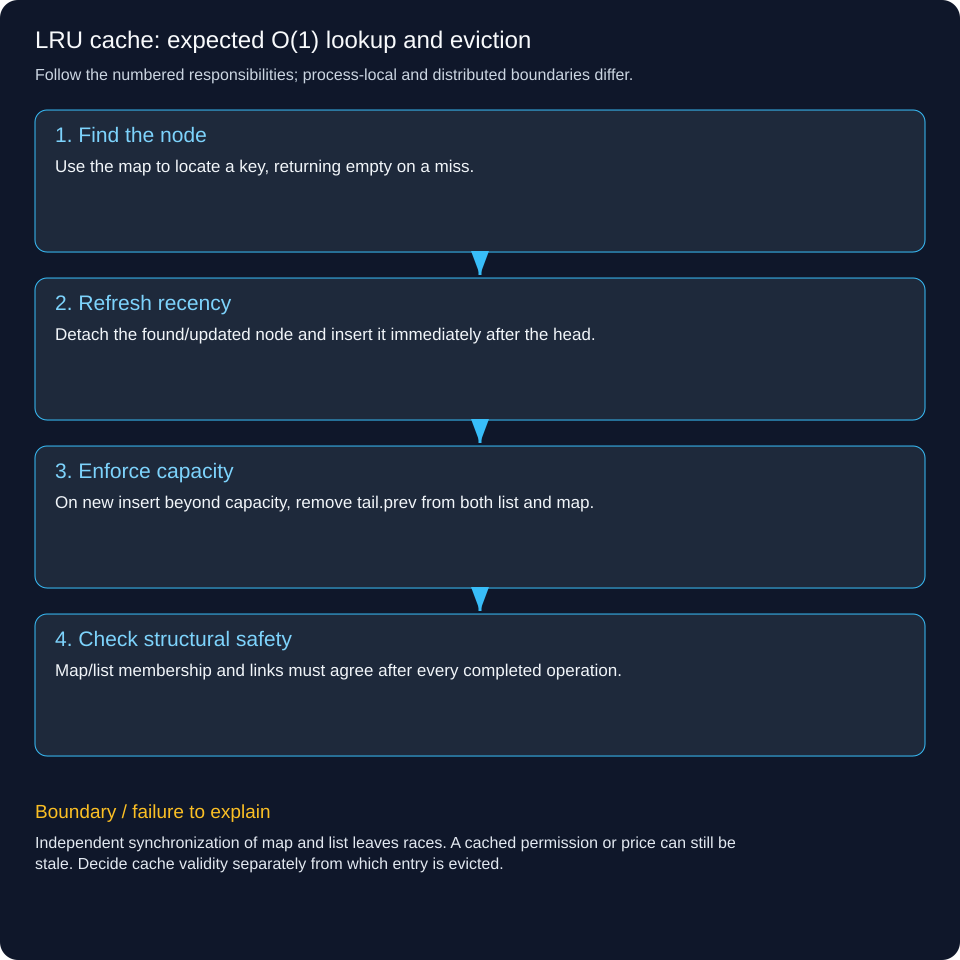

# LRU cache: expected O(1) lookup and eviction

Build a bounded least-recently-used cache. Successful get and updating an existing key make it most recent. When inserting beyond capacity, evict the least recent key.

## Follow a concrete operation

Capacity is two. put(1,A), put(2,B), get(1), put(3,C) must evict 2, because reading 1 made it newer. Updating 1 to A2 also refreshes it. A cache miss returns an explicit empty result; null keys/values are disallowed, and zero capacity is a disabled cache.

## Why a map or list alone is insufficient

A hash map quickly locates a key but does not provide the eviction order. A list preserves order but searching the whole list is O(n). Combine HashMap<K,Node> with a doubly linked list so the map finds the exact node and the node links allow constant pointer updates. Head/tail sentinels simplify empty and single-element cases.

## Write the invariants

Every map entry identifies exactly one list node. Every non-sentinel list node has a matching map entry. head.next is most recent and tail.prev is least recent. Forward/back links agree; size never exceeds capacity at the end of a public operation. Store only references internally; decide whether mutable cached values themselves require defensive copies at a higher boundary.

## Trace get and put

get finds a node, detaches it and moves it to the head. A miss does not create an entry. put on an existing key updates the value and moves the same node. put on a new key creates a node and, if over capacity, detaches tail.prev and removes its key from the map. Eviction must update both structures, not only the list.

## Explain the O(1) claim precisely

List unlink/link work is O(1). Hash-table operations are expected/amortized O(1) under normal hash distribution; do not claim deterministic constant time for every possible hash collision. Hash-map resizing can cost more for an individual operation. Memory is O(capacity). A successful get mutates recency, so it needs the same synchronization protection as writes in this exact-LRU implementation.

## Compare implementation choices

Java LinkedHashMap with access-order configuration and an eviction hook is a concise alternative; the explicit node implementation demonstrates the underlying design. The lab uses synchronized public operations for exact local order. High-throughput caches often use more elaborate or approximate policies. LRU is an eviction rule, not TTL, persistence, freshness, authorization or a distributed consistency guarantee.



## Trace the responsibilities

1. **Find the node:** Use the map to locate a key, returning empty on a miss.

2. **Refresh recency:** Detach the found/updated node and insert it immediately after the head.

3. **Enforce capacity:** On new insert beyond capacity, remove tail.prev from both list and map.

4. **Check structural safety:** Map/list membership and links must agree after every completed operation.

## Runnable Java 21 example

This standard-library lab runs locally. It does not deploy a backend, persist data, contact a bank or coordinate multiple servers.

[Source](../../examples/lld/LruCacheDemo.java)

```java
import java.util.*;
public class LruCacheDemo {
 static class Lru<K,V> {
  private static class Node<K,V>{K key;V value;Node<K,V> prev,next;Node(K k,V v){key=k;value=v;}}
  private final int capacity;private final Map<K,Node<K,V>> index=new HashMap<>();
  private final Node<K,V> head=new Node<>(null,null),tail=new Node<>(null,null);
  Lru(int capacity){if(capacity<0)throw new IllegalArgumentException();this.capacity=capacity;head.next=tail;tail.prev=head;}
  private void detach(Node<K,V> n){n.prev.next=n.next;n.next.prev=n.prev;}
  private void newest(Node<K,V> n){n.next=head.next;n.prev=head;head.next.prev=n;head.next=n;}
  synchronized Optional<V> get(K key){Objects.requireNonNull(key);Node<K,V> n=index.get(key);if(n==null)return Optional.empty();detach(n);newest(n);return Optional.of(n.value);}
  synchronized void put(K key,V value){Objects.requireNonNull(key);Objects.requireNonNull(value);
   Node<K,V> n=index.get(key);if(n!=null){n.value=value;detach(n);newest(n);return;}
   if(capacity==0)return;n=new Node<>(key,value);index.put(key,n);newest(n);
   if(index.size()>capacity){Node<K,V> old=tail.prev;detach(old);index.remove(old.key);}
  }
  synchronized void verify(){
   int count=0;Node<K,V> previous=head;
   for(Node<K,V> n=head.next;n!=tail;n=n.next){if(n.prev!=previous||index.get(n.key)!=n)throw new AssertionError();previous=n;if(++count>index.size())throw new AssertionError("cycle");}
   if(tail.prev!=previous||count!=index.size()||count>capacity)throw new AssertionError();
  }
 }
 static void check(boolean ok){if(!ok)throw new AssertionError();}
 public static void main(String[] args){
  Lru<Integer,String> cache=new Lru<>(2);cache.put(1,"A");cache.put(2,"B");cache.get(1);cache.put(3,"C");
  check(cache.get(2).isEmpty());check(cache.get(1).orElseThrow().equals("A"));cache.verify();
  cache.put(1,"A2");cache.put(4,"D");check(cache.get(3).isEmpty());check(cache.get(1).orElseThrow().equals("A2"));cache.verify();
  Lru<Integer,String> zero=new Lru<>(0);zero.put(1,"X");check(zero.get(1).isEmpty());zero.verify();
  Random random=new Random(81);Lru<Integer,Integer> actual=new Lru<>(5);
  LinkedHashMap<Integer,Integer> model=new LinkedHashMap<>(16,.75f,true);
  for(int i=0;i<1000;i++){
   int key=random.nextInt(12);
   if(random.nextBoolean()){int v=random.nextInt(100);actual.put(key,v);model.put(key,v);if(model.size()>5)model.remove(model.keySet().iterator().next());}
   else check(actual.get(key).equals(Optional.ofNullable(model.get(key))));
   actual.verify();
  }
  System.out.println("PASS: access/update recency, eviction, zero capacity, list invariants and reference-model comparison");
 }
}
```

```powershell
javac -d .pattern-classes examples/lld/LruCacheDemo.java
java -cp .pattern-classes LruCacheDemo
```

Expected: PASS after assertions verify the stated invariants.

## Trade-offs and failure handling

Independent synchronization of map and list leaves races. A cached permission or price can still be stale. Decide cache validity separately from which entry is evicted.

## Interview check

Why is get a write operation from the point of view of concurrency in an access-ordered LRU cache?

[LLD and HLD learning paths](../lld-hld-learning-path.md)

[Java access-ordered LinkedHashMap contract](https://docs.oracle.com/en/java/javase/21/docs/api/java.base/java/util/LinkedHashMap.html)
