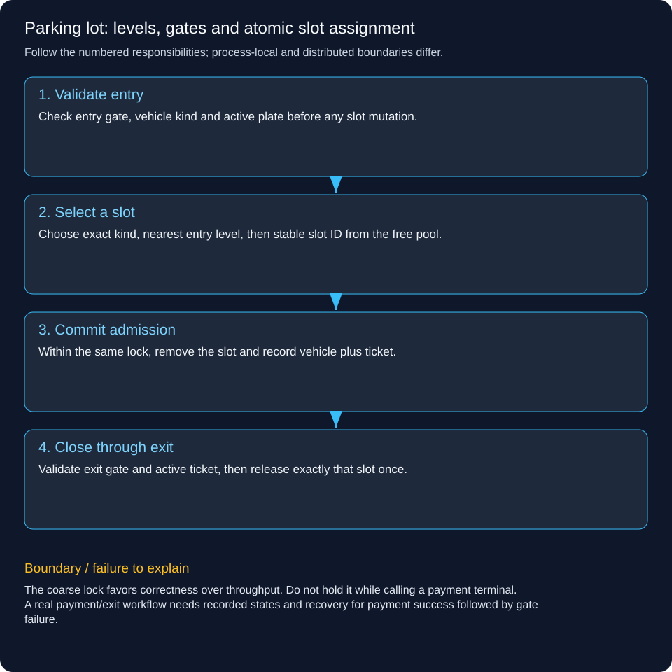

# Parking lot: levels, gates and atomic slot assignment

Design one parking-lot process that can admit vehicles through multiple entry gates and close tickets at exit gates without assigning the same slot twice.

## Follow a concrete operation

A car enters E1 on level 1. There are car slots on levels 0 and 1 and a bike slot on level 0. Our explicit policy chooses an exact-type slot nearest the entry level, breaking ties by slot ID. The car receives ticket 1 for the level-1 slot; an exit gate later closes that ticket and returns the slot to the free pool.

## Clarify the contract before classes

We model bike/car/truck kinds, numbered levels, entry/exit gates, active tickets and currently parked plates. This version uses exact-type fit; if motorcycles may occupy car spaces, introduce a documented compatibility rule. Full capacity returns no ticket. Duplicate active admission for the same plate and unknown/closed tickets are errors. Payment, pricing, reservation expiry and sensor reconciliation are extensions, not silently implemented features.

## Assign responsibilities

Vehicle is immutable plate/type data. Slot has stable ID, level and kind. Gate has ID, level and direction. Ticket connects vehicle, assigned slot and entry gate. Lot owns the mutable free-slot and active-ticket indexes. Level is represented as a number on slots/gates; a richer product can promote it into a Level entity with physical capacity and display policies. UI panels and gate devices do not independently mutate the slot map.

## Follow enter and exit

enter validates gate and vehicle, rejects an already parked plate, selects a free compatible slot, removes it from free state and records a ticket. All of those steps share one synchronized boundary. exit checks an exit gate and active ticket, removes the ticket/plate and releases that exact slot. A wrong-direction gate must fail before changing state. A repeated exit is rejected rather than incrementing availability twice.

## Reason about concurrency and complexity

If two gates see one free slot, only one enter may finish with a ticket. The demo serializes the whole decision/update within one JVM. A free-slot scan costs O(s) for s available slots; indexes by level/type can improve selection but require consistent maintenance. Multiple application replicas need an authoritative database transaction/unique reservation or single assignment owner; synchronized does not coordinate separate processes.

## Where authentication belongs

A real HTTP/gate integration authenticates devices/operators and authorizes permitted lot/gate actions outside this local object API. Knowing a ticket number should not permit arbitrary refunds or ticket edits. Persist ticket and occupancy changes transactionally if restart recovery is required. The demo deliberately keeps state in memory and does not claim durable parking control.



## Trace the responsibilities

1. **Validate entry:** Check entry gate, vehicle kind and active plate before any slot mutation.

2. **Select a slot:** Choose exact kind, nearest entry level, then stable slot ID from the free pool.

3. **Commit admission:** Within the same lock, remove the slot and record vehicle plus ticket.

4. **Close through exit:** Validate exit gate and active ticket, then release exactly that slot once.

## Runnable Java 21 example

This standard-library lab runs locally. It does not deploy a backend, persist data, contact a bank or coordinate multiple servers.

[Source](../../examples/lld/ParkingLotDemo.java)

```java
import java.util.*;
import java.util.concurrent.*;

public class ParkingLotDemo {
 enum Kind {BIKE,CAR,TRUCK}
 enum Direction {ENTRY,EXIT}
 record Gate(String id,int level,Direction direction){}
 record Slot(String id,int level,Kind kind){}
 record Vehicle(String plate,Kind kind){}
 record Ticket(long id,Vehicle vehicle,Slot slot,String entryGate){}
 static class Lot {
  private final Map<String,Gate> gates=new HashMap<>();
  private final Map<String,Slot> free=new HashMap<>();
  private final Map<Long,Ticket> active=new HashMap<>();
  private final Set<String> parked=new HashSet<>();
  private long nextId=1;
  Lot(List<Gate> gates,List<Slot> slots){
   for(Gate g:gates)if(this.gates.putIfAbsent(g.id(),g)!=null)throw new IllegalArgumentException("duplicate gate");
   for(Slot s:slots)if(free.putIfAbsent(s.id(),s)!=null)throw new IllegalArgumentException("duplicate slot");
  }
  private Gate gate(String id,Direction direction){
   Gate g=gates.get(id);if(g==null||g.direction()!=direction)throw new IllegalArgumentException("invalid gate");return g;
  }
  synchronized Optional<Ticket> enter(String gateId,Vehicle vehicle){
   Gate entry=gate(gateId,Direction.ENTRY);Objects.requireNonNull(vehicle);
   if(vehicle.plate()==null||vehicle.plate().isBlank()||vehicle.kind()==null)throw new IllegalArgumentException("vehicle required");
   if(parked.contains(vehicle.plate()))throw new IllegalStateException("already parked");
   // Explicit policy: exact kind, nearest level to gate, then stable slot ID.
   Optional<Slot> candidate=free.values().stream().filter(s->s.kind()==vehicle.kind())
    .min(Comparator.<Slot>comparingLong(s->Math.abs((long)s.level()-entry.level())).thenComparing(Slot::id));
   if(candidate.isEmpty())return Optional.empty();
   Slot slot=candidate.get();Ticket ticket=new Ticket(nextId++,vehicle,slot,gateId);
   free.remove(slot.id());parked.add(vehicle.plate());active.put(ticket.id(),ticket);return Optional.of(ticket);
  }
  synchronized Ticket exit(String gateId,long ticketId){
   gate(gateId,Direction.EXIT);Ticket ticket=active.get(ticketId);
   if(ticket==null)throw new IllegalArgumentException("unknown or closed ticket");
   active.remove(ticketId);parked.remove(ticket.vehicle().plate());free.put(ticket.slot().id(),ticket.slot());return ticket;
  }
 }
 static void check(boolean value){if(!value)throw new AssertionError();}
 public static void main(String[] args)throws Exception{
  var gates=List.of(new Gate("E0",0,Direction.ENTRY),new Gate("E1",1,Direction.ENTRY),new Gate("X0",0,Direction.EXIT));
  Lot lot=new Lot(gates,List.of(new Slot("L0-C1",0,Kind.CAR),new Slot("L1-C1",1,Kind.CAR),new Slot("L0-B1",0,Kind.BIKE)));
  Ticket ticket=lot.enter("E1",new Vehicle("CAR-81",Kind.CAR)).orElseThrow();check(ticket.slot().level()==1);
  try{lot.enter("E0",ticket.vehicle());throw new AssertionError();}catch(IllegalStateException expected){}
  try{lot.exit("E0",ticket.id());throw new AssertionError();}catch(IllegalArgumentException expected){}
  check(lot.exit("X0",ticket.id()).equals(ticket));
  try{lot.exit("X0",ticket.id());throw new AssertionError();}catch(IllegalArgumentException expected){}
  Lot one=new Lot(gates,List.of(new Slot("only",0,Kind.CAR)));
  try(var pool=Executors.newFixedThreadPool(2)){
   var a=pool.submit(()->one.enter("E0",new Vehicle("A",Kind.CAR)).isPresent());
   var b=pool.submit(()->one.enter("E1",new Vehicle("B",Kind.CAR)).isPresent());
   check((a.get()?1:0)+(b.get()?1:0)==1);
  }
  System.out.println("PASS: levels, gate validation, exact-kind policy, closed tickets and competing entries");
 }
}
```

```powershell
javac -d .pattern-classes examples/lld/ParkingLotDemo.java
java -cp .pattern-classes ParkingLotDemo
```

Expected: PASS after assertions verify the stated invariants.

## Trade-offs and failure handling

The coarse lock favors correctness over throughput. Do not hold it while calling a payment terminal. A real payment/exit workflow needs recorded states and recovery for payment success followed by gate failure.

## Interview check

How would you prevent two entry gates on different servers from assigning the last car slot?

[LLD and HLD learning paths](../lld-hld-learning-path.md)
