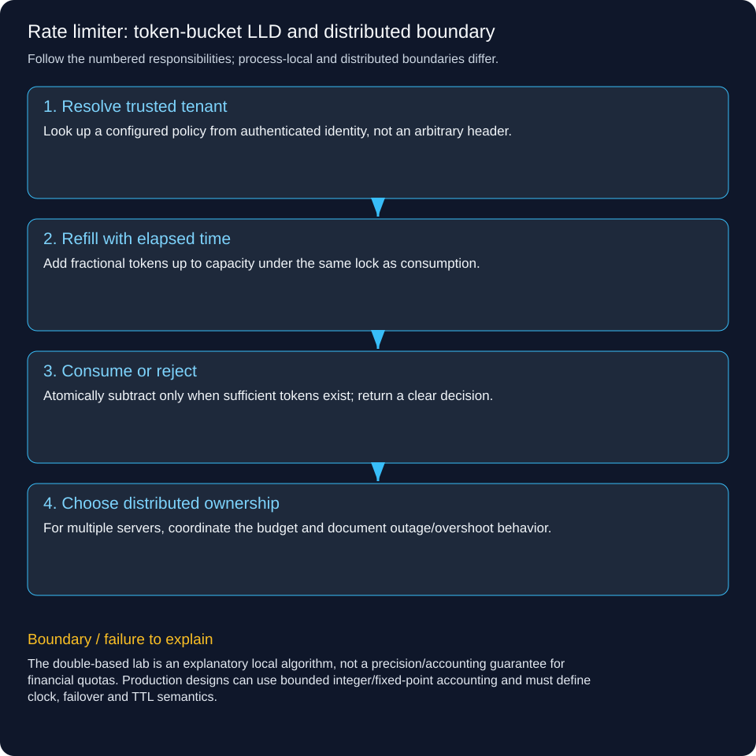

# Rate limiter: token-bucket LLD and distributed boundary

Implement a token bucket with injected time, atomic token accounting and tenant selection; then connect it to a cluster-wide admission design. The runnable Java bucket is local to one process.

## Follow a concrete operation

A tenant starts with capacity 2 and refill 1 token/second. Two requests succeed immediately, the third is rejected. After half a second there is still no full token; after another half second one request succeeds. Fifty simultaneous requests against a frozen ten-token bucket admit exactly ten.

## Define policy and objects

Bucket owns capacity, refill rate, tokens, last-observed time and a monotonic clock supplier. Limiter holds a fixed registry of configured tenant buckets so arbitrary keys cannot grow memory without bound in this demo. Each positive request cost consumes that many tokens; a cost above available tokens is rejected. Unknown tenants are rejected. Identity must already have been authenticated by the caller boundary.

## Refill and consume atomically

Inside one synchronized operation, compute elapsed monotonic time, add elapsed*rate capped at capacity, then compare and subtract cost. Keep fractional tokens so half-second waits accumulate correctly. The lab injects an AtomicLong clock to test without sleeps. System.nanoTime is appropriate for local elapsed time; separate machines do not share a comparable nanoTime origin.

## Connect to API behavior

On allow, continue to the backend, which still checks object-level authorization and resource capacity. On deny, return an appropriate HTTP 429 contract with retry guidance. Do not hold the bucket lock across backend processing. Rate limits bound arrivals; they do not replace in-flight limits, bounded queues, timeouts or backpressure.

## Make cluster-wide semantics explicit

Deploying this Java map on five independent servers creates five budgets. For a stricter shared per-tenant limit, route the key to one authoritative limiter owner or perform refill/consume atomically in a shared store/script with an explicit time/failover policy. Local/regional token allocations can reduce coordination if the product accepts a defined overshoot budget. Do not label a process-local synchronized block globally scalable by itself.

## Handle failure and key lifecycle

Choose fail-open or fail-closed per endpoint risk when the limiter store is unavailable; monitor the fallback. Bound key cardinality and idle lifetime in a dynamic registry. Concurrent bucket eviction/recreation must not reset an active budget and grant extra bursts. Backoff retry traffic and test hot tenants so the limiter does not become the bottleneck it was meant to prevent.



## Trace the responsibilities

1. **Resolve trusted tenant:** Look up a configured policy from authenticated identity, not an arbitrary header.

2. **Refill with elapsed time:** Add fractional tokens up to capacity under the same lock as consumption.

3. **Consume or reject:** Atomically subtract only when sufficient tokens exist; return a clear decision.

4. **Choose distributed ownership:** For multiple servers, coordinate the budget and document outage/overshoot behavior.

## Runnable Java 21 example

This standard-library lab runs locally. It does not deploy a backend, persist data, contact a bank or coordinate multiple servers.

[Source](../../examples/lld/TokenBucketDemo.java)

```java
import java.util.*;
import java.util.concurrent.*;
import java.util.concurrent.atomic.*;
import java.util.function.LongSupplier;
public class TokenBucketDemo {
 static class Bucket {
  private final double capacity,perSecond;private final LongSupplier clock;private double tokens;private long last;
  Bucket(int capacity,double perSecond,LongSupplier clock){
   if(capacity<1||!Double.isFinite(perSecond)||perSecond<=0)throw new IllegalArgumentException();
   this.capacity=capacity;this.perSecond=perSecond;this.clock=Objects.requireNonNull(clock);tokens=capacity;last=clock.getAsLong();
  }
  synchronized boolean allow(int cost){
   if(cost<1)throw new IllegalArgumentException("positive cost required");long now=clock.getAsLong();long elapsed=now-last;
   if(elapsed>0){tokens=Math.min(capacity,tokens+elapsed/1_000_000_000.0*perSecond);last=now;}
   if(tokens<cost)return false;tokens-=cost;return true;
  }
 }
 // A fixed authenticated-tenant registry avoids unbounded attacker-created keys in this demo.
 record Limiter(Map<String,Bucket> configured){
  Limiter{configured=Map.copyOf(configured);}
  boolean allow(String trustedTenant,int cost){Bucket b=configured.get(trustedTenant);if(b==null)throw new IllegalArgumentException("unknown tenant");return b.allow(cost);}
 }
 static void check(boolean ok){if(!ok)throw new AssertionError();}
 public static void main(String[] args)throws Exception{
  AtomicLong time=new AtomicLong();Bucket b=new Bucket(2,1,time::get);check(b.allow(1));check(b.allow(1));check(!b.allow(1));
  time.addAndGet(500_000_000);check(!b.allow(1));time.addAndGet(500_000_000);check(b.allow(1));check(!b.allow(1));
  Bucket racing=new Bucket(10,1,time::get);AtomicInteger accepted=new AtomicInteger();
  try(var pool=Executors.newFixedThreadPool(8)){
   List<Future<?>> work=new ArrayList<>();for(int i=0;i<50;i++)work.add(pool.submit(()->{if(racing.allow(1))accepted.incrementAndGet();}));for(var f:work)f.get();
  }
  check(accepted.get()==10);
  Limiter limiter=new Limiter(Map.of("A",new Bucket(1,1,time::get),"B",new Bucket(1,1,time::get)));
  check(limiter.allow("A",1));check(!limiter.allow("A",1));check(limiter.allow("B",1));
  try{b.allow(0);throw new AssertionError();}catch(IllegalArgumentException expected){}
  System.out.println("PASS: burst/refill without sleeps, final-token concurrency, independent tenants and invalid cost");
 }
}
```

```powershell
javac -d .pattern-classes examples/lld/TokenBucketDemo.java
java -cp .pattern-classes TokenBucketDemo
```

Expected: PASS after assertions verify the stated invariants.

## Trade-offs and failure handling

The double-based lab is an explanatory local algorithm, not a precision/accounting guarantee for financial quotas. Production designs can use bounded integer/fixed-point accounting and must define clock, failover and TTL semantics.

## Interview check

If the same tenant has a capacity-20 bucket independently on five servers, why can it receive a much larger initial burst?

[LLD and HLD learning paths](../lld-hld-learning-path.md)
