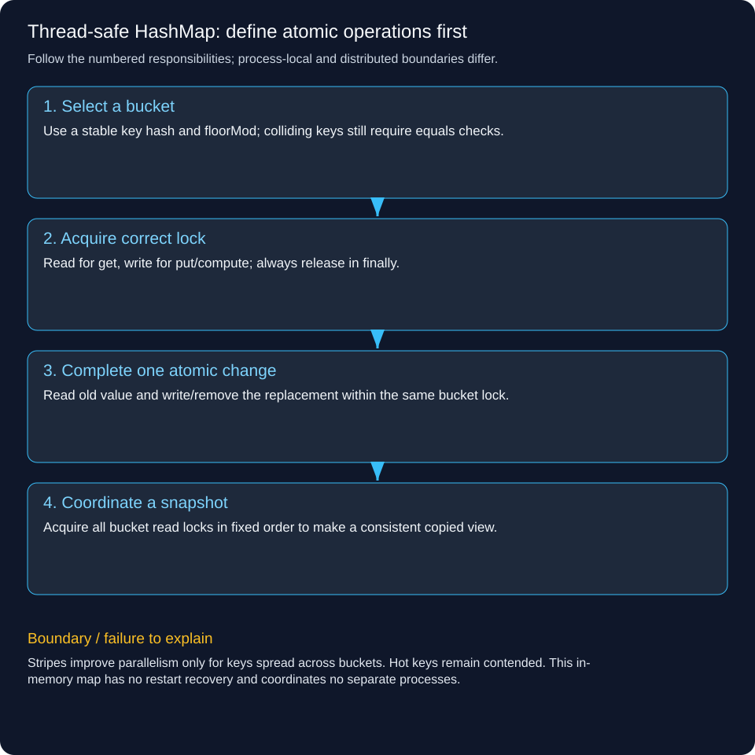

# Thread-safe HashMap: define atomic operations first

Design a map whose documented single-key operations are safe under concurrent access, then explain which compound operations still need one atomic boundary. Use a fixed striped teaching implementation, not a claim to reimplement ConcurrentHashMap.

## Follow a concrete operation

Eight threads each increment count 1,000 times. The result must be 8,000. A thread-safe get followed by a thread-safe put can still lose increments because the combined read-modify-write was not atomic. compute holds one key’s bucket write lock across the update.

## Start with the contract

Disallow null keys and values, use equals to distinguish colliding keys, define get-miss as null, allow compute returning null to remove a key, and provide an immutable consistent snapshot. Keys must keep stable hashCode/equals while stored. Thread-safe container structure does not make a mutable value object automatically safe.

## Partition synchronization

Choose a fixed number of buckets. Each owns an ordinary HashMap and a read/write lock. Hash the key with floorMod to safely handle negative hashes including Integer.MIN_VALUE. Reads take a bucket read lock; puts and compute take its write lock. Operations in different buckets can proceed independently, while colliding keys intentionally contend on one bucket.

## Make read-modify-write atomic

compute acquires the bucket write lock, reads old value, calculates replacement and updates/removes before unlocking in finally. Keep callbacks short, nonblocking and free of calls back into this map; calling across buckets or requesting a snapshot inside a callback can deadlock. An application needing external I/O should design that operation outside the lock with explicit race semantics.

## Define global operations honestly

A snapshot acquires all bucket read locks in a fixed order and releases in reverse, copying values into an immutable map. That blocks writers and is O(number of entries + stripes), unlike the expected single-key lookup cost. Per-bucket HashMap resizing is protected by that bucket lock; this demo does not dynamically change the stripe array or offer lock-free reads.

## Production comparison

Prefer Java ConcurrentHashMap when its documented operations match the need; use compute, merge or putIfAbsent instead of assuming get-plus-put is atomic. Do not describe modern ConcurrentHashMap as merely the old fixed Segment design. Its iteration/aggregate semantics differ from this lab’s all-bucket snapshot. A distributed key-value store additionally needs network, durability, replication and partition behavior.



## Trace the responsibilities

1. **Select a bucket:** Use a stable key hash and floorMod; colliding keys still require equals checks.

2. **Acquire correct lock:** Read for get, write for put/compute; always release in finally.

3. **Complete one atomic change:** Read old value and write/remove the replacement within the same bucket lock.

4. **Coordinate a snapshot:** Acquire all bucket read locks in fixed order to make a consistent copied view.

## Runnable Java 21 example

This standard-library lab runs locally. It does not deploy a backend, persist data, contact a bank or coordinate multiple servers.

[Source](../../examples/lld/StripedMapDemo.java)

```java
import java.util.*;
import java.util.concurrent.*;
import java.util.concurrent.locks.*;
import java.util.function.BiFunction;
public class StripedMapDemo {
 static class Bucket<K,V>{final Map<K,V> values=new HashMap<>();final ReadWriteLock lock=new ReentrantReadWriteLock();}
 // Fixed stripes; not ConcurrentHashMap's implementation or performance contract.
 static class StripedMap<K,V>{
  private final List<Bucket<K,V>> buckets;
  StripedMap(int stripes){if(stripes<1)throw new IllegalArgumentException();buckets=new ArrayList<>();for(int i=0;i<stripes;i++)buckets.add(new Bucket<>());}
  private Bucket<K,V> bucket(K key){Objects.requireNonNull(key);return buckets.get(Math.floorMod(key.hashCode(),buckets.size()));}
  V get(K key){var b=bucket(key);b.lock.readLock().lock();try{return b.values.get(key);}finally{b.lock.readLock().unlock();}}
  void put(K key,V value){Objects.requireNonNull(value);var b=bucket(key);b.lock.writeLock().lock();try{b.values.put(key,value);}finally{b.lock.writeLock().unlock();}}
  V compute(K key,BiFunction<K,V,V> change){Objects.requireNonNull(change);var b=bucket(key);b.lock.writeLock().lock();try{
   V next=change.apply(key,b.values.get(key));if(next==null)b.values.remove(key);else b.values.put(key,next);return next;
  }finally{b.lock.writeLock().unlock();}}
  // Callbacks must not invoke this map (including snapshot) or block on external work.
  Map<K,V> snapshot(){for(var b:buckets)b.lock.readLock().lock();try{
   Map<K,V> copy=new HashMap<>();for(var b:buckets)copy.putAll(b.values);return Map.copyOf(copy);
  }finally{for(int i=buckets.size()-1;i>=0;i--)buckets.get(i).lock.readLock().unlock();}}
 }
 record Collision(String key){public int hashCode(){return Integer.MIN_VALUE;}}
 public static void main(String[] args)throws Exception{
  var map=new StripedMap<String,Integer>(8);map.put("count",0);
  try(var pool=Executors.newFixedThreadPool(8)){
   List<Future<?>> work=new ArrayList<>();for(int t=0;t<8;t++)work.add(pool.submit(()->{for(int i=0;i<1000;i++)map.compute("count",(k,v)->v+1);}));
   for(var f:work)f.get();
  }
  if(map.get("count")!=8000||map.snapshot().get("count")!=8000)throw new AssertionError();
  map.compute("count",(k,v)->null);if(map.get("count")!=null)throw new AssertionError();
  var collisions=new StripedMap<Collision,Integer>(3);collisions.put(new Collision("A"),1);collisions.put(new Collision("B"),2);
  if(collisions.get(new Collision("A"))!=1||collisions.get(new Collision("B"))!=2)throw new AssertionError();
  try{map.put("bad",null);throw new AssertionError();}catch(NullPointerException expected){}
  System.out.println("PASS: atomic increments, collision equality, MIN_VALUE hash, removal and consistent snapshot");
 }
}
```

```powershell
javac -d .pattern-classes examples/lld/StripedMapDemo.java
java -cp .pattern-classes StripedMapDemo
```

Expected: PASS after assertions verify the stated invariants.

## Trade-offs and failure handling

Stripes improve parallelism only for keys spread across buckets. Hot keys remain contended. This in-memory map has no restart recovery and coordinates no separate processes.

## Interview check

Why can individually thread-safe get and put methods still produce a wrong concurrent counter?

[LLD and HLD learning paths](../lld-hld-learning-path.md)

[Java ConcurrentHashMap contract](https://docs.oracle.com/en/java/javase/21/docs/api/java.base/java/util/concurrent/ConcurrentHashMap.html)
