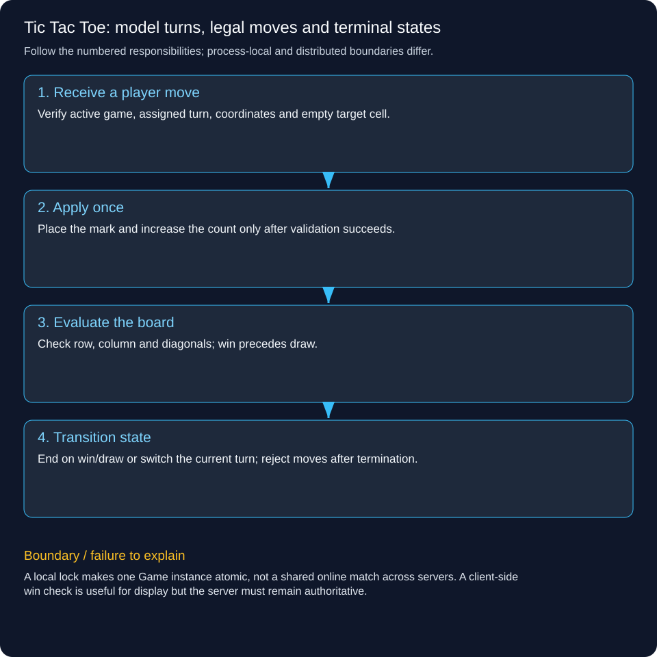

# Tic Tac Toe: model turns, legal moves and terminal states

Design a complete two-player 3×3 game using explicit board, player turn and game state. Choose Tic Tac Toe from the requested Chess-or-Tic-Tac-Toe exercise so the full rules can be implemented and tested.

## Follow a concrete operation

X places at (0,0). O cannot overwrite that cell, and X cannot immediately play again. Later X fills the top row and the game becomes X_WON. All subsequent moves must be rejected. A different nine-move sequence fills the board without a win and becomes DRAW.

## Choose the objects and invariants

Mark is X or O; State is IN_PROGRESS, X_WON, O_WON or DRAW. Game owns a private 3×3 board, the current turn and the count of accepted moves. No UI or caller receives a mutable board reference. A move is accepted only when the game is active, the supplied player owns the turn, coordinates are in range and the cell is empty.

## Execute one legal move

Validate before mutation, place the mark and increment move count. Check the affected row/column and both diagonals. A win takes precedence over draw on the final cell. If there is no win and all nine cells are filled, declare draw; otherwise switch the turn. A rejected move must not advance the turn or consume a move. This transition is synchronized in the lab.

## Separate rules from interaction

A web controller translates an authorized player action into Game.move; a console or browser renders returned state. For online play, bind the authenticated user to an assigned mark server-side rather than accepting an arbitrary player field as authority. Persist moves or event history if reconnect/replay is required. A version guard can reject competing stale client moves across replicas.

## Complexity and extension

For this fixed 3×3 board a move check has constant bounded work. A generalized n×n scan costs O(n) per move; row/column counters can reduce checking work when the rules allow it. Chess is a larger extension requiring piece-specific movement, obstruction, check/checkmate, castling and promotion; those are not provided by renaming this board. Avoid inheritance hierarchies with unused piece types for a game with only two marks.

## Verify the rules, not only a happy path

The lab checks wrong turn, occupied cell, out-of-range coordinates, row and diagonal wins, draw and moves after termination. Add O wins, column/anti-diagonal wins and replay/version behavior when extending. Tests should assert that rejected commands leave state unchanged; they should not merely assert a status label after every method.



## Trace the responsibilities

1. **Receive a player move:** Verify active game, assigned turn, coordinates and empty target cell.

2. **Apply once:** Place the mark and increase the count only after validation succeeds.

3. **Evaluate the board:** Check row, column and diagonals; win precedes draw.

4. **Transition state:** End on win/draw or switch the current turn; reject moves after termination.

## Runnable Java 21 example

This standard-library lab runs locally. It does not deploy a backend, persist data, contact a bank or coordinate multiple servers.

[Source](../../examples/lld/TicTacToeDemo.java)

```java
import java.util.*;
public class TicTacToeDemo {
 enum Mark {X,O}
 enum State {IN_PROGRESS,X_WON,O_WON,DRAW}
 static class Game {
  private final Mark[][] board=new Mark[3][3];private Mark turn=Mark.X;private State state=State.IN_PROGRESS;private int moves;
  synchronized State move(Mark player,int row,int col){
   Objects.requireNonNull(player);
   if(state!=State.IN_PROGRESS)throw new IllegalStateException("game over");
   if(player!=turn)throw new IllegalArgumentException("wrong turn");
   if(row<0||row>=3||col<0||col>=3||board[row][col]!=null)throw new IllegalArgumentException("invalid cell");
   board[row][col]=player;moves++;
   boolean rowWin=true,colWin=true,diag=true,anti=true;
   for(int i=0;i<3;i++){rowWin&=board[row][i]==player;colWin&=board[i][col]==player;diag&=board[i][i]==player;anti&=board[i][2-i]==player;}
   if(rowWin||colWin||diag||anti)state=player==Mark.X?State.X_WON:State.O_WON;
   else if(moves==9)state=State.DRAW;else turn=turn==Mark.X?Mark.O:Mark.X;
   return state;
  }
 }
 static void check(boolean ok){if(!ok)throw new AssertionError();}
 public static void main(String[] args){
  Game win=new Game();
  try{win.move(Mark.O,0,0);throw new AssertionError();}catch(IllegalArgumentException expected){}
  win.move(Mark.X,0,0);
  try{win.move(Mark.O,0,0);throw new AssertionError();}catch(IllegalArgumentException expected){}
  win.move(Mark.O,1,0);win.move(Mark.X,0,1);win.move(Mark.O,1,1);check(win.move(Mark.X,0,2)==State.X_WON);
  try{win.move(Mark.O,2,2);throw new AssertionError();}catch(IllegalStateException expected){}
  Game draw=new Game();int[][] cells={{0,0},{0,1},{0,2},{1,1},{1,0},{1,2},{2,1},{2,0},{2,2}};
  State result=null;for(int i=0;i<cells.length;i++)result=draw.move(i%2==0?Mark.X:Mark.O,cells[i][0],cells[i][1]);check(result==State.DRAW);
  Game diagonal=new Game();diagonal.move(Mark.X,0,0);diagonal.move(Mark.O,0,1);diagonal.move(Mark.X,1,1);diagonal.move(Mark.O,0,2);check(diagonal.move(Mark.X,2,2)==State.X_WON);
  try{new Game().move(Mark.X,-1,0);throw new AssertionError();}catch(IllegalArgumentException expected){}
  System.out.println("PASS: turn, occupied/out-of-range cells, row/diagonal wins, draw and terminal state");
 }
}
```

```powershell
javac -d .pattern-classes examples/lld/TicTacToeDemo.java
java -cp .pattern-classes TicTacToeDemo
```

Expected: PASS after assertions verify the stated invariants.

## Trade-offs and failure handling

A local lock makes one Game instance atomic, not a shared online match across servers. A client-side win check is useful for display but the server must remain authoritative.

## Interview check

Why must a full-board winning move become X_WON/O_WON rather than DRAW?

[LLD and HLD learning paths](../lld-hld-learning-path.md)
