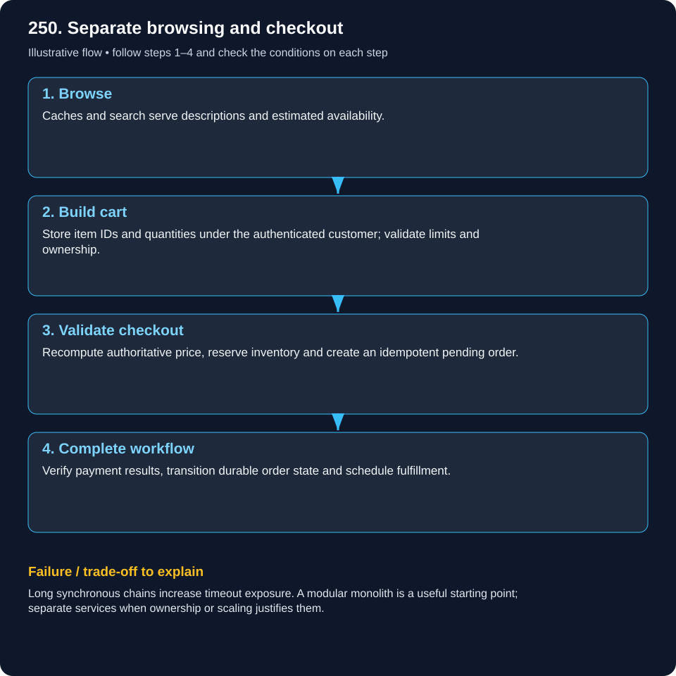
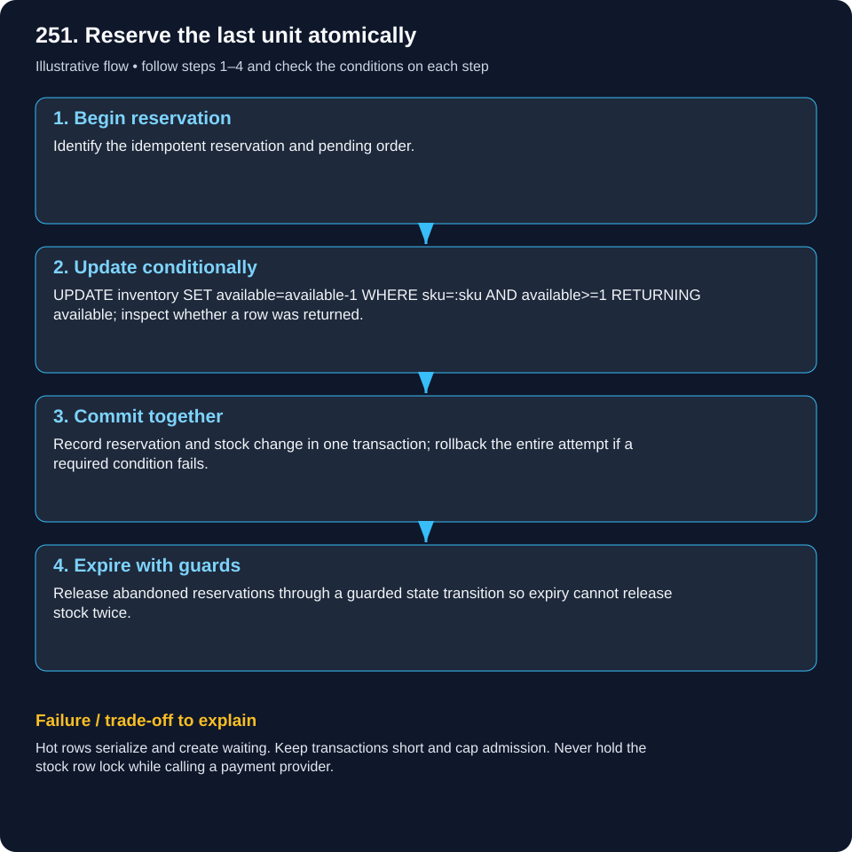
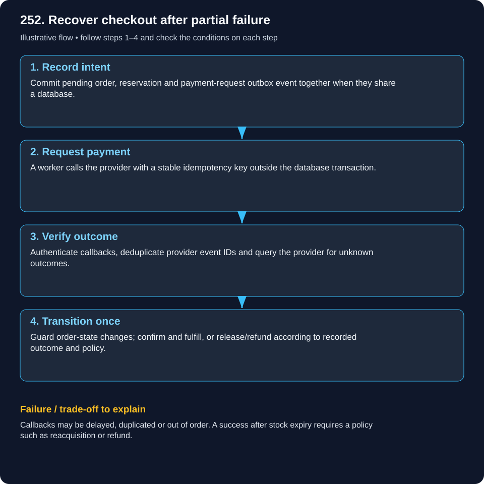
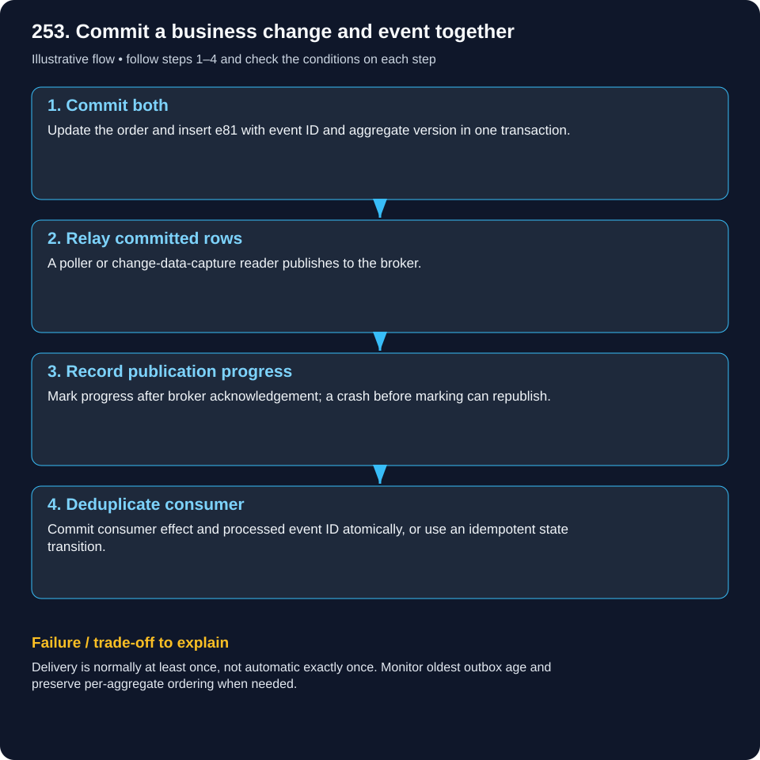
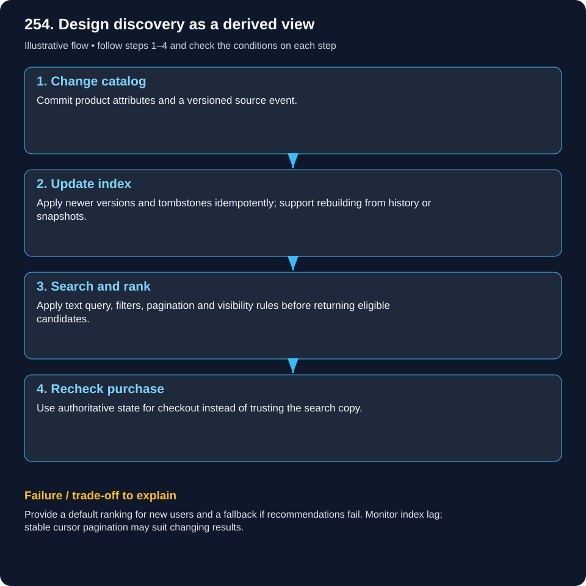

# System Design — E-commerce & Payments

Read the example, follow the flow, then explain the failure case. These are illustrative designs, not documented company internals.

[Beginner guide and glossary](system-design/visual-learning-guide.md) · [Case studies](system-design/README.md)

## 250. Design an e-commerce platform from catalog to checkout.

### Separate browsing and checkout

Browsing uses a catalog copy; buying the last item needs the real stock ledger.

### What it means

Catalog, cart, checkout, payment and fulfillment have different correctness needs. A cart records intent, not a permanent promise of price or availability.

### Worked real-world example

A buyer adds two mugs. One sells out and the price changes before checkout. The server must recompute current terms rather than trust browser totals.

### Follow the flow

1. **Browse:** Caches and search serve descriptions and estimated availability.

2. **Build cart:** Store item IDs and quantities under the authenticated customer; validate limits and ownership.

3. **Validate checkout:** Recompute authoritative price, reserve inventory and create an idempotent pending order.

4. **Complete workflow:** Verify payment results, transition durable order state and schedule fulfillment.

### Failure and trade-offs

Long synchronous chains increase timeout exposure. A modular monolith is a useful starting point; separate services when ownership or scaling justifies them.

### Check your understanding

Why must the server reject a client-supplied discounted total?

## 251. How do you prevent overselling during a flash sale?

### Reserve the last unit atomically

Two cashiers must not both promise the same last mug.

### What it means

A separate read of available=1 followed by a write lets competing buyers both decide to sell. Reserve with an atomic condition or equivalent serialization at the authoritative data boundary.

### Worked real-world example

Buyers A and B request the final unit. A guarded database update lets only one committed transaction decrement available from 1 to 0.

### Follow the flow

1. **Begin reservation:** Identify the idempotent reservation and pending order.

2. **Update conditionally:** UPDATE inventory SET available=available-1 WHERE sku=:sku AND available>=1 RETURNING available; inspect whether a row was returned.

3. **Commit together:** Record reservation and stock change in one transaction; rollback the entire attempt if a required condition fails.

4. **Expire with guards:** Release abandoned reservations through a guarded state transition so expiry cannot release stock twice.

### Failure and trade-offs

Hot rows serialize and create waiting. Keep transactions short and cap admission. Never hold the stock row lock while calling a payment provider.

### Check your understanding

What response should buyer B receive after buyer A commits?

## 252. How do you design a reliable checkout and payment workflow?

### Recover checkout after partial failure

Stock reservation and card payment are separate promises; a timeout undoes neither.

### What it means

A saga records workflow progress across local transactions and external effects. A compensation is a new action such as refunding a charge; it does not erase history.

### Worked real-world example

A provider charges the card but its response times out. Keep the result unknown/pending and reconcile using the original provider key; a fresh key can double-charge.

### Follow the flow

1. **Record intent:** Commit pending order, reservation and payment-request outbox event together when they share a database.

2. **Request payment:** A worker calls the provider with a stable idempotency key outside the database transaction.

3. **Verify outcome:** Authenticate callbacks, deduplicate provider event IDs and query the provider for unknown outcomes.

4. **Transition once:** Guard order-state changes; confirm and fulfill, or release/refund according to recorded outcome and policy.

### Failure and trade-offs

Callbacks may be delayed, duplicated or out of order. A success after stock expiry requires a policy such as reacquisition or refund.

### Check your understanding

Why is unknown more accurate than failed after a payment timeout?

## 253. What is the transactional outbox pattern?

### Commit a business change and event together

Write the order and the instruction to announce it on the same durable page.

### What it means

Transactional outbox stores the business update and an event in one database transaction. A relay publishes committed rows later, closing the crash window between database commit and event publish.

### Worked real-world example

Order 81 becomes confirmed alongside outbox event e81. An API crash after commit cannot erase the event the relay must publish.

### Follow the flow

1. **Commit both:** Update the order and insert e81 with event ID and aggregate version in one transaction.

2. **Relay committed rows:** A poller or change-data-capture reader publishes to the broker.

3. **Record publication progress:** Mark progress after broker acknowledgement; a crash before marking can republish.

4. **Deduplicate consumer:** Commit consumer effect and processed event ID atomically, or use an idempotent state transition.

### Failure and trade-offs

Delivery is normally at least once, not automatic exactly once. Monitor oldest outbox age and preserve per-aggregate ordering when needed.

### Check your understanding

Which crash window causes duplicate publication?

## 254. Design product search, filtering and recommendations.

### Design discovery as a derived view

The shop directory finds a shelf; the cashier verifies the purchase terms.

### What it means

Text search ranks matching documents; filters restrict exact attributes; recommendations rank candidates using context. Search indexes are derived and may lag behind authoritative catalog changes.

### Worked real-world example

Search running shoes with size 9 and relevance sorting. Recommendations suggest socks; checkout independently revalidates stock, price and eligibility.

### Follow the flow

1. **Change catalog:** Commit product attributes and a versioned source event.

2. **Update index:** Apply newer versions and tombstones idempotently; support rebuilding from history or snapshots.

3. **Search and rank:** Apply text query, filters, pagination and visibility rules before returning eligible candidates.

4. **Recheck purchase:** Use authoritative state for checkout instead of trusting the search copy.

### Failure and trade-offs

Provide a default ranking for new users and a fallback if recommendations fail. Monitor index lag; stable cursor pagination may suit changing results.

### Check your understanding

What should users still be able to do when recommendations are down?
