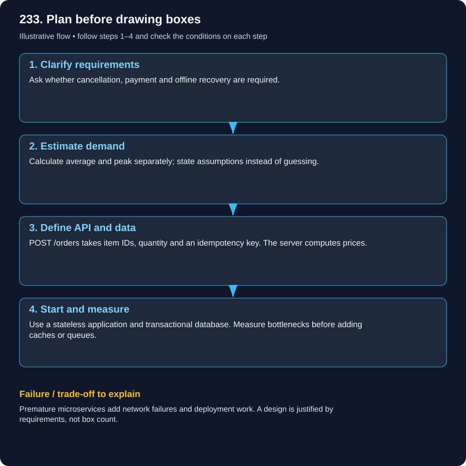
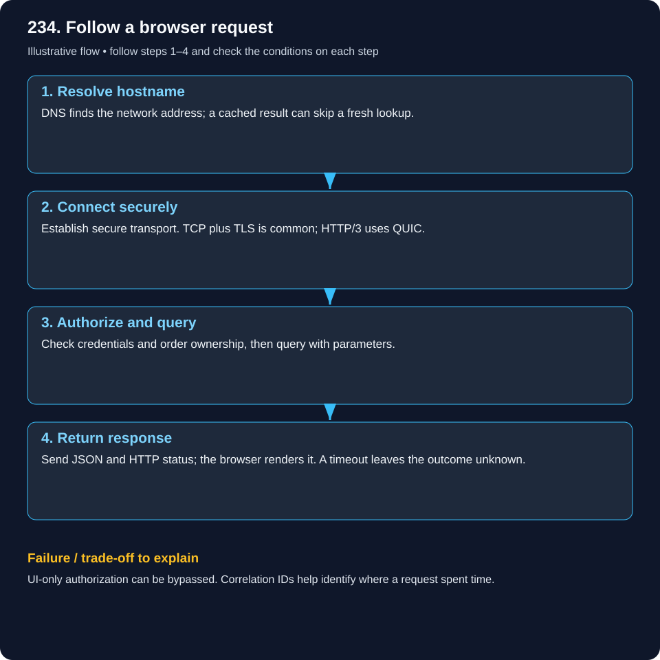
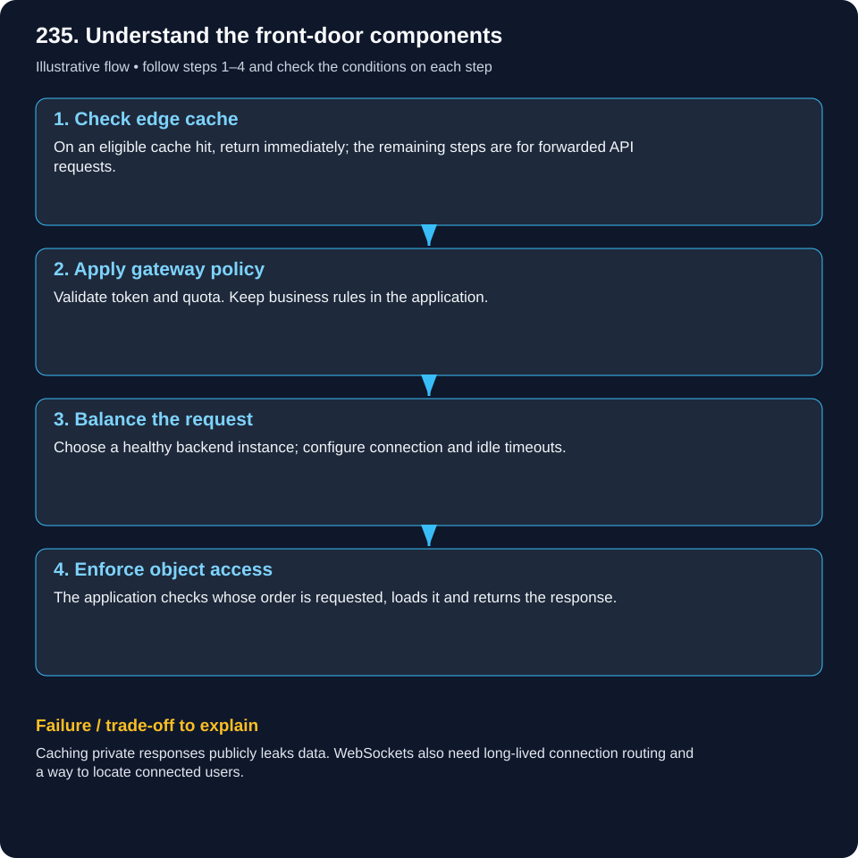
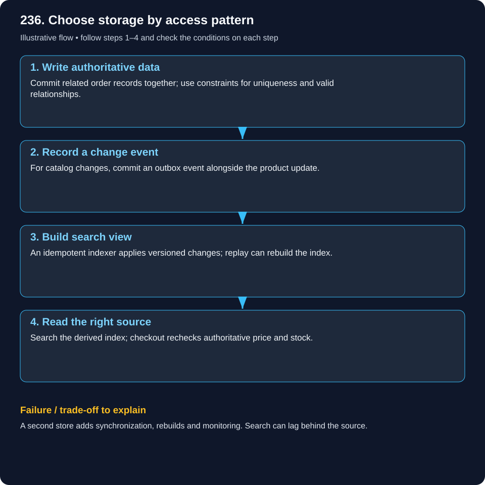
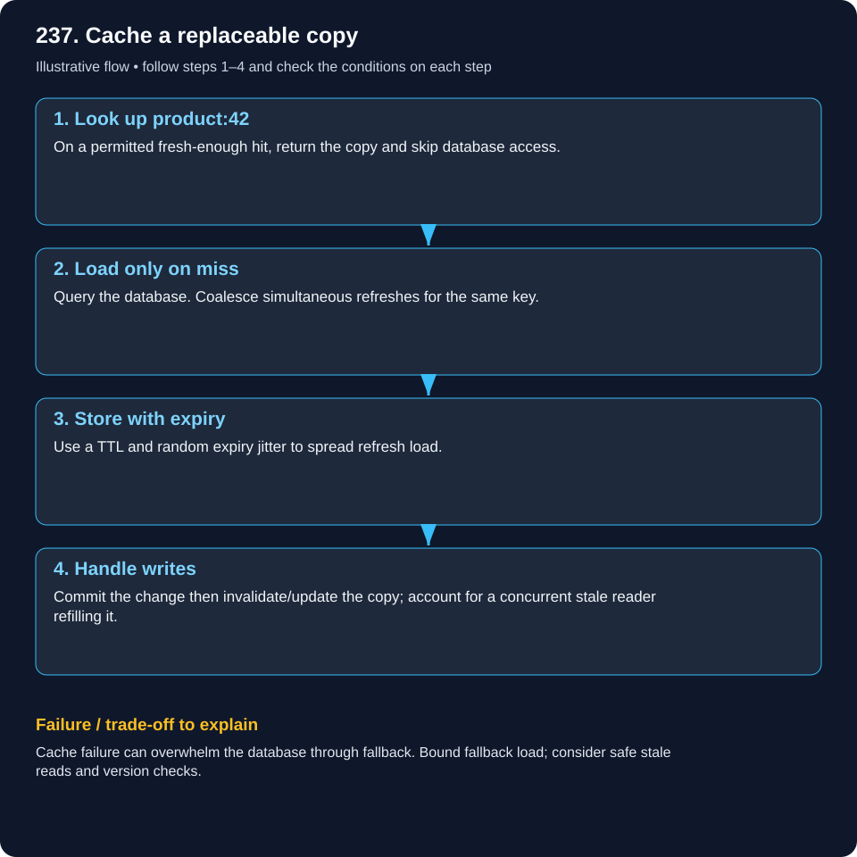
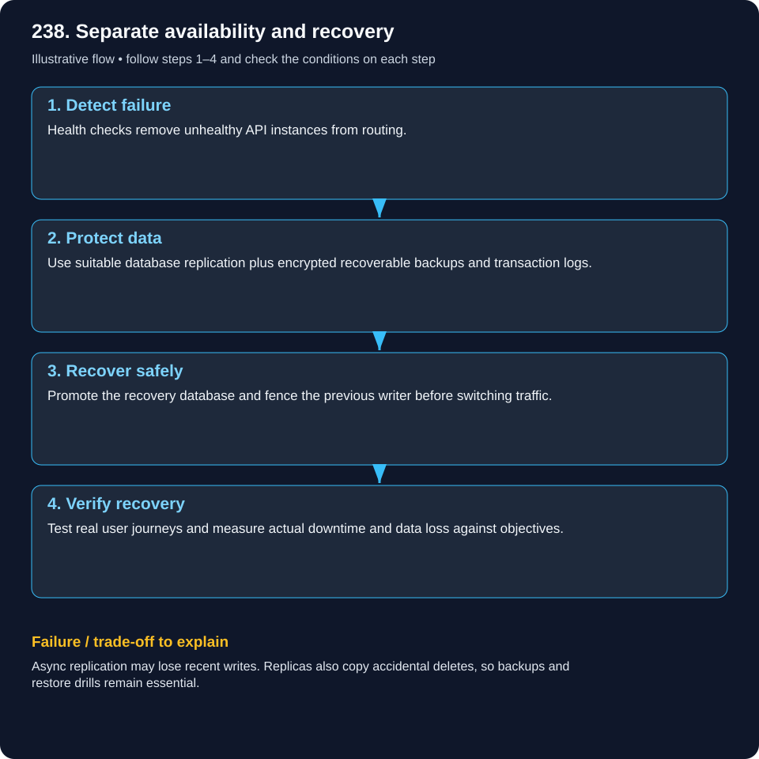
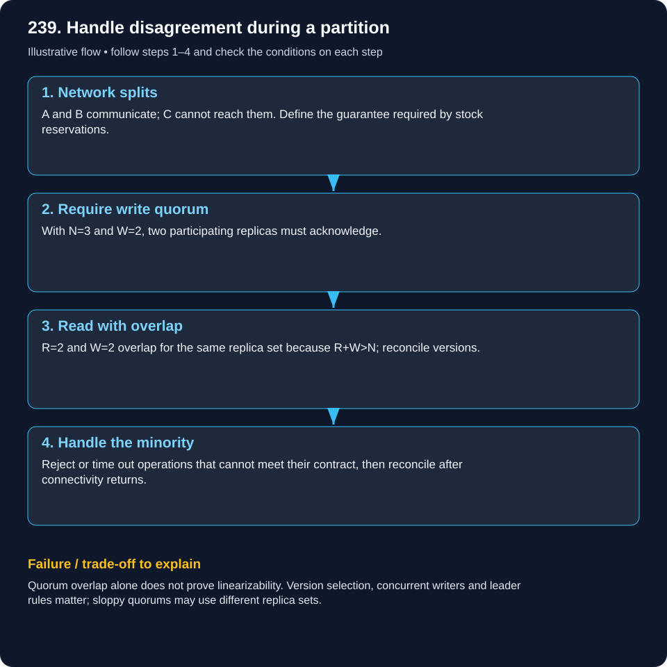
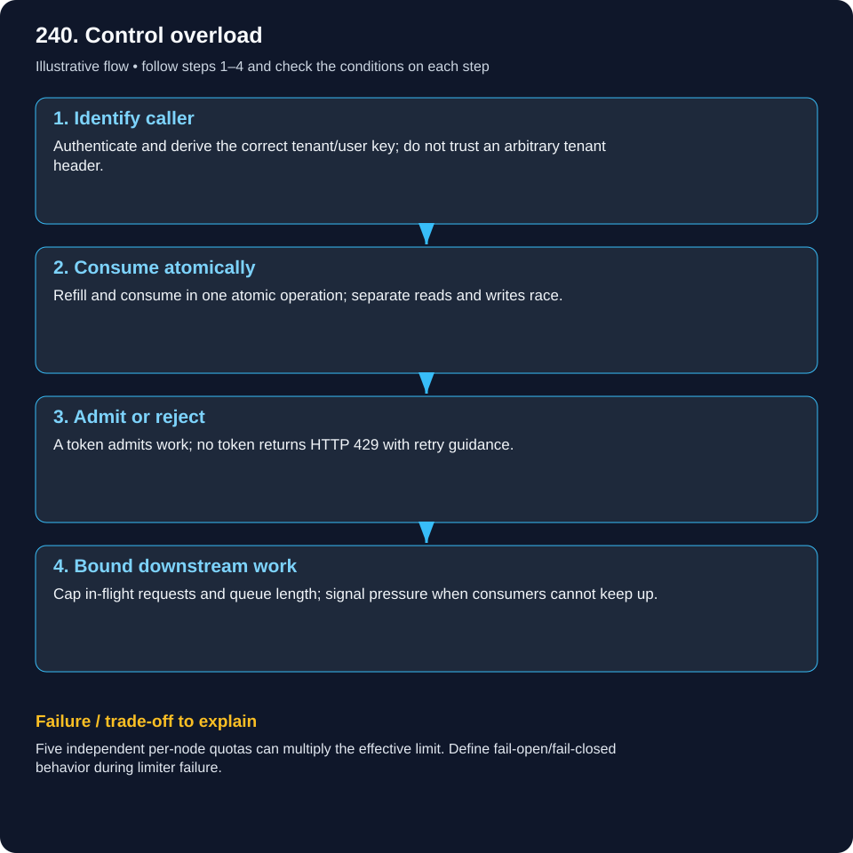
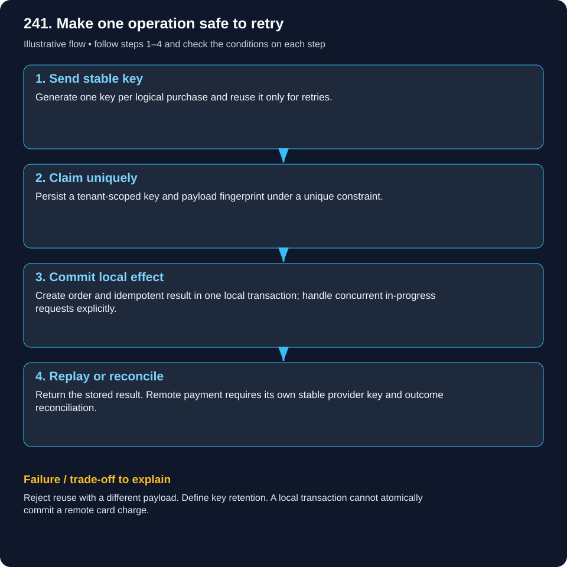
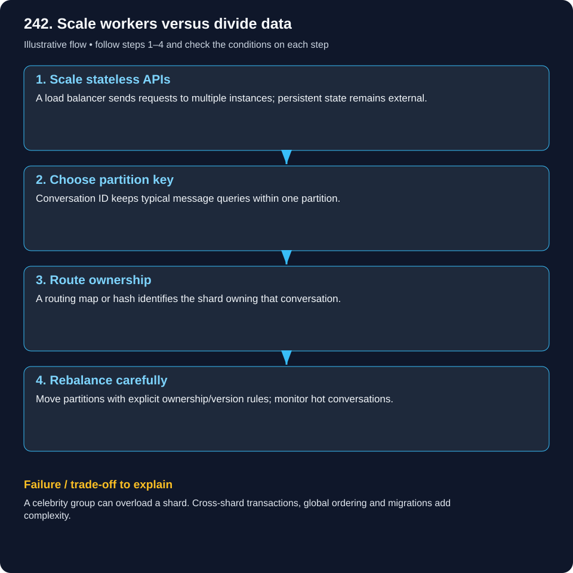

# System design foundations: learn through worked requests

Read these ten lessons in sequence, then build [the Short URL service](system-design/short-url.md). Each lesson changes one part of a concrete request rather than introducing disconnected technology names.

## 233. How do you approach a system design interview?

### Design the canteen before picking technology

Start with a student placing a lunch order, not with a list of cloud products. Ask what must happen on the screen: browse a menu, choose quantity, place an order, pay and collect. Then ask what may go wrong: duplicate clicks, no stock and a lost payment response. Each requirement should have a measurable or testable outcome. For example, one logical click with retries creates one order, and confirmed orders survive the promised failure model.

### Work through the decision and failure

Work the numbers explicitly. Ten thousand students placing two orders in a ten-hour day means 20,000/36,000 = 0.56 order writes/second average. If 4,000 arrive in ten minutes, that interval is 6.7/second. Menu reads, payment calls, bytes stored and peak concentration are separate dimensions. Start with one API and database; test those assumptions. Use the checkout tutorial to see how an authoritative stock decision leads to API, schema and transaction choices. A design interview answer is an evolving argument, not a diagram chosen before the requirements.

### Trace the steps

1. **Clarify requirements:** Ask whether cancellation, payment and offline recovery are required.

2. **Estimate demand:** Calculate average and peak separately; state assumptions instead of guessing.

3. **Define API and data:** POST /orders takes item IDs, quantity and an idempotency key. The server computes prices.

4. **Start and measure:** Use a stateless application and transactional database. Measure bottlenecks before adding caches or queues.

### Explain it back

If traffic grows 100 times, which measurement would guide your first change?

## 234. Explain client-server architecture and HTTP request lifecycle.

### Watch one browser request and its response

Bob types https://go.learn.example/aB72xQ9. Split the URL into scheme, hostname and path. DNS resolves only the hostname; it does not translate the short code. Secure transport connects Bob to the shortener’s approved edge and certificate. An HTTP GET then carries the path and hostname to the application, which makes the mapping/access decision. Network setup can be reused across requests; HTTP/3 uses QUIC rather than assuming every request always starts a new TCP connection.

### Work through the decision and failure

The application returns 302 Location: https://courses.example/lesson/42. Bob’s browser follows that instruction with a second request to the destination hostname, whose DNS/TLS and application are separate. If the first service returns 302 and the second returns 500, the two operations had different outcomes. Use a trace/request ID for the boundaries you control, and do not send shortener credentials to the destination. The full Short URL tutorial includes the actual request/response headers.

### Trace the steps

1. **Resolve hostname:** DNS finds the network address; a cached result can skip a fresh lookup.

2. **Connect securely:** Establish secure transport. TCP plus TLS is common; HTTP/3 uses QUIC.

3. **Authorize and query:** Check credentials and order ownership, then query with parameters.

4. **Return response:** Send JSON and HTTP status; the browser renders it. A timeout leaves the outcome unknown.

### Explain it back

If a response times out but the order exists, should the client create a fresh order?

## 235. How do load balancers, reverse proxies, API gateways and CDNs differ?

### Add an entry component only for its responsibility

Imagine a shop initially running one API behind HTTPS. Adding a second API instance creates a routing question: which healthy instance receives the next request? A load balancer solves that. A reverse proxy describes the role of accepting requests for upstream servers; load balancing may be one of its capabilities. A gateway can additionally enforce API token/quota policy. These roles can be implemented by one product; drawing four boxes is not mandatory.

### Work through the decision and failure

Now serve a public product image repeatedly to distant users: a CDN cache can answer near them. That does not mean a private order response belongs in a public cache. The application must still authorize that the order belongs to the caller even if a gateway validated their identity token. DNS chooses the hostname’s route; API routing chooses the backend/path; object authorization chooses whether the operation is allowed. If a gateway fails, bypassing it is safe only if the alternate route preserves required controls, not merely because the backend is reachable.

### Trace the steps

1. **Check edge cache:** On an eligible cache hit, return immediately; the remaining steps are for forwarded API requests.

2. **Apply gateway policy:** Validate token and quota. Keep business rules in the application.

3. **Balance the request:** Choose a healthy backend instance; configure connection and idle timeouts.

4. **Enforce object access:** The application checks whose order is requested, loads it and returns the response.

### Explain it back

Why does gateway token validation not replace order-ownership checks?

## 236. How do you choose between SQL, NoSQL and search engines?

### Design the data question before choosing SQL or NoSQL

Follow checkout: order 81 and its order lines must agree about ownership, totals and state. A relational transaction and constraints are a useful starting point. Now follow a search request for waterproof shoes in size 9: relevance and filtering may need a derived search index. These are two different read/write contracts, not a rule that SQL is old and NoSQL is fast.

### Work through the decision and failure

Write the product change and an outbox event in the source database. An indexer applies versioned changes to the search view. A search result may briefly be stale; checkout still checks current authoritative price and stock. If the index is down, decide whether basic product browsing can use a simpler source lookup; do not make stock correctness depend on index availability. Evaluate a chosen document/key-value product by its actual transaction, query and consistency guarantees. Additional stores require rebuilds, version ordering and permission propagation.

### Trace the steps

1. **Write authoritative data:** Commit related order records together; use constraints for uniqueness and valid relationships.

2. **Record a change event:** For catalog changes, commit an outbox event alongside the product update.

3. **Build search view:** An idempotent indexer applies versioned changes; replay can rebuild the index.

4. **Read the right source:** Search the derived index; checkout rechecks authoritative price and stock.

### Explain it back

What happens if search shows a product that just sold out?

## 237. Explain caching strategies and cache invalidation.

### Trace a cache hit, a miss and a racing writer

Alice requests product 42. On a cache hit the API can return its permitted cached description without querying the database. On a miss it loads the authoritative row and stores a copy with a TTL. Only the miss branch calls the database; a straight arrow through both boxes can conceal that important choice. Coalesce simultaneous misses so 1,000 waiting readers do not all rebuild the same key.

### Work through the decision and failure

Now a writer commits a new price and invalidates product:42. A reader that loaded the old row before commit may refill the old value afterward. TTL bounds staleness but does not make that race disappear; version-aware updates, ordering and a business-approved freshness policy may be needed. Checkout should revalidate authoritative terms. When Redis is down, cap database fallback concurrency rather than replacing every cache hit with unlimited DB traffic. Test hit, miss, stale refill, invalidation and outage as distinct paths.

### Trace the steps

1. **Look up product:42:** On a permitted fresh-enough hit, return the copy and skip database access.

2. **Load only on miss:** Query the database. Coalesce simultaneous refreshes for the same key.

3. **Store with expiry:** Use a TTL and random expiry jitter to spread refresh load.

4. **Handle writes:** Commit the change then invalidate/update the copy; account for a concurrent stale reader refilling it.

### Explain it back

Why can invalidation race with a cache refill?

## 238. How do you design for high availability and disaster recovery?

### Recover an order service through three different disasters

First stop one API process: a load balancer can remove it and use a healthy replica if state was external. Next lose the database writer: promotion requires the chosen replication guarantee and fencing the old writer, not just another API process. Finally delete yesterday’s records accidentally: a live replica may copy the delete, so tested historical backup/point-in-time restore is required. These are different recovery mechanisms.

### Work through the decision and failure

Set an example RTO of 30 minutes and RPO of five minutes, then run a drill. Measure time to restore usable user journeys and the actual committed-data gap, not merely time to start a VM. An asynchronous replica may not satisfy zero data loss. Authorization, DNS, certificates, secrets and dependent queues must also work in the recovery environment. Compare restored order/payment state and reconcile unknown external effects before opening full traffic. Availability architecture is incomplete without an executable ownership and recovery procedure.

### Trace the steps

1. **Detect failure:** Health checks remove unhealthy API instances from routing.

2. **Protect data:** Use suitable database replication plus encrypted recoverable backups and transaction logs.

3. **Recover safely:** Promote the recovery database and fence the previous writer before switching traffic.

4. **Verify recovery:** Test real user journeys and measure actual downtime and data loss against objectives.

### Explain it back

How would you recover from an accidental delete while every server remains healthy?

## 239. Explain CAP theorem, consistency and quorum.

### Follow the last-seat decision during a partition

Replicas A, B and C hold stock state. A and B can communicate, while C is isolated. If every side independently promises the last seat, two customers may get a success response for one seat. To preserve the required single-history decision, the isolated side may have to reject or delay. CAP concerns that partition-time trade-off between linearizable behavior and successful responses to every request; it is not a general instruction to pick any two database features.

### Work through the decision and failure

With a fixed replica set N=3, a write quorum W=2 and read quorum R=2 overlap because R+W>N. Explain which replicas participate and how reads reconcile versions. Overlap alone is not a proof of linearizability under concurrent writers or alternative/sloppy replica sets. For booking, use the actual database/consensus transaction contract. For a social feed you might accept stale reads explicitly. Authentication and stock consistency are independent: an authorized caller can still be rejected because the service cannot safely decide during the partition.

### Trace the steps

1. **Network splits:** A and B communicate; C cannot reach them. Define the guarantee required by stock reservations.

2. **Require write quorum:** With N=3 and W=2, two participating replicas must acknowledge.

3. **Read with overlap:** R=2 and W=2 overlap for the same replica set because R+W>N; reconcile versions.

4. **Handle the minority:** Reject or time out operations that cannot meet their contract, then reconcile after connectivity returns.

### Explain it back

Why can a social feed tolerate stale data more easily than last-seat booking?

## 240. Explain rate limiting, throttling and backpressure.

### Spend the final token across two servers

A tenant’s bucket holds one token. Requests reach API instances A and B simultaneously. If both separately read one and later write zero, both enter. An atomic refill/compare/consume operation allows only one request at that boundary. Identify the tenant from verified credentials, not an arbitrary request header. A permitted quota decision still does not authorize access to someone else’s order.

### Work through the decision and failure

For capacity 20 and refill 10 tokens/second, an idle tenant may burst 20, then sustain around the refill rate under the policy. If five nodes instead each maintain an independent full bucket, total allowed traffic can multiply. Decide on shared ownership or allocated local budgets and acceptable overshoot. On store outage, define fail-open/fail-closed per endpoint risk. HTTP 429 should communicate rejection and retry guidance. Backpressure and bounded in-flight work also matter: rate permission cannot create extra database connections or make a slow provider fast.

### Trace the steps

1. **Identify caller:** Authenticate and derive the correct tenant/user key; do not trust an arbitrary tenant header.

2. **Consume atomically:** Refill and consume in one atomic operation; separate reads and writes race.

3. **Admit or reject:** A token admits work; no token returns HTTP 429 with retry guidance.

4. **Bound downstream work:** Cap in-flight requests and queue length; signal pressure when consumers cannot keep up.

### Explain it back

If five servers each allow 10 requests/second locally, what aggregate rate is possible?

## 241. How do you design idempotent APIs?

### Replay a lost order response without replaying its effect

Alice sends POST /orders with key purchase-81. The server commits order 81 but the response is lost. Alice does not know whether creation failed, so retrying with a fresh identity risks another order. Reuse purchase-81 for the same logical purchase. A tenant-scoped unique idempotency record plus payload fingerprint lets another API instance find the original result.

### Work through the decision and failure

The idempotency claim, local business change and stored result need a defined transactional/concurrent protocol. Two simultaneous claims must not both execute the effect. Different payload reuse is rejected; key retention defines how long replay is recognized. A remote payment is a separate effect: use the provider’s stable key and reconcile unknown outcome. An in-memory cache is not a durable, cluster-wide solution. Test lost response, simultaneous retry, payload conflict, crash before commit and crash after a remote call separately.

### Trace the steps

1. **Send stable key:** Generate one key per logical purchase and reuse it only for retries.

2. **Claim uniquely:** Persist a tenant-scoped key and payload fingerprint under a unique constraint.

3. **Commit local effect:** Create order and idempotent result in one local transaction; handle concurrent in-progress requests explicitly.

4. **Replay or reconcile:** Return the stored result. Remote payment requires its own stable provider key and outcome reconciliation.

### Explain it back

What if identical keys arrive simultaneously at two API instances?

## 242. What are horizontal scaling, partitioning and sharding?

### Scale the layer that is actually saturated

A single API process saturates CPU while the database is comfortable. Add stateless API instances behind routing: that is horizontal application scaling. If the writer database is now saturated, adding more callers may make it worse. Partitioning divides records; sharding distributes partitions across independently operated nodes; replication copies the same records. These actions solve different constraints.

### Work through the decision and failure

For chat, conversation_id can keep one conversation’s messages on one partition for efficient ordered history reads. A routing map identifies the authoritative shard. A huge celebrity conversation is still a hot partition, even when most keys are balanced. Cross-shard queries, tenant authorization, migrations and ownership handoff become explicit design work. Rebalancing cannot let two nodes both act as current writer without a coordination rule. Measure CPU, write capacity, lock contention and hot-key distribution before choosing a shard key or claiming that more servers increase every form of capacity.

### Trace the steps

1. **Scale stateless APIs:** A load balancer sends requests to multiple instances; persistent state remains external.

2. **Choose partition key:** Conversation ID keeps typical message queries within one partition.

3. **Route ownership:** A routing map or hash identifies the shard owning that conversation.

4. **Rebalance carefully:** Move partitions with explicit ownership/version rules; monitor hot conversations.

### Explain it back

Why can sharding by country leave one database overloaded?
