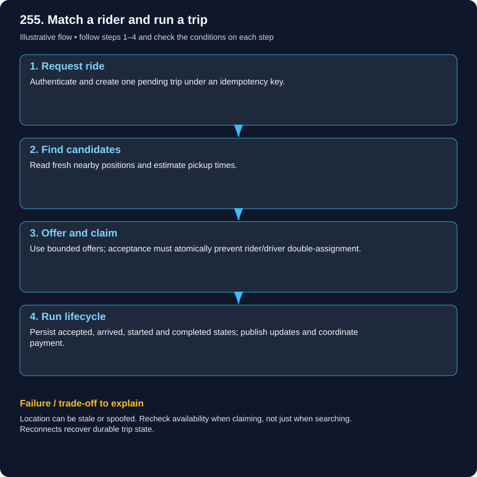
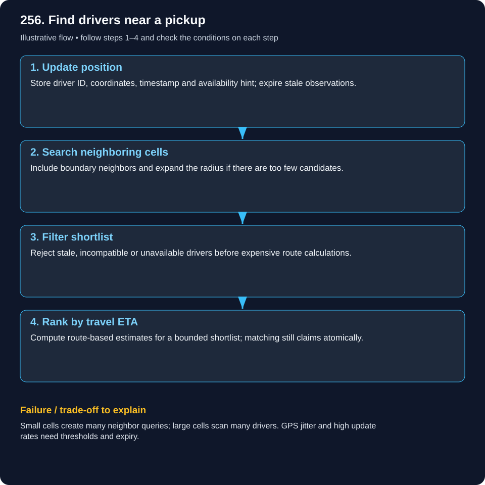
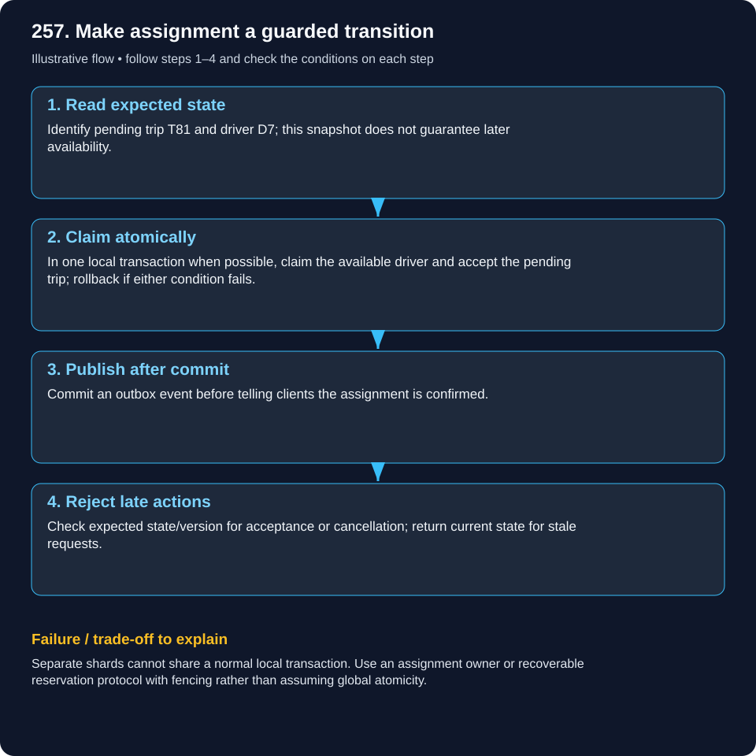
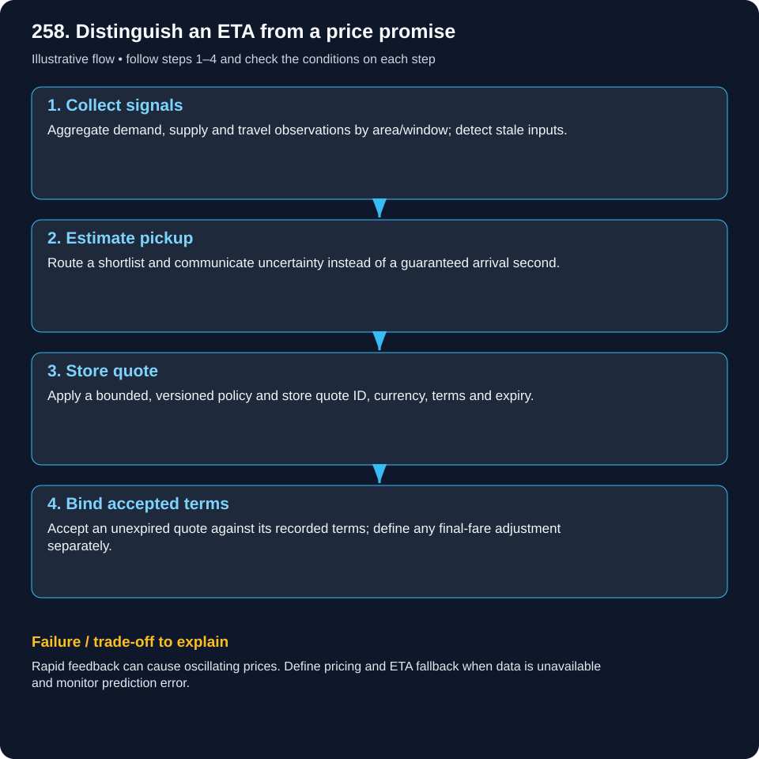

# System Design — Uber / Ride Hailing

Read the example, follow the flow, then explain the failure case. These are illustrative designs, not documented company internals.

[Beginner guide and glossary](system-design/visual-learning-guide.md) · [Case studies](system-design/README.md)

## 255. Design an Uber-like ride-hailing system.

### Match a rider and run a trip

Dispatch finds candidates, offers a trip and allows exactly one valid assignment.

### What it means

Driver location is fast-changing and approximate. A confirmed assignment and trip lifecycle need stronger durable correctness. Separate these two kinds of state.

### Worked real-world example

A rider requests pickup near a station. Nearby available drivers are shortlisted, ranked by pickup time and offered the ride with an acceptance deadline.

### Follow the flow

1. **Request ride:** Authenticate and create one pending trip under an idempotency key.

2. **Find candidates:** Read fresh nearby positions and estimate pickup times.

3. **Offer and claim:** Use bounded offers; acceptance must atomically prevent rider/driver double-assignment.

4. **Run lifecycle:** Persist accepted, arrived, started and completed states; publish updates and coordinate payment.

### Failure and trade-offs

Location can be stale or spoofed. Recheck availability when claiming, not just when searching. Reconnects recover durable trip state.

### Check your understanding

If a geographic index says free but the trip database says busy, which wins?

## 256. How do you find nearby drivers efficiently?

### Find drivers near a pickup

Search nearby map cells first, then compare actual road travel.

### What it means

Spatial indexes narrow coordinate searches without scanning the whole fleet. Cells, geohashes and spatial database indexes are options. Straight-line distance is only a candidate filter.

### Worked real-world example

The closest driver is across a river. A slightly farther driver on the same side may reach the rider sooner.

### Follow the flow

1. **Update position:** Store driver ID, coordinates, timestamp and availability hint; expire stale observations.

2. **Search neighboring cells:** Include boundary neighbors and expand the radius if there are too few candidates.

3. **Filter shortlist:** Reject stale, incompatible or unavailable drivers before expensive route calculations.

4. **Rank by travel ETA:** Compute route-based estimates for a bounded shortlist; matching still claims atomically.

### Failure and trade-offs

Small cells create many neighbor queries; large cells scan many drivers. GPS jitter and high update rates need thresholds and expiry.

### Check your understanding

Why does searching only the rider’s own cell miss some nearby drivers?

## 257. How do you design trip state and matching concurrency?

### Make assignment a guarded transition

Two dispatchers may propose the same driver, but only one claim should win.

### What it means

A state machine lists allowed transitions. Compare-and-set or a transaction checks the expected state/version before writing. Lock expiry alone cannot prevent an old holder writing stale state.

### Worked real-world example

Two riders compete for driver D7. In one database, a conditional transition from available to reserved can succeed for only one transaction.

### Follow the flow

1. **Read expected state:** Identify pending trip T81 and driver D7; this snapshot does not guarantee later availability.

2. **Claim atomically:** In one local transaction when possible, claim the available driver and accept the pending trip; rollback if either condition fails.

3. **Publish after commit:** Commit an outbox event before telling clients the assignment is confirmed.

4. **Reject late actions:** Check expected state/version for acceptance or cancellation; return current state for stale requests.

### Failure and trade-offs

Separate shards cannot share a normal local transaction. Use an assignment owner or recoverable reservation protocol with fencing rather than assuming global atomicity.

### Check your understanding

How should an acceptance arriving after offer expiry be handled?

## 258. How do surge pricing and ETA estimation work?

### Distinguish an ETA from a price promise

An arrival time is a forecast; a quote has agreed terms and an expiry.

### What it means

ETA estimates travel from routes, traffic and pickup conditions. Surge responds to recent demand/supply under a defined pricing policy. Inputs need freshness, smoothing and fallback behavior.

### Worked real-world example

An illustrative area sees 100 requests and 20 available drivers in a recent window. That signal may inform pricing, but does not by itself define a trustworthy multiplier.

### Follow the flow

1. **Collect signals:** Aggregate demand, supply and travel observations by area/window; detect stale inputs.

2. **Estimate pickup:** Route a shortlist and communicate uncertainty instead of a guaranteed arrival second.

3. **Store quote:** Apply a bounded, versioned policy and store quote ID, currency, terms and expiry.

4. **Bind accepted terms:** Accept an unexpired quote against its recorded terms; define any final-fare adjustment separately.

### Failure and trade-offs

Rapid feedback can cause oscillating prices. Define pricing and ETA fallback when data is unavailable and monitor prediction error.

### Check your understanding

What should happen if the quote expires while the rider decides?
