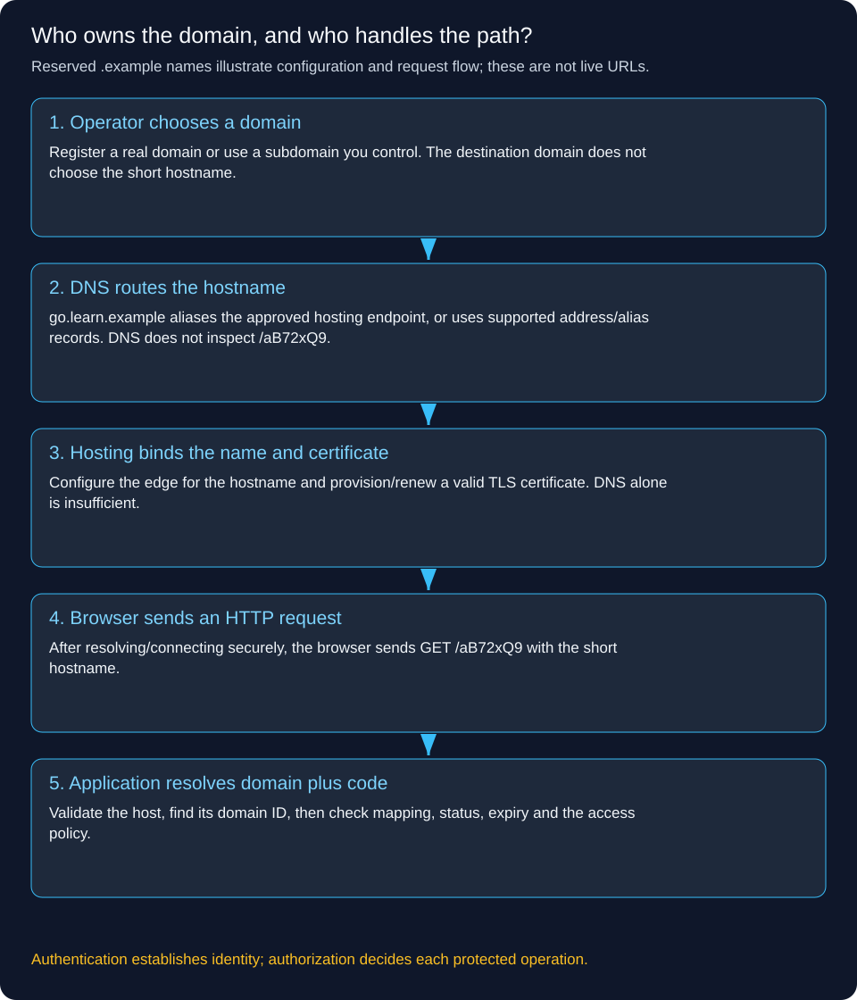
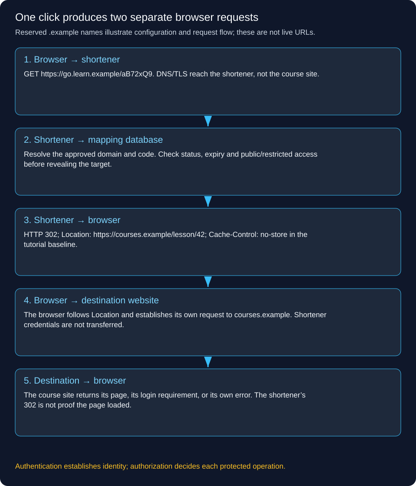

# Build a Short URL service: from domain name to the destination page

This tutorial follows one feature from the user’s point of view, then builds the architecture needed to make it work. Read it in order. We introduce a component only after identifying the job it must do.

All `.example` hostnames below are reserved teaching names. They are not working sites. In production, use a domain you own or a customer domain you have verified.

## 1. Start with the exact user journey

Alice runs a training website. She wants to share this long URL:

```text
https://courses.example/java/system-design?campaign=october&lesson=short-links
```

She signs into our shortener, pastes it and receives:

```text
https://go.learn.example/aB72xQ9
```

Bob receives that short URL in a message. He clicks it. His browser first contacts our shortener at `go.learn.example`. Our shortener looks up `aB72xQ9`, then tells his browser to navigate to the original URL. His browser makes a SECOND request to `courses.example` and loads the course page.

The long URL is not compressed inside the code. We store a mapping. Without access to that mapping, the short code alone cannot reconstruct the destination.

Our first version needs only three things: a domain that reaches our application, an application that creates/looks up mappings, and a durable database. Redis, a broker and analytics are later additions, not prerequisites for the redirect.

## 2. Where does the short domain come from?

It is a product/deployment choice, not an algorithm that guesses a domain from the long URL.

As the shortener operator, we register and maintain a domain, or use a subdomain of an existing domain we control. For example, the owner of `learn.example` can configure `go.learn.example`. We do not need to register a separate domain for every link. Thousands of codes can share that hostname.

We store the approved public origin as trusted configuration:

```text
PUBLIC_SHORT_ORIGIN=https://go.learn.example
returned_short_url = PUBLIC_SHORT_ORIGIN + "/" + generated_code
```

The destination might be on `courses.example`, `shop.example` or another allowed website. That does not change our default short domain.

Do not build public links from an arbitrary incoming Host or X-Forwarded-Host header. An attacker can forge those values unless a trusted proxy validates and replaces them. Use configured/verified origins and an allowed-host policy.

## 3. Connect that hostname to our application

Suppose our application runs behind a managed load balancer whose provider gives us an endpoint named `shortener-edge.provider.example`. We configure DNS for our subdomain to reach that endpoint, using the record type supported by the hosting provider.

```text
go.learn.example  CNAME  shortener-edge.provider.example
```

A CNAME aliases a hostname to another hostname. An A/AAAA record instead provides an IPv4/IPv6 address. Root/apex domains have DNS constraints; use the provider’s supported alias/flattening or address configuration rather than assuming every apex can have an ordinary CNAME.

We also bind `go.learn.example` to the edge/hosting configuration and provision a TLS certificate covering that hostname. Correct DNS without the hosting binding or certificate is not a complete HTTPS deployment. Plan certificate renewal and domain renewal.



Here is the crucial boundary: DNS resolves `go.learn.example`; it does not look up `/aB72xQ9`. The URL path is handled by our HTTP application after the browser reaches the server and establishes a secure connection.

TLS SNI helps the edge select the certificate for the hostname. HTTP Host, or the HTTP/2/3 authority field, identifies the requested host for routing. Validate these through the trusted edge configuration; neither substitutes for user authorization.

## 4. Decide what must be stored

Each row must answer: for this approved short domain and this code, where should the browser go, who owns the link, and is it allowed to redirect now?

This is an illustrative PostgreSQL schema. Start without custom domains if that feature is unnecessary; one fixed domain still works.

```sql
CREATE TABLE short_domain (
    id BIGINT GENERATED ALWAYS AS IDENTITY PRIMARY KEY,
    hostname TEXT NOT NULL UNIQUE,
    tenant_id UUID,             -- NULL can identify the operator's default domain
    verified_at TIMESTAMPTZ,
    status TEXT NOT NULL CHECK (status IN ('PENDING', 'ACTIVE', 'DISABLED'))
);

CREATE TABLE short_link (
    id BIGINT GENERATED ALWAYS AS IDENTITY PRIMARY KEY,
    domain_id BIGINT NOT NULL REFERENCES short_domain(id),
    code VARCHAR(16) NOT NULL,
    target_url TEXT NOT NULL,
    owner_id UUID NOT NULL,
    tenant_id UUID NOT NULL,
    access_mode TEXT NOT NULL CHECK (access_mode IN ('PUBLIC', 'RESTRICTED')),
    status TEXT NOT NULL CHECK (status IN ('ACTIVE', 'DISABLED')),
    expires_at TIMESTAMPTZ,
    created_at TIMESTAMPTZ NOT NULL DEFAULT now(),
    UNIQUE (domain_id, code)
);
```

A restricted link also needs an ACL or another explicit audience policy, such as an owner-approved set of user IDs or verified tenant membership. That policy must be checked server-side; hiding the link in the UI is insufficient.

Why include domain_id in uniqueness? `go.team-a.example/sale` and `go.team-b.example/sale` may legitimately point to different destinations. Lookup and cache keys must include the verified domain identity, not just `sale`.

Normalize hostnames consistently, including case and internationalized domain handling, when registering and looking them up. Keep code comparison case-sensitive if the alphabet distinguishes upper/lower case; do not accidentally collapse two codes in routing or database collation.

## 5. Alice creates a short link

Alice signs into the management application. For a browser application, an OIDC login can establish a server-side session carried by a Secure, HttpOnly cookie. Protect cookie-authenticated write requests against CSRF. An API client may instead use an appropriate access token. These are alternative authentication setups, not a requirement to send both.

For illustration, an API request might be:

```http
POST /api/links HTTP/1.1
Host: manage.learn.example
Authorization: Bearer <access-token-for-this-api>
Content-Type: application/json
Idempotency-Key: alice-create-81

{
  "targetUrl": "https://courses.example/java/system-design?campaign=october&lesson=short-links",
  "accessMode": "PUBLIC",
  "expiresAt": "2026-11-30T23:59:59Z"
}
```

The server performs these steps in order:

1. Authenticate Alice. Validate the credential using the chosen identity system. For a JWT access token, check signature, issuer, audience, expiry and required claims; merely decoding JSON does not authenticate it.
2. Authorize creation. Derive Alice’s identity/tenant from verified credentials and membership. Check create permission, plan/quota and permission to use the selected short domain. Never trust ownerId or tenantId submitted by the client.
3. Validate the target and settings. Parse an absolute URL, allow approved schemes such as HTTPS/HTTP, reject control characters and embedded credentials, enforce length/expiry limits and apply the product’s abuse policy. A corporate-only shortener might allowlist destination domains; a public shortener has a broader policy and needs abuse handling.
4. Resolve the idempotency key within Alice’s tenant/operation scope. Store a request fingerprint and result under a unique constraint. The same key and payload should return the original result; conflicting payload reuse should be rejected. Make this durable claim and link creation one local transaction.
5. Generate a candidate code and INSERT the mapping. A unique `(domain_id, code)` constraint is the final authority on collisions. On a random collision, retry with another candidate within a bounded limit. Do not overwrite the existing row.
6. Commit before returning success. Build the short URL from the verified configured domain, then respond with the created resource.

```http
HTTP/1.1 201 Created
Content-Type: application/json
Location: /api/links/9182
Cache-Control: no-store

{
  "id": 9182,
  "shortUrl": "https://go.learn.example/aB72xQ9",
  "accessMode": "PUBLIC"
}
```

If the database committed but Alice lost the response, she retries with `alice-create-81`; she should get the same link rather than a second mapping. Creation idempotency is a business-operation rule, separate from resolving a short URL.

## 6. How is the code generated?

For this tutorial, choose cryptographically generated random Base62 candidates. Base62 is an alphabet of 62 characters, not encryption. Seven characters give `62^7 = 3,521,614,606,208` possible strings, but random collisions still occur as the number of links grows.

We use a secure random source, a fixed maximum retry count and the database uniqueness constraint. Capacity, collision rate and abuse/enumeration requirements determine production code length; seven is an example, not a universal recommendation.

An alternative is to allocate a unique integer from a database sequence and encode it in Base62. This simplifies uniqueness but makes codes predictable. Neither approach is an authorization mechanism. Avoid using a short code to protect confidential content.

Illustrative control flow, not complete production code:

```text
begin local transaction
  claim (tenant, operation, idempotency_key) with request fingerprint
  if previously completed: return original result after transaction handling
  reject mismatched fingerprint or handle concurrent in-progress request
  repeat up to configured collision limit:
    draw candidate code
    INSERT link ... ON CONFLICT (domain_id, code) DO NOTHING RETURNING id
    if insert returned id: record completed idempotency result; commit; return
  rollback and report temporary creation failure
```

PostgreSQL-style ON CONFLICT avoids treating a uniqueness collision as an unhandled error that leaves the surrounding transaction unusable. Transaction isolation, concurrent idempotency claims and retry behavior must be implemented against the chosen database’s contract.

## 7. Bob clicks the short URL: trace both HTTP requests

Bob enters `https://go.learn.example/aB72xQ9` in his browser.

First, the browser resolves the short hostname using DNS, connects to the shortener’s edge, verifies its TLS certificate and sends this request:

```http
GET /aB72xQ9 HTTP/1.1
Host: go.learn.example
```

Our application maps the validated hostname to an active short_domain row, then looks up `(domain_id, aB72xQ9)`. It checks ACTIVE status, expiry, access policy and any abuse block. For an active PUBLIC link it returns:

```http
HTTP/1.1 302 Found
Location: https://courses.example/java/system-design?campaign=october&lesson=short-links
Cache-Control: no-store
Referrer-Policy: no-referrer
```

For this first version we choose no-store so browsers/shared caches do not retain a redirect that might be changed or disabled. That is an explicit simplicity/freshness choice; later we can cache eligible public mappings with defined invalidation and revocation bounds. Restricted redirects must not be served from a public shared cache.

The browser reads Location and makes a separate HTTPS request to the destination:

```http
GET /java/system-design?campaign=october&lesson=short-links HTTP/1.1
Host: courses.example
```

The destination returns its own page or its own login response. Our shortener did not fetch or host the course page. It also did not transfer an authenticated shortener session to the course website. Cookies and credentials belong to their configured origins/domains and must not be copied into the destination URL.



Why 302? We want a temporary redirect for a GET link whose destination or availability can change. A permanent 301/308 may be retained by clients/caches and complicate updates. For method-preserving redirects 307/308 have different semantics; our public resolution endpoint is deliberately GET/HEAD, not a general forwarding endpoint for arbitrary POST bodies.

HEAD can apply the same policy and return redirect headers without a response body. It should not necessarily count as a human click. Health checks, previews and security scanners can also issue GET requests.

## 8. Authentication and authorization are three separate questions

**Who may manage the mapping?** Alice must authenticate to create, edit, disable or view private analytics. The backend checks link.owner_id or a suitable tenant/admin policy on every management operation. Knowing `/api/links/9182` is not enough. Bob must not edit Alice’s link by guessing that ID. Missing authentication can produce 401 on the API; authenticated-but-forbidden access can produce 403, or a deliberate 404 policy to avoid exposing existence.

**Who may resolve it?** A PUBLIC link intentionally permits anonymous resolution. Bob does not need a shortener account. PUBLIC means anyone with/discovering the link can resolve it; random-looking codes do not make it private.

For a RESTRICTED link, require a shortener-side authenticated identity and check the link’s audience/ACL before revealing the destination. An interactive browser may be sent through a sign-in flow; an API request can receive 401. After login, return to a validated internal link identifier/path, not an arbitrary returnTo URL that creates an unintended redirect vulnerability. A logged-in user outside the audience must still be denied.

**Who may view the destination?** The destination makes its own decision. If the course requires an enrollment/login, Bob must satisfy that policy at `courses.example`. Restricting the short URL cannot protect a publicly accessible destination once someone knows its long URL. To protect the resource itself, enforce authorization at the destination; if needed, design a separate bounded-lifetime signed-access mechanism there rather than pretending a short code grants secure access.

Do not append identity tokens, passwords or session cookies to long URLs. They leak through logs, browser history and sharing. The example sets Referrer-Policy to reduce referral leakage, but that does not fix secrets deliberately placed in the target itself.

## 9. What if a customer wants their own domain?

A customer who owns `team.example` might want `go.team.example/sale`. DNS pointing at our infrastructure does not by itself prove that a specific logged-in tenant may claim that domain.

The management workflow is:

1. A tenant admin requests the hostname. We normalize it, prevent competing active claims, and generate an expiring tenant-bound random ownership challenge.
2. The admin adds the requested DNS TXT record. Our verification worker checks that the expected token is visible, including retry/propagation handling.
3. The admin configures the provider-specific CNAME/address routing. We bind the hostname to the serving edge and provision the certificate.
4. Only after ownership, routing and HTTPS readiness checks pass do we mark the domain ACTIVE for that tenant.
5. We monitor renewal and domain lifecycle. On removal, disable our binding/certificate/tenant association safely and document DNS cleanup so dangling records cannot be claimed by another customer.

For a click on `go.team.example/sale`, first resolve the approved host to that domain’s ID, then query `(domain_id, sale)`. Never let an unverified Host header switch into another tenant. Reject unknown hosts instead of silently serving the operator’s default tenant.

## 10. Walk through failures before adding scale

**The code does not exist.** Database lookup succeeds but returns no matching row: respond 404. A short negative-cache lifetime may protect repeated misses later. Rate limits reduce enumeration. Do not confuse an empty result with a database timeout.

**The link expired or was disabled.** Return the documented expired/blocked response, such as 410 or a safe branded unavailable page. Do not return Location. A policy can use 404 where exposing existence is undesirable. Management writes and cache invalidation must have an explicit revocation target.

**The user is not permitted.** Deny before revealing the target. If the identity/ACL service is unavailable for a restricted link, fail closed with a temporary error rather than assume public access. Availability does not justify silently dropping a confidentiality rule.

**Redis is unavailable.** Our first version has no Redis. Once it is added, a bounded fallback can query the database for active public mappings. Use timeouts, concurrency caps and circuit-breaking; unrestricted cache fallback can turn one outage into a database outage.

**The database is unavailable.** Return a temporary 503 when authoritative lookup cannot be completed. Do not label it 404, invent a destination or silently use an expired mapping. A later public-cache policy may permit known active cached results within a documented freshness window. Restricted/disabled-state guarantees may require stronger checks or failing closed.

**One application instance dies.** Keep durable mappings outside instance memory. A load balancer removes the unhealthy instance and routes new requests to another. Bound client/proxy retry attempts to avoid retry storms. A single-process first deployment has no such redundancy yet; add it when availability requirements demand it.

**DNS, domain registration or certificate fails.** Bob may fail before HTTP reaches us: there may be no application status code at all. Monitor external DNS resolution and HTTPS probes, automate renewals, and test provider/edge bindings. More API replicas cannot repair an expired domain.

**The destination is down.** We may successfully return 302 while the destination then times out or returns 500. Those are separate outcomes. Our service cannot guarantee arbitrary destination availability. Do not fetch every target synchronously to decide each redirect; that adds latency and server-side request forgery risk.

**Analytics is down.** Redirecting should not wait for a dashboard update. Emit events asynchronously with a bounded buffer and a documented loss/durability policy. If exact billable clicks are required, define what counts as a click and design durable accounting separately. A browser following Location is not proof a human viewed the final page.

## 11. URL validation, abuse and SSRF

A URL shortener intentionally redirects to destinations, so a generic ban on all external redirects would defeat the product. Instead, define who can create links, which destinations are acceptable, how abuse is detected, and how blocked mappings are revoked.

Parse URLs using a URI/URL library; do not concatenate untrusted text into headers. Restrict schemes, reject embedded credentials/control characters, bound input length and consider nested shortener chains, loops, malware and phishing. Limit creation rates and lookup misses; provide reporting and takedown procedures.

A simple redirect returns Location without server-side fetching. If we later add title previews, screenshots, reputation scanning or URL reachability tests, our servers DO fetch targets. Isolate that worker, block internal/private/metadata destinations using robust network egress controls, revalidate redirect hops and resolved addresses, and handle DNS rebinding. Scheme validation alone does not prevent SSRF.

Avoid storing unnecessary personal data in analytics. Do not log authentication tokens or sensitive target query strings. Restrict who can see a tenant’s links and analytics.

## 12. Evolve the architecture from the working version

At low traffic, one stateless API and PostgreSQL with `(domain_id, code)` indexing may be sufficient. Measure request latency, database time and error rates. Back up mappings and test restore; replication alone is not historical recovery.

For an illustrative 100M redirects/day, average is `100,000,000 / 86,400 ≈ 1,157 requests/second`. If we assume a tenfold peak, plan for about 11,574/second. At 99% cache hits, the peak database read rate is still about 116/second, plus creations and other operations. These are assumptions to load-test, not a capacity promise.

Now add multiple API instances for service capacity/availability. Add a mapping cache only if database reads or latency justify it. Keys include domain ID. A cached record must carry the policy fields needed for its allowed usage, not only the long URL. Define TTL, version/invalidation strategy, hot-key protection and takedown behavior.

Add queues/workers for analytics or scanning because those tasks need a different latency/failure path. Keep the actual redirect journey short. Add sharding only when measured data/traffic demands exceed a simpler database design; choose a distribution strategy that still handles viral hot links.

Monitor creation success, redirect status/latency, database/cache errors, miss rates, blocked attempts and external DNS/TLS health separately. For a healthy 302 followed by a broken target, the shortener metric alone cannot report destination success.

## 13. Verify the design with concrete scenarios

1. Alice creates a PUBLIC link, Bob resolves it, and a browser follows Location to the exact original path and query.
2. Alice repeats a timed-out create request with the same idempotency key; one mapping exists.
3. Two code candidates collide; one insert wins and the other retries without changing the winner’s target.
4. Bob calls Alice’s management endpoint; it is denied without modification.
5. A RESTRICTED link denies an anonymous user, permits an allowed user after login, and denies a different authenticated user.
6. Two approved domains both use `/sale`; each resolves only its own mapping. An unknown Host is rejected.
7. Disable/expire a link after caching; verify the advertised revocation behavior rather than assuming deletion is instantaneous everywhere.
8. Break Redis, the database, DNS and the destination separately; confirm their different observable outcomes.
9. Simulate an unavailable authorization dependency; restricted links fail closed.
10. Simulate lost analytics; the documented redirect behavior remains intact.

These are acceptance scenarios for an implementation, not claims that this repository deploys a running shortener. The repository contains the tutorial and diagrams.

## 14. Explain the whole design in an interview

We own or verify a short hostname and configure DNS, hosting bindings and TLS so it reaches our service. An authenticated creator submits a validated destination. We store a domain-scoped unique code mapping and return the configured public origin plus code. On a click, our API checks the domain, mapping status, expiry and access policy, then returns a temporary redirect with Location. The browser separately requests the destination, which enforces its own access rules. We distinguish missing links, denied access and temporary infrastructure failures, then add caches, replicas and background workers only for measured capacity or availability needs.

## Reference documentation

- [MDN: HTTP redirection and the browser’s follow-up request](https://developer.mozilla.org/en-US/docs/Web/HTTP/Guides/Redirections)
- [MDN: 302 Found](https://developer.mozilla.org/en-US/docs/Web/HTTP/Reference/Status/302)
- [Cloudflare: CNAME records and hostname aliases](https://www.cloudflare.com/learning/dns/dns-records/dns-cname-record/)
- [OWASP: enforce authorization on each protected request](https://cheatsheetseries.owasp.org/cheatsheets/Authorization_Cheat_Sheet.html)

[All system-design tutorials](system-design/README.md) · [Foundation lessons](system-design-foundations.md)
