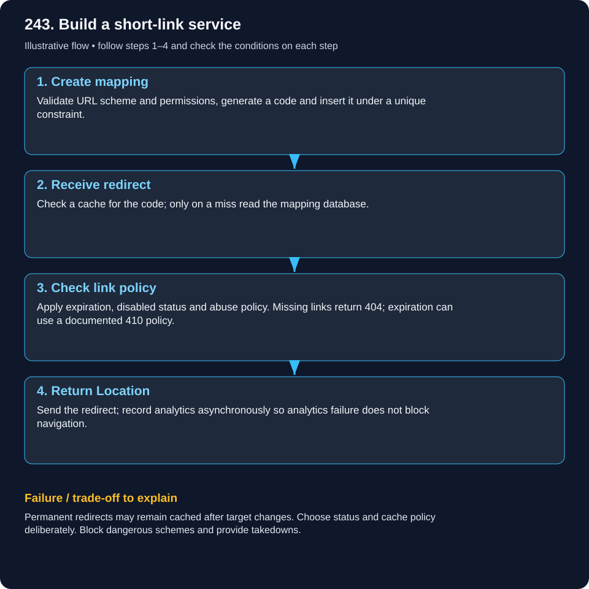
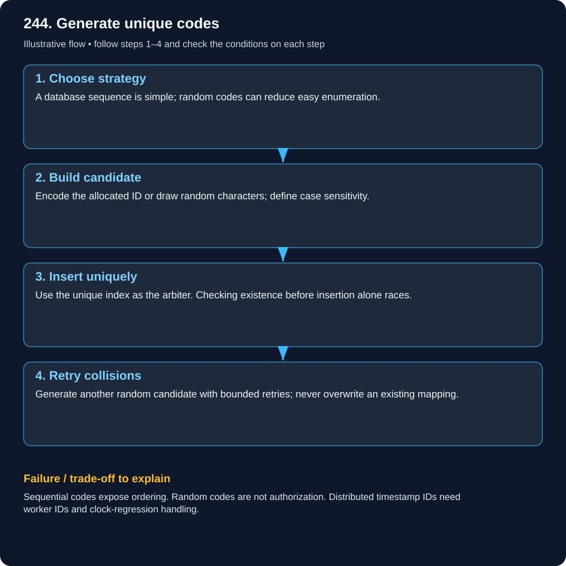
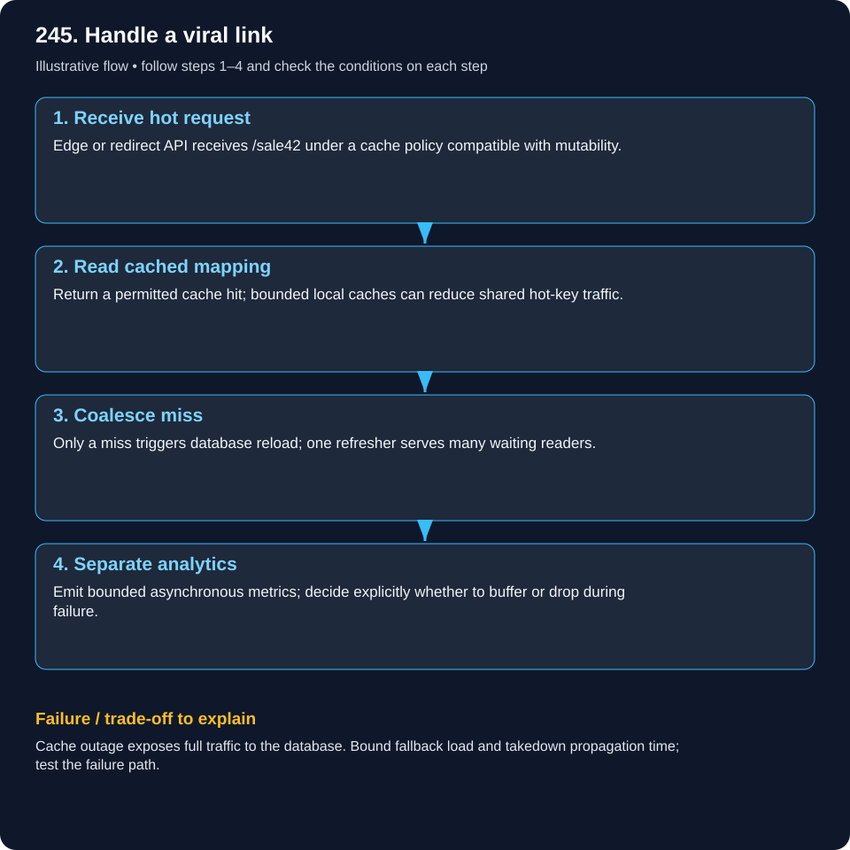

# System Design — URL Shortener

Read the example, follow the flow, then explain the failure case. These are illustrative designs, not documented company internals.

[Beginner guide and glossary](system-design/visual-learning-guide.md) · [Case studies](system-design/README.md)

## 243. Design a TinyURL/ShortURL service end to end.

### Build a short-link service

A code is a coat-check ticket pointing to something stored elsewhere.

### What it means

A shortener stores code-to-URL mappings. Creation writes the mapping; opening a code reads it and returns an HTTP redirect. The browser then follows the Location header.

### Worked real-world example

POST /links stores aB72 mapped to https://example.test/products/42. GET /aB72 returns 302 and that target if the link is active.

### Follow the flow

1. **Create mapping:** Validate URL scheme and permissions, generate a code and insert it under a unique constraint.

2. **Receive redirect:** Check a cache for the code; only on a miss read the mapping database.

3. **Check link policy:** Apply expiration, disabled status and abuse policy. Missing links return 404; expiration can use a documented 410 policy.

4. **Return Location:** Send the redirect; record analytics asynchronously so analytics failure does not block navigation.

### Failure and trade-offs

Permanent redirects may remain cached after target changes. Choose status and cache policy deliberately. Block dangerous schemes and provide takedowns.

### Check your understanding

Which is more important to preserve: one click metric or the code-to-URL mapping?

## 244. How would you generate globally unique short codes?

### Generate unique codes

Sequential tickets need a unique allocator; random tickets need a collision check.

### What it means

Base62 encodes numbers with 62 symbols; it does not generate uniqueness. Encode an allocated unique ID, or generate random codes and enforce uniqueness on insertion.

### Worked real-world example

Seven Base62 characters offer 62^7 = 3,521,614,606,208 possibilities. Birthday collisions are still possible when drawing many random codes.

### Follow the flow

1. **Choose strategy:** A database sequence is simple; random codes can reduce easy enumeration.

2. **Build candidate:** Encode the allocated ID or draw random characters; define case sensitivity.

3. **Insert uniquely:** Use the unique index as the arbiter. Checking existence before insertion alone races.

4. **Retry collisions:** Generate another random candidate with bounded retries; never overwrite an existing mapping.

### Failure and trade-offs

Sequential codes expose ordering. Random codes are not authorization. Distributed timestamp IDs need worker IDs and clock-regression handling.

### Check your understanding

Why is Base62(123) unique only when 123 was allocated uniquely?

## 245. How do you scale ShortURL redirects to millions of requests?

### Handle a viral link

Repeatedly reading a popular ticket should not repeatedly open the archive.

### What it means

Redirects usually outnumber creations. Cache active mappings and add stateless redirect instances. A viral code is a hot key even if all other keys are evenly distributed.

### Worked real-world example

An illustrative 100M redirects/day averages 1,157/second. A tenfold peak is 11,574/second. Even 99% cache hits leave about 116 database reads/second at peak.

### Follow the flow

1. **Receive hot request:** Edge or redirect API receives /sale42 under a cache policy compatible with mutability.

2. **Read cached mapping:** Return a permitted cache hit; bounded local caches can reduce shared hot-key traffic.

3. **Coalesce miss:** Only a miss triggers database reload; one refresher serves many waiting readers.

4. **Separate analytics:** Emit bounded asynchronous metrics; decide explicitly whether to buffer or drop during failure.

### Failure and trade-offs

Cache outage exposes full traffic to the database. Bound fallback load and takedown propagation time; test the failure path.

### Check your understanding

How quickly must a disabled phishing link stop working across caches?
