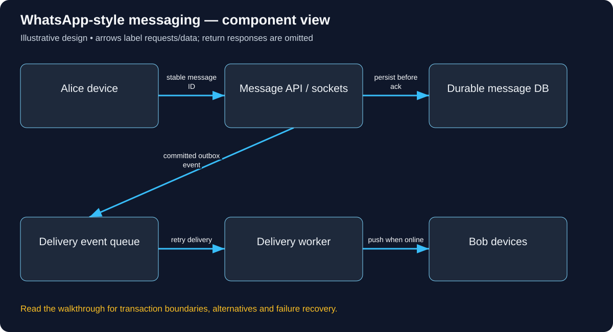

# Build WhatsApp-style messaging: follow the complete user journey

Read in order: each decision below follows from the same real-world situation. Domains ending in .example are reserved teaching names, not live services. These are illustrative designs, not descriptions of a company’s internal implementation.

## 1. Start with Alice and Bob, not a broker

Alice types “Meet at 6” and presses Send. Bob has no mobile connection. Alice should learn that the service accepted the message, while Bob must receive it after reconnecting. Accepted, delivered and read are different facts. We will build that sequence first. A live socket alone cannot satisfy it because disconnecting would lose the only delivery path.

## 2. How the apps find the service

The operator configures an owned hostname such as chat.learn.example in DNS, binds it to an HTTPS/WebSocket edge and provisions its certificate. The app has this approved service origin in configuration. The domain of Bob’s email address does not decide which server owns the chat. DNS locates the service; conversation and recipient IDs select application records after connection. A mobile reconnect can reach another server, so required state must not exist only on the old socket node.

## 3. Log in and send one message

Alice authenticates and establishes an authorized connection. A WebSocket handshake must validate the credential and permitted browser origins where applicable; being connected is not permission to post to every conversation. Alice sends {conversationId: c7, clientMessageId: m81, ciphertext: ...}. The service derives the sender from the session, verifies membership and checks that m81 has not already been accepted for that sender/conversation.

The concrete API/data vocabulary used in this journey:

```text
POST /conversations/{id}/messages; GET messages?after=cursor. Message(conversation, sequence, sender, client_message_id unique within its scope, ciphertext). DeviceCursor tracks delivery.
```

A concrete request and observable response for this journey (illustrative API contract):

```http
POST /conversations/c7/messages
Authorization: Bearer <chat-access-token>
Content-Type: application/json

{"clientMessageId":"m81","ciphertext":"<encrypted-envelope>"}

HTTP/1.1 201 Created
{"messageId":"m81","sequence":41,"state":"ACCEPTED"}

GET /conversations/c7/messages?after=40
Authorization: Bearer <bob-access-token>

HTTP/1.1 200 OK
{"messages":[{"messageId":"m81","sequence":41,"ciphertext":"<encrypted-envelope>"}],"cursor":41}
```



Use this diagram to locate the responsibilities just introduced. Arrows show selected requests/data; the paragraphs distinguish return responses, alternatives and transaction boundaries.

## 4. Commit before showing accepted

Within the chosen database boundary, insert the message, assign its conversation sequence and store a delivery outbox event. Return accepted only after the promised durability level is met. If the response disappears, Alice retries m81 and receives the original sequence rather than creating another message. A single partition owner or transactional sequencer can order one conversation; phone clocks cannot reliably do so. An outbox relay can publish twice, so workers and recipients must tolerate duplicates.

## 5. Deliver now or recover later

A delivery worker looks up Bob’s connected devices in a session directory. When Bob is offline, a notification can wake his app but is not the message database. On reconnect Bob authenticates, proves membership again and requests messages after cursor 40. If he gets 42 before 41, he fetches the missing range. Devices deduplicate IDs, acknowledge delivered state and later explicitly report read state. History retention and tombstones determine what an old cursor can recover.

## 6. Keep privacy rules on every path

Check membership for send, history reads, attachment access and socket subscriptions, not just conversation creation. Revocation must reach live sessions or be enforced at each operation. End-to-end encryption happens on authorized devices using an established protocol; TLS alone only encrypts the connection to the service. Store encrypted envelopes and explicit metadata. Multi-device keys, attachments, backup recovery and joining/leaving groups require deliberate policies.

## 7. Rehearse the failures

Kill the socket server after database commit: the message remains and reconnect recovers it. Kill the worker after push: redelivery is possible and Bob deduplicates. Lose database access: do not acknowledge durable acceptance. Lose the membership service: deny protected reads/sends temporarily rather than bypass membership. Expire a device session: require reauthentication. For groups, choose a fan-out model that does not block acceptance on every recipient; huge groups may fetch shared history. Measure accepted-message latency, reconnect gaps and delivery lag separately.

## 8. Prove the first version before scaling

Begin with one authenticated API/socket service and durable conversation storage. Test two devices, an offline recipient, retry of the same client ID, forbidden conversation reads and history after reconnect. Then add multiple connection nodes, a shared session directory and background delivery workers for measured connection count and fan-out needs. Do not claim global ordering or exactly-once external effects merely because a broker exists.

## Work the capacity assumption

100,000 connected users sending one message/minute produce about 1,667 sends/second before group fan-out and multi-device copies. These are illustrative assumptions; measure the chosen implementation and peak distribution before treating them as capacity.

## Explain the journey back

How does Bob recover if he receives sequence 42 before sequence 41? Then explain the hostname, caller identity, object-level permission, authoritative record, success acknowledgement and crash/retry behavior for this same action.

## Reference documentation

- [Authorization on protected operations](https://cheatsheetseries.owasp.org/cheatsheets/Authorization_Cheat_Sheet.html)
- [Event delivery semantics](https://kafka.apache.org/41/design/design/)

[All tutorials](system-design/README.md) · [Foundation lessons](system-design-foundations.md)
