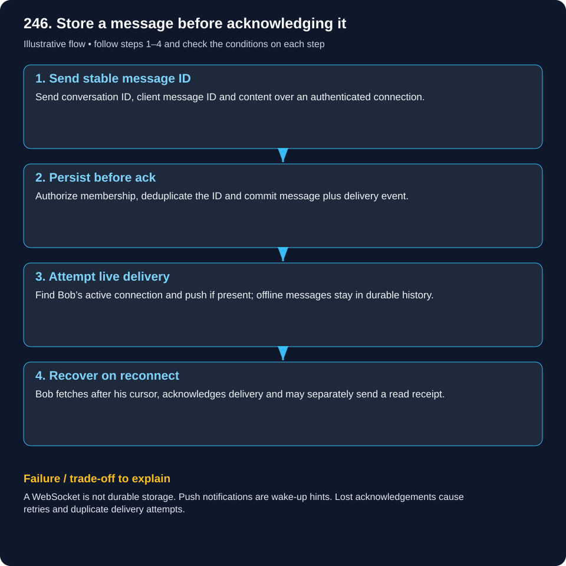
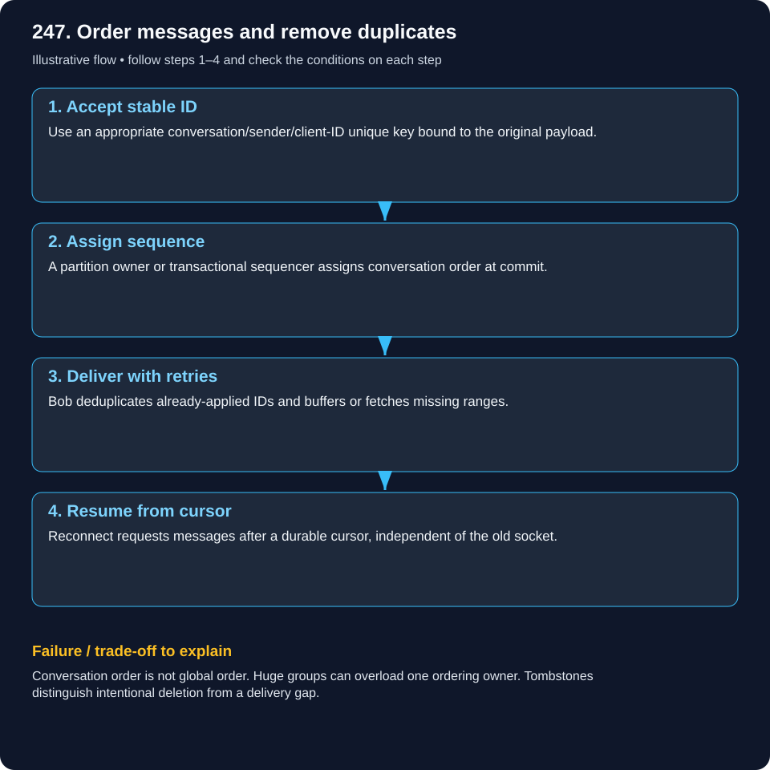
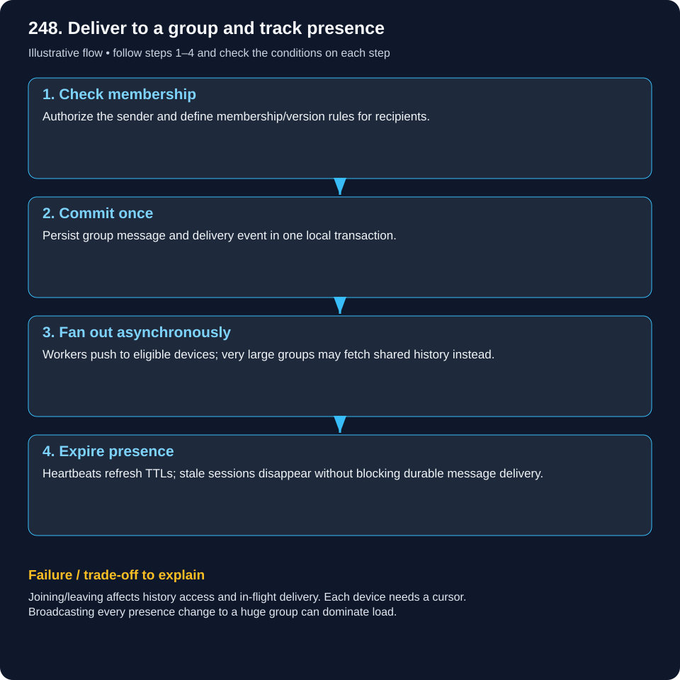
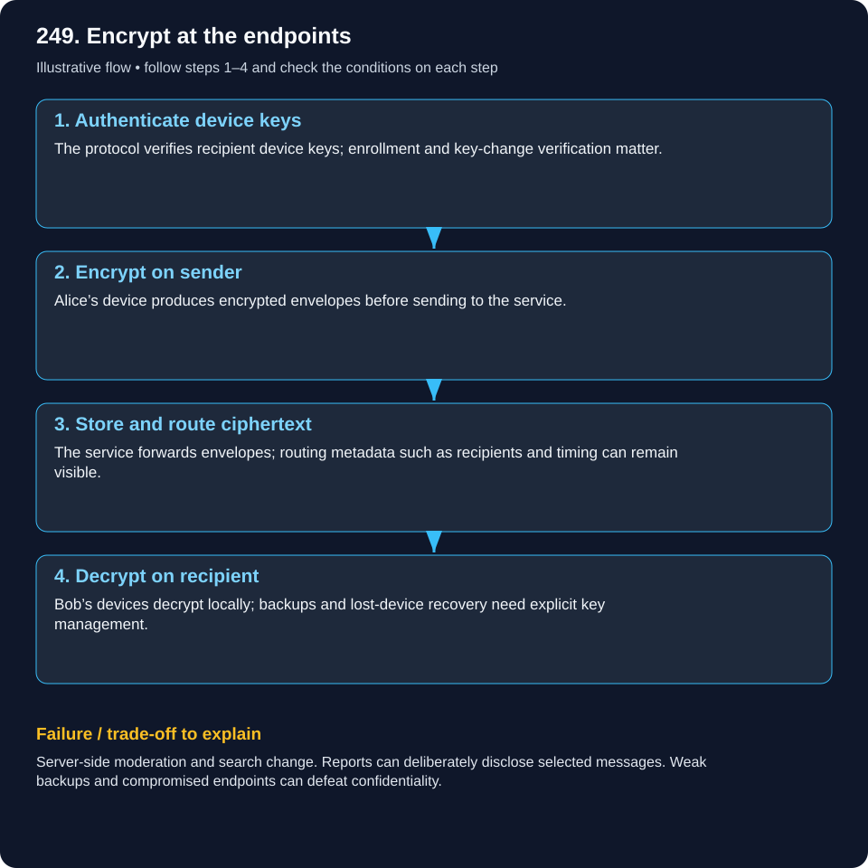

# System Design — WhatsApp & Messaging

Read the example, follow the flow, then explain the failure case. These are illustrative designs, not documented company internals.

[Beginner guide and glossary](system-design/visual-learning-guide.md) · [Case studies](system-design/README.md)

## 246. Design a WhatsApp-like one-to-one chat system.

### Store a message before acknowledging it

A postal office accepting a letter and delivering it are separate events.

### What it means

Chat combines live connections with durable history. A server acknowledgement means accepted under a defined durability contract. Delivery and read receipts are separate states.

### Worked real-world example

Alice sends m81 while Bob is offline. Alice sees accepted after commit. Bob later reconnects with his last-seen cursor and fetches missing messages.

### Follow the flow

1. **Send stable message ID:** Send conversation ID, client message ID and content over an authenticated connection.

2. **Persist before ack:** Authorize membership, deduplicate the ID and commit message plus delivery event.

3. **Attempt live delivery:** Find Bob’s active connection and push if present; offline messages stay in durable history.

4. **Recover on reconnect:** Bob fetches after his cursor, acknowledges delivery and may separately send a read receipt.

### Failure and trade-offs

A WebSocket is not durable storage. Push notifications are wake-up hints. Lost acknowledgements cause retries and duplicate delivery attempts.

### Check your understanding

What should accepted mean if Bob has no active connection?

## 247. How do you handle ordering and duplicates in chat?

### Order messages and remove duplicates

Numbered pages stay readable when the printer hands you the same page twice.

### What it means

Retries and reconnects can duplicate or reorder delivery. Use a stable client message ID for deduplication and an authoritative per-conversation sequence for accepted order.

### Worked real-world example

m81 gets sequence 41 but Alice loses the response. Retrying must return 41. Bob receiving 42 before 41 can detect a gap and fetch missing history.

### Follow the flow

1. **Accept stable ID:** Use an appropriate conversation/sender/client-ID unique key bound to the original payload.

2. **Assign sequence:** A partition owner or transactional sequencer assigns conversation order at commit.

3. **Deliver with retries:** Bob deduplicates already-applied IDs and buffers or fetches missing ranges.

4. **Resume from cursor:** Reconnect requests messages after a durable cursor, independent of the old socket.

### Failure and trade-offs

Conversation order is not global order. Huge groups can overload one ordering owner. Tombstones distinguish intentional deletion from a delivery gap.

### Check your understanding

Why is a phone timestamp unreliable as the only ordering key?

## 248. How would you design WhatsApp group messaging and presence?

### Deliver to a group and track presence

A group announcement has many recipients; an attendance light is only a recent hint.

### What it means

Fan-out-on-write prepares individual deliveries; fan-out-on-read fetches shared history. Presence is usually approximate, based on heartbeats and expiry rather than a guaranteed disconnect notification.

### Worked real-world example

A 50-member study group can use per-member delivery tasks. A 100,000-member announcement channel may prefer shared history and cursor reads.

### Follow the flow

1. **Check membership:** Authorize the sender and define membership/version rules for recipients.

2. **Commit once:** Persist group message and delivery event in one local transaction.

3. **Fan out asynchronously:** Workers push to eligible devices; very large groups may fetch shared history instead.

4. **Expire presence:** Heartbeats refresh TTLs; stale sessions disappear without blocking durable message delivery.

### Failure and trade-offs

Joining/leaving affects history access and in-flight delivery. Each device needs a cursor. Broadcasting every presence change to a huge group can dominate load.

### Check your understanding

May a departed member read a message sent after leaving?

## 249. How does end-to-end encryption change messaging architecture?

### Encrypt at the endpoints

The server carries a locked parcel; only authorized devices can open it.

### What it means

End-to-end encryption keeps content encryption/decryption on endpoint devices. TLS protects a connection to the server but can still expose plaintext at that server. Use established audited protocols.

### Worked real-world example

Alice encrypts for Bob’s authorized devices before upload. The server queues ciphertext for offline delivery and cannot directly run plaintext search over it.

### Follow the flow

1. **Authenticate device keys:** The protocol verifies recipient device keys; enrollment and key-change verification matter.

2. **Encrypt on sender:** Alice’s device produces encrypted envelopes before sending to the service.

3. **Store and route ciphertext:** The service forwards envelopes; routing metadata such as recipients and timing can remain visible.

4. **Decrypt on recipient:** Bob’s devices decrypt locally; backups and lost-device recovery need explicit key management.

### Failure and trade-offs

Server-side moderation and search change. Reports can deliberately disclose selected messages. Weak backups and compromised endpoints can defeat confidentiality.

### Check your understanding

Why does HTTPS alone not provide Alice-to-Bob end-to-end encryption?
