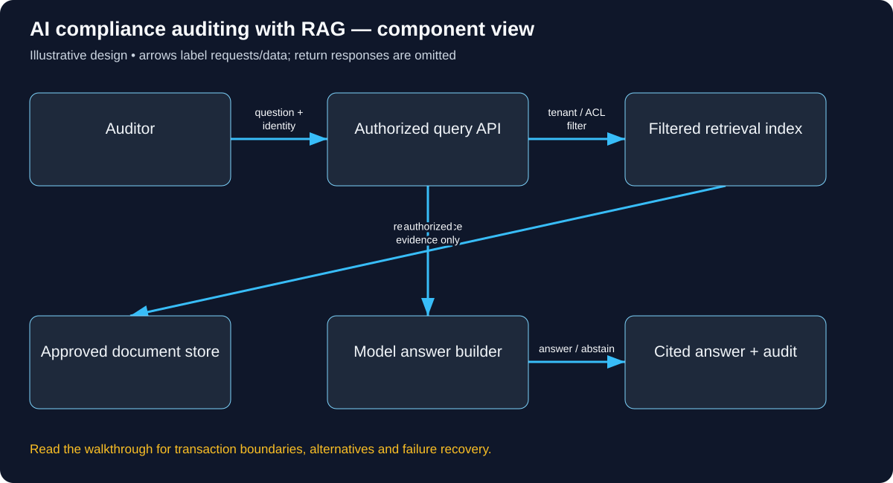

# Build AI compliance auditing with RAG: follow the complete user journey

Read in order: each decision below follows from the same real-world situation. Domains ending in .example are reserved teaching names, not live services. These are illustrative designs, not descriptions of a company’s internal implementation.

## 1. Start with a question requiring evidence

An employee asks: “How long may our team retain customer call records?” A useful answer must cite the applicable approved policy version. A fluent guess is a failure. The first design question is where approved evidence lives and which documents this employee is allowed to read. A vector database is only a candidate-search tool; it does not know corporate authorization by itself.

## 2. Connect the user and trusted model endpoints

The organization owns an internal HTTPS portal such as audit.learn.example, configured with DNS, TLS and identity-aware access. The application calls approved model/embedding endpoints using server-held credentials. A link printed in an uploaded document is evidence text, not authority to make a network/tool request. Define data-residency and provider-retention requirements before sending sensitive chunks to a hosted model.

## 3. Ingest approved policy versions

An authorized policy owner uploads a document. Store its immutable version, checksum, source location, tenant and ACL. Extract text, create chunks with page/section provenance and compute embeddings in an asynchronous job. Keep ingestion status explicit: uploaded is not yet searchable. Deleting/restricting a document requires removal or filtering of derived chunks and caches, not merely hiding its filename in the UI.

The concrete API/data vocabulary used in this journey:

```text
POST /documents for ingestion; POST /questions for retrieval. Document(tenant, version, ACL), Chunk(source/page, text), Embedding, AuditRecord.
```

A concrete request and observable response for this journey (illustrative API contract):

```http
POST /questions
Authorization: Bearer <auditor-access-token>
Content-Type: application/json

{"question":"How long may our team retain call records?"}

HTTP/1.1 200 OK
{"status":"INSUFFICIENT_AUTHORIZED_EVIDENCE","answer":null,"citations":[]}

This is a valid abstention, not an HTTP infrastructure error. When sufficient
approved evidence exists, return a grounded answer with real permitted source
IDs/pages/versions. Do not invent those citations to fill the response shape.
```



Use this diagram to locate the responsibilities just introduced. Arrows show selected requests/data; the paragraphs distinguish return responses, alternatives and transaction boundaries.

## 4. Retrieve for one authenticated question

The query API derives tenant/user from verified credentials. Apply tenant/ACL and approved-version filters before selecting candidate evidence, then rank/retrieve a bounded set. Validate authorization again where needed at source access. Retrieval must not first expose forbidden snippets to the model and hope the final response hides them. Log query/evidence IDs safely without indiscriminately logging confidential text.

## 5. Construct and verify the answer

Pass the user question and authorized evidence to a constrained answer builder. Instruct it to cite actual source chunks and abstain when evidence is insufficient. Separate system instructions from retrieved content; a malicious paragraph saying ignore previous instructions does not change tool permissions. Verify citation linkage and surface applicable version/date. A confident answer citing an obsolete policy is still wrong.

## 6. Work through failure and evaluation

If extraction fails, retain an explicit failed-ingestion state for retry, not an empty policy treated as valid. If retrieval finds no permitted evidence, return an evidence-not-found/abstention response. If the model times out, report temporary answer unavailability without inventing text. If identity is unavailable, deny protected retrieval. Evaluate retrieval recall, correct ACL exclusion, citation faithfulness and version selection separately; one aggregate accuracy score hides different faults.

## 7. Make the first release reviewable

Start with a small approved policy collection and manually curated questions with expected evidence. Test the same question as two users with different permissions, a superseded policy, an injected document and deleted source chunks. Only after that measure chunk count, vector index overhead, model latency/cost and ingestion lag. Add caching only with tenant/permission/version-aware keys and a revocation policy.

## Work the capacity assumption

For 10,000 documents × 30 chunks, store 300,000 chunks; estimate vector bytes from dimension × bytes/value plus index overhead. These are illustrative assumptions; measure the chosen implementation and peak distribution before treating them as capacity.

## Explain the journey back

Can a perfectly fluent answer still be wrong if it cites an outdated policy? Then explain the hostname, caller identity, object-level permission, authoritative record, success acknowledgement and crash/retry behavior for this same action.

## Reference documentation

- [Authorization on protected operations](https://cheatsheetseries.owasp.org/cheatsheets/Authorization_Cheat_Sheet.html)
- [Tenant isolation](https://cheatsheetseries.owasp.org/cheatsheets/Multi_Tenant_Security_Cheat_Sheet.html)
- [Secure multitenant retrieval architecture](https://learn.microsoft.com/en-us/azure/architecture/ai-ml/guide/secure-multitenant-rag)

[All tutorials](README.md) · [Foundation lessons](../system-design-foundations.md)
