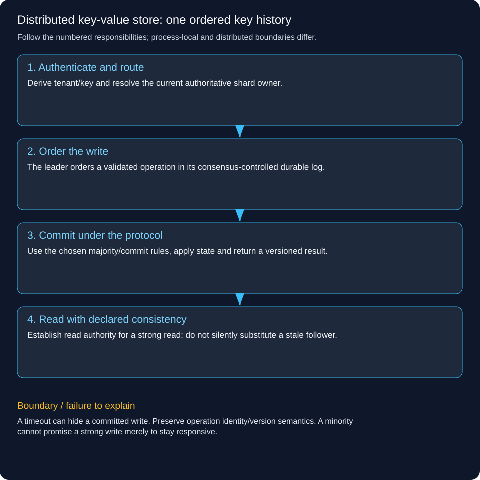

# Design a distributed key-value store: follow one write and one read

Alice’s service stores `profile:81` and later reads it from another application server. We want a key lookup service with a documented durability and consistency contract. A concurrent Java map is useful inside one node; it cannot by itself keep data across process crashes or coordinate nodes separated by a network.

All .example names are reserved teaching names. This is an illustrative design, not a claim to implement Raft or any particular database.

## 1. Choose the contract before drawing replicas

Our starting contract is per-key PUT, GET, DELETE and compare-and-set by version, scoped to an authenticated tenant. We want acknowledged writes to survive the failures covered by the configured quorum and durable storage policy. For this tutorial, linearizable operations for a key are handled by the current leader of its shard; minority partitions cannot accept writes requiring a quorum.

We do not promise cross-shard transactions, unlimited availability during partition, or zero latency. A multi-key operation needs a separately designed transaction/ownership protocol. Atomicity for one key is not automatically a global snapshot.

## 2. Route the request to the right owner

The operator owns kv.learn.example and configures DNS, load balancing, TLS and workload access. DNS gets the caller to the service; it does not hash individual keys. A router derives the tenant from verified credentials and maps `(tenant, key)` to a shard using a versioned routing map/hash scheme. Include tenant identity in data, routing, cache and quota boundaries.

For example, the router maps `(A, profile:81)` to shard S3. S3 has replicas N1, N2 and N3; N1 is currently leader. A stale router gets a controlled ownership redirect/retry rather than being allowed to create an independent writer. Internal nodes authenticate each other as well as client workloads.

## 3. Define the request and record

```http
PUT /v1/keys/profile%3A81
Authorization: Bearer <tenant-A-workload-credential>
Content-Type: application/json
Idempotency-Key: change-81

{"value":{"name":"Alice"},"expectedVersion":7}
```

This illustrative conditional PUT means update only if the authoritative version is 7. The storage record includes tenant, key, value/tombstone, logical version and any defined expiry metadata. Request identity and a result record can make retries recognizable under the service’s retention policy.

```http
HTTP/1.1 200 OK
Content-Type: application/json

{"key":"profile:81","version":8,"state":"COMMITTED"}
```

Only return that success when the chosen consensus/durable-storage commit contract is met. A failed expected-version comparison returns a conflict such as 409 under this API contract. Authentication and per-key/namespace permission checks happen independently of version matching.

## 4. Follow the write through the shard



The leader validates the operation, orders it in its replicated log and writes according to the configured durable-log policy. Followers append the replicated entries and acknowledge according to that policy. For a three-voter shard, a majority means two voters. A consensus implementation tracks terms, log matching and the valid commit point; do not replace it with “send to any two servers and accept the newest timestamp.”

After an entry is committed under the consensus protocol, replicas apply the ordered operation to their state machine. Return the successful versioned result at the appropriate point. If compare-and-set requires version 7, it must be evaluated against the authoritative ordered state, so two competing updates cannot both successfully claim the same prior version.

Use an established consensus/storage implementation when building a real service. A few Java methods plus acknowledgements do not implement safe elections, durable recovery or all consensus rules.

## 5. Follow a read from another client

```http
GET /v1/keys/profile%3A81
Authorization: Bearer <another-authorized-tenant-A-workload>
```

The router resolves the same shard. For the promised linearizable read, the serving protocol must establish current leadership/read authority, for example through the chosen consensus implementation’s read-index/quorum mechanism, before reading the applied state. Simply asking an old leader or an arbitrary follower can return stale data.

```http
HTTP/1.1 200 OK
Content-Type: application/json

{"key":"profile:81","version":8,"value":{"name":"Alice"}}
```

An API may also expose explicitly weaker/stale reads for cheaper local/follower access. Name that choice in the contract. Never silently downgrade a strong read when a quorum is unavailable. A key absent under a completed authoritative read is different from a storage timeout.

## 6. Crash and retry the same operation

Suppose N1 commits version 8, but the response to Alice disappears. Alice cannot infer failure from timeout. With a stable request identity, the new leader can recognize a retained completed result; a compare-and-set retry with expectedVersion 7 otherwise conflicts because version 8 is already present. Define how the client learns whether its own write succeeded rather than teaching it to blindly overwrite with a new version.

Now stop N1. The remaining voters elect according to the consensus protocol and preserve its committed-log guarantees. An old leader must not continue accepting writes after losing authority; terms and protocol checks fence stale ownership. If fewer than a majority are available, the strong write/read service may be temporarily unavailable. That is the deliberate partition-time consistency trade-off.

## 7. Recover storage, expiry and deleted records

A node reconstructs its state from a valid snapshot plus later durable log entries. Snapshots/checkpoints must agree with the replicated log position. Retention and compaction must not remove information still needed by lagging replicas or recovery. Durable logs/replicas are not substitutes for tested historical backups against accidental deletion/corruption.

DELETE can be represented as an ordered tombstone until safe cleanup conditions are met. Otherwise a stale replica may resurrect a deleted value. TTL needs a documented clock/expiration contract: replicated expiry decisions and follower read semantics must agree with the promised visibility. Wall clocks across machines are not a universal conflict-resolution oracle.

## 8. Decide the failure response and authorization boundary

Reject a tenant-A credential trying to read tenant B’s namespace before returning its value or existence where that is sensitive. Access revocation, snapshots, administrative APIs, backups and operational logs all need appropriate authorization. TLS encrypts traffic; it does not decide which caller may modify a key.

If the router is stale, retry the same logical request with bounded attempts against current ownership. If the shard cannot meet the requested guarantee, return a temporary error such as 503, not a fabricated 404 or silent stale success. If a write conflicts by version, report the conflict distinctly from infrastructure failure. Rate-limit hot tenants and bound request/value sizes so one caller cannot exhaust memory or log capacity.

## 9. Add shards only after one shard is correct

Replication adds copies for one shard’s durability/availability contract. Sharding distributes different keys across ownership groups for scale. If every shard hashes a celebrity key to one group, that hot key still has one authoritative write sequence. More shards do not split a single linearizable key’s writes automatically.

Moving a key range between shards requires a versioned ownership/handoff protocol, transfer/catch-up and fencing so old and new groups cannot both be authoritative. Consistent hashing can reduce remapping but does not supply this protocol. During movement, define retry, read and write behavior explicitly.

## 10. Walk through acceptance tests

Create version 1, read it through another router, then race two expectedVersion=1 writes and require exactly one successful change under the chosen contract. Lose a reply after commit and retry with the same operation identity. Partition the leader from a majority and ensure it cannot continue acknowledging strong writes. Recover a follower from snapshot/log and verify ordered state. Delete a key, reconnect an old replica and ensure it is not resurrected. Query another tenant’s key and deny it.

These are validation requirements for a real implementation, not claims that this repository runs a distributed store. Measure latency distributions, log/replication lag, disk pressure, leader changes, conflicts and hot-key concentration. Keep backup/restore and failure drills separate from happy-path throughput benchmarks.

## References

- [etcd API consistency guarantees](https://etcd.io/docs/v3.5/learning/api_guarantees/)
- [Raft: consensus protocol and paper](https://raft.github.io/)
- [OWASP tenant isolation](https://cheatsheetseries.owasp.org/cheatsheets/Multi_Tenant_Security_Cheat_Sheet.html)

[LLD and HLD learning paths](../lld-hld-learning-path.md) · [All system-design tutorials](README.md)
