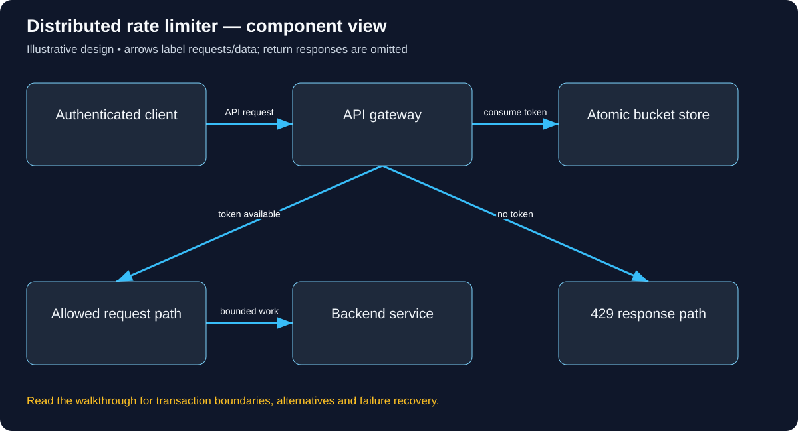

# Build Distributed rate limiter: follow the complete user journey

Read in order: each decision below follows from the same real-world situation. Domains ending in .example are reserved teaching names, not live services. These are illustrative designs, not descriptions of a company’s internal implementation.

## 1. Follow two requests competing for one token

A paid tenant may sustain 10 requests/second with a burst of 20. After previous traffic only one token remains. Two API instances receive requests simultaneously. Both must not read one token and independently accept it. That race, plus how we identify the tenant and handle store failure, is the problem the limiter design must solve.

## 2. Put the check on the real request path

Clients resolve api.learn.example through the operator’s DNS/TLS edge and reach an API gateway or middleware. The limiter is usually an internal check on this path, not a public database endpoint. Prevent bypass through direct backend access using appropriate network and workload authentication controls. DNS balancing alone does not coordinate quota across instances.

## 3. Determine the policy key from trusted identity

Authenticate an access token/API credential and map it to tenant, subject and allowed plan. Construct the quota key from those verified attributes plus route/cost class. Do not trust a client-supplied X-Tenant header. Anonymous endpoints may use an abuse budget with carefully interpreted source information; shared NAT and proxies make an IP address an imperfect user identity.

The concrete API/data vocabulary used in this journey:

```text
Middleware check(tenant, route, cost). Policy(capacity, refill_rate), Bucket(tokens, last_refill, expiry). Use bounded key space.
```

A concrete request and observable response for this journey (illustrative API contract):

```http
GET /api/reports
Authorization: Bearer <verified-tenant-access-token>

HTTP/1.1 429 Too Many Requests
Retry-After: 1
Content-Type: application/json

{"error":"RATE_LIMITED","retryAfterSeconds":1}

This is the no-token branch. On the allowed branch, the gateway forwards to the
backend, which separately checks report authorization. A 200 backend response
is not generated merely because the limiter found a token.
```



Use this diagram to locate the responsibilities just introduced. Arrows show selected requests/data; the paragraphs distinguish return responses, alternatives and transaction boundaries.

## 4. Execute the atomic decision

For a bucket with current tokens T, elapsed seconds d, refill rate r and capacity C, compute min(C,T+d*r), then consume request cost only if sufficient. Refill, comparison and subtraction must be atomic at the chosen store/owner. With one remaining token, one caller consumes it and the next is rejected. Define time source and how to handle clock movement rather than mixing arbitrary app-server clocks.

## 5. Return a useful outcome

An allowed request proceeds to the backend, which still enforces its own business authorization and in-flight resource bounds. A rejected request gets HTTP 429 and suitable retry guidance; do not silently enqueue unlimited waiting work. Rate permission is not permission to read another tenant’s order. A token may reasonably be charged for an attempted request even if its later backend operation fails; document the policy.

## 6. Handle distribution and outages

A single atomic shared bucket provides a clearer global decision but can be a hot dependency. Local/regional token allocations reduce coordination with an explicit overshoot/fairness budget. If the store fails, choose fail-open or fail-closed by endpoint risk and expose metrics. Fail-open can protect availability but weakens quota; fail-closed can reject legitimate traffic. Neither should happen accidentally because a timeout was caught as true.

## 7. Bound the limiter itself

Expire inactive keys, constrain attacker-controlled key cardinality, bound decision timeouts and avoid retry storms against an unavailable store. A malicious tenant can use many subjects/paths unless hierarchical budgets exist. The limiter protects request arrival rate; a slow backend still needs connection-pool/in-flight/queue limits and backpressure.

## 8. Verify the budget with concurrent traffic

Test a full burst, steady refill, two callers racing for the final token, stale time and datastore outage policies. Repeat across API instances, not only within one thread. At one million requests/minute, the check runs about 16,667 times/second; measure contention and added latency. Confirm direct backend traffic cannot bypass both gateway policy and application authorization.

## Work the capacity assumption

One million requests/minute is about 16,667 limiter decisions/second, so the check must be cheap and measured under contention. These are illustrative assumptions; measure the chosen implementation and peak distribution before treating them as capacity.

## Explain the journey back

Why is GET tokens followed by SET tokens unsafe under concurrent requests? Then explain the hostname, caller identity, object-level permission, authoritative record, success acknowledgement and crash/retry behavior for this same action.

## Reference documentation

- [Authorization on protected operations](https://cheatsheetseries.owasp.org/cheatsheets/Authorization_Cheat_Sheet.html)

[All tutorials](README.md) · [Foundation lessons](../system-design-foundations.md)
