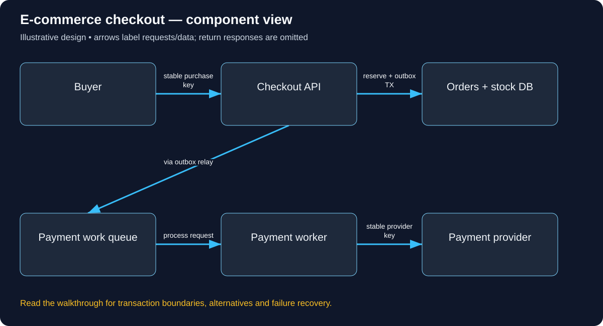

# Build E-commerce checkout: follow the complete user journey

Read in order: each decision below follows from the same real-world situation. Domains ending in .example are reserved teaching names, not live services. These are illustrative designs, not descriptions of a company’s internal implementation.

## 1. Follow one purchase of the last mug

Alice adds mug-42 to her cart, then clicks Pay. At the same moment Bob buys the last available mug. Our task is to produce one correct order and one intended payment effect per purchase, while giving the losing buyer an honest sold-out result. Cached product pages are discovery views, not inventory reservations. Start by choosing where the stock decision is authoritative.

## 2. Where the browser sends requests

The shop operator owns shop.learn.example and configures DNS, edge routing and TLS for the web/API origin. A separate payment provider owns its own API/domain. The shop calls that approved provider endpoint from trusted configuration. A return URL shown to a browser is not proof of payment; a customer can visit or modify a browser URL. Confirm outcomes using authenticated server-to-server responses, signed callbacks and reconciliation.

## 3. Create a trusted checkout request

Alice signs in or receives a deliberately scoped guest-checkout session. POST /checkout contains item IDs, quantities, delivery choices and an idempotency key purchase-81, not a trusted total or owner ID. The server derives cart ownership from the verified session and recomputes price, currency, tax and eligibility. Cookie-based writes need CSRF protection. Card details should use the provider’s appropriate hosted/tokenized integration rather than passing raw card data through an interview toy API.

The concrete API/data vocabulary used in this journey:

```text
POST /checkout with idempotency key. Order, OrderLine, Reservation(state, expiry), PaymentAttempt(provider key/status), Outbox. Calculate price on the server.
```

A concrete request and observable response for this journey (illustrative API contract):

```http
POST /checkout
Authorization: Bearer <buyer-access-token>
Idempotency-Key: purchase-81
Content-Type: application/json

{"items":[{"sku":"mug-42","quantity":1}],"paymentMethodRef":"<provider-token>"}

HTTP/1.1 202 Accepted
{"orderId":81,"state":"PAYMENT_PENDING","statusUrl":"/orders/81"}

GET /orders/81
Authorization: Bearer <same-buyers-access-token>

HTTP/1.1 200 OK
{"orderId":81,"state":"CONFIRMED"}
```



Use this diagram to locate the responsibilities just introduced. Arrows show selected requests/data; the paragraphs distinguish return responses, alternatives and transaction boundaries.

## 4. Make the stock decision atomic

Inside a short local transaction, claim the purchase key, conditionally decrement available stock and create a pending order, reservation and payment outbox intent. UPDATE inventory SET available=available-1 WHERE sku=:sku AND available>=1 RETURNING available lets one buyer win the last unit. Check the affected row; an earlier SELECT is not a guarantee. If any required change fails, roll back all local changes. Do not hold this transaction open while a remote payment call runs.

## 5. Move from pending to a known payment result

A worker reads the committed intent and calls the provider with a stable provider idempotency key. A timeout means unknown: the card may already be charged. Query/retry using the same reference according to the provider contract. Verify webhook authenticity and deduplicate its event ID. A guarded order transition marks payment confirmed and records fulfillment intent. A duplicated callback cannot create a second shipment. A local transaction cannot magically include the remote provider.

## 6. Handle cancellation, expiry and refunds

Reserve stock for a defined interval. Expiry and payment success can race, so reservation states and version guards must decide exactly which action wins. A late successful charge after release needs policy: reacquire stock or refund. Refund is compensation recorded as a new business event, not rollback of time. Customers can only view/cancel their own orders; staff refund permissions and audit trails are separate from ordinary customer rights.

## 7. Search and browse without weakening checkout

Product changes flow to a derived search index; search can filter/rank and recommendations can fail independently. Cart entries carry item identity/quantity, not permanent price promises. A stale search result may show a sold-out mug; checkout revalidates authoritative state. Begin with transactional order/stock ownership, then split services only with a defined reservation protocol and recovery for partial success.

## 8. Test what the buyer sees under failure

Retry purchase-81 after losing its response and assert one order. Race two buyers for stock=1 and assert only one reservation. Delay payment success until after expiry and verify compensation. Submit someone else’s order ID and deny it. Simulate database outage before commit: do not report success. Stop analytics/email workers: the paid order remains durable. Track pending-payment age, reservation leaks, reconciliation backlog and duplicate-effect attempts, not only HTTP 200 counts.

## Work the capacity assumption

For 60,000 checkouts/hour, average is 16.7/second. Flash-sale concentration on a single SKU may matter more than total average. These are illustrative assumptions; measure the chosen implementation and peak distribution before treating them as capacity.

## Explain the journey back

Which local records must commit together to stop an order existing without a recoverable payment request? Then explain the hostname, caller identity, object-level permission, authoritative record, success acknowledgement and crash/retry behavior for this same action.

## Reference documentation

- [Authorization on protected operations](https://cheatsheetseries.owasp.org/cheatsheets/Authorization_Cheat_Sheet.html)
- [Database concurrency and row locking](https://www.postgresql.org/docs/18/explicit-locking.html)
- [Safe retries with idempotent APIs](https://aws.amazon.com/builders-library/making-retries-safe-with-idempotent-APIs/)

[All tutorials](README.md) · [Foundation lessons](../system-design-foundations.md)
