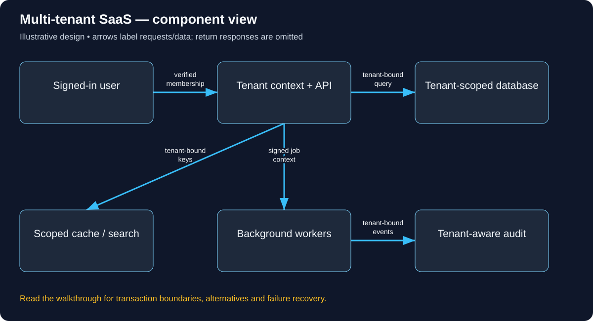

# Build Multi-tenant SaaS: follow the complete user journey

Read in order: each decision below follows from the same real-world situation. Domains ending in .example are reserved teaching names, not live services. These are illustrative designs, not descriptions of a company’s internal implementation.

## 1. Follow Alice opening her company’s project

Company A and Company B use the same project tracker. Alice belongs to A and requests project 42. A guessed project ID from B must never return B’s tasks, attachments or cached results. This must remain true in APIs, workers, search and exports, not only on the first database query.

## 2. Decide how domains map to tenants

The operator owns app.learn.example. A customer may use team-a.learn.example under that owned zone, or a verified custom domain. Configure DNS/TLS/edge bindings and a trusted hostname-to-tenant directory; verify ownership before accepting custom domains. A hostname selects a tenant context, not a user identity. A visitor typing team-b into a Host/header cannot thereby gain membership in B.

## 3. Authenticate then establish membership

Alice logs in through the chosen identity provider. The API validates her session/token and resolves which tenant memberships/roles she currently has. If a route selects company A, verify she is authorized there. Do not assume the user controls a tenant just because their email suffix resembles its name. Workload/service credentials also need tenant/purpose scoping for internal calls.

The concrete API/data vocabulary used in this journey:

```text
GET /projects derives tenant from authenticated membership. Project primary/unique keys and queries include tenant_id. Tenant, Membership, Project, AuditRecord.
```

A concrete request and observable response for this journey (illustrative API contract):

```http
GET /projects/42
Authorization: Bearer <alice-access-token>

Derived server context: user=alice, tenant=A, role=member
Database intent: SELECT permitted fields WHERE tenant_id=A AND project_id=42

HTTP/1.1 200 OK
{"projectId":42,"name":"A onboarding","tenantId":"A"}

If project 42 belongs only to tenant B, this request must not return B's record.
Choose a documented forbidden/not-found policy and apply it consistently.
The client cannot grant itself B membership by sending tenantId=B.
```



Use this diagram to locate the responsibilities just introduced. Arrows show selected requests/data; the paragraphs distinguish return responses, alternatives and transaction boundaries.

## 4. Execute one tenant-scoped request

GET /projects/42 derives tenant context from the verified session and route policy. Query by tenant_id AND project_id, check project permissions and return an API value rather than leaking an ORM graph. Store tenant ID in appropriate composite unique constraints and foreign keys so cross-tenant relationships cannot be inserted casually. Row-level security can add defense but must be configured and tested with real connection/session behavior.

## 5. Carry context beyond the database

Cache keys include tenant and relevant permission/version context. Search queries apply tenant/ACL filters before results leave the service. Blob downloads use scoped, expiring authorization. A background export job stores trusted tenant/user purpose and rechecks access as required; workers cannot infer tenant solely from an arbitrary payload field. Audit records identify actor, tenant, operation and result without exposing unnecessary data.

## 6. Handle a support user and membership removal

Tenant admins act within their own organization. Platform support access is a separate explicit privileged flow with approval/audit rules appropriate to the product. Removing Alice’s membership must affect new requests and live subscriptions, caches and long-running exports according to a documented revocation window. Authentication succeeding does not mean an old tenant permission remains valid forever.

## 7. Recover without leaking or starving neighbors

On tenant-directory/authorization failure, deny protected access rather than choose a default tenant. On cache outage, use bounded tenant-scoped DB fallback. Enforce per-tenant quotas and workload isolation so one large tenant does not exhaust every shared pool. Backups/restores and exports need tenant-aware procedures; a full shared-database restore is not automatically a safe single-tenant restore.

## 8. Choose isolation after defining the invariant

Begin with a clear shared-table model and deliberate cross-tenant negative tests. Database-per-tenant gives different isolation/operating trade-offs; it does not remove authentication or routing requirements. Test colliding project IDs, unscoped cache keys, forbidden exports, custom-host spoofing and membership removal. Measure both total traffic and the largest tenant rather than assuming tenants are equal.

## Work the capacity assumption

Size for both total tenants and largest tenant. One tenant with 80% of requests can invalidate an average-per-tenant capacity estimate. These are illustrative assumptions; measure the chosen implementation and peak distribution before treating them as capacity.

## Explain the journey back

If database queries are scoped correctly but Redis keys omit tenant_id, is isolation complete? Then explain the hostname, caller identity, object-level permission, authoritative record, success acknowledgement and crash/retry behavior for this same action.

## Reference documentation

- [Authorization on protected operations](https://cheatsheetseries.owasp.org/cheatsheets/Authorization_Cheat_Sheet.html)
- [Tenant isolation](https://cheatsheetseries.owasp.org/cheatsheets/Multi_Tenant_Security_Cheat_Sheet.html)

[All tutorials](README.md) · [Foundation lessons](../system-design-foundations.md)
