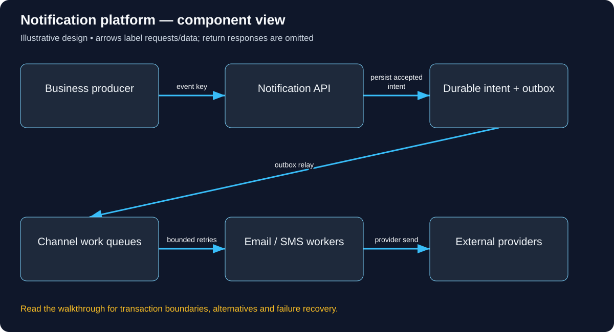

# Build Notification platform: follow the complete user journey

Read in order: each decision below follows from the same real-world situation. Domains ending in .example are reserved teaching names, not live services. These are illustrative designs, not descriptions of a company’s internal implementation.

## 1. Follow one order confirmation

Order 81 is confirmed and Alice expects an email plus an app notification. The order must remain confirmed even if the email provider is down. “Accepted for sending”, “provider accepted”, “delivered” and “read” are different facts. We therefore record durable notification intent and process delivery asynchronously instead of holding checkout open while every provider responds.

## 2. Know which domains and credentials do what

The operator configures an HTTPS notification-management API with DNS/TLS. Its workers call approved provider APIs with server-managed credentials. Email also uses an owned sender domain with the provider’s required authentication records such as SPF/DKIM/DMARC configuration; those concern email sender verification, not HTTP user authorization. SMS and mobile push have their own provider credentials and registration rules.

## 3. Record the business event once

Checkout commits order confirmation and an outbox event together. A relay delivers event e81 to the notification service. The service authenticates the producing workload, checks allowed tenant/event types and records a stable event-recipient-channel identity. A random public caller must not be able to send arbitrary branded messages to arbitrary recipients. Templates and recipient selection belong to trusted business rules.

The concrete API/data vocabulary used in this journey:

```text
POST /notifications with stable event key. Intent(tenant, recipient, template, channel), Preference, DeliveryAttempt(provider ID/status), DedupKey.
```

A concrete request and observable response for this journey (illustrative API contract):

```http
POST /notifications
Authorization: Bearer <trusted-order-service-credential>
Content-Type: application/json

{"eventId":"e81","orderId":81,"recipientRef":"customer-alice","template":"ORDER_CONFIRMED"}

HTTP/1.1 202 Accepted
{"intentId":"N81","state":"ACCEPTED_FOR_PROCESSING"}

The service resolves authorized tenant/customer contact data and preferences.
202 acknowledges the stored intent; it does not claim the email was delivered.
Repeated e81 for the same permitted recipient/channel resolves to the existing
intent under the documented deduplication policy.
```



Use this diagram to locate the responsibilities just introduced. Arrows show selected requests/data; the paragraphs distinguish return responses, alternatives and transaction boundaries.

## 4. Choose channels from preferences

Resolve Alice’s verified contact destinations and current preferences, including necessary transactional versus optional promotional policy. Create channel work with the chosen template version and safe data fields. Do not place full secrets or unnecessary payment/customer details in message bodies or logs. A change of contact address needs verification; a request parameter must not silently redirect sensitive notifications to an attacker.

## 5. Send and track a delivery attempt

A worker consumes channel work, observes provider rate limits and creates an attempt record. It calls the provider with a stable idempotency key where supported, stores the returned provider reference and handles authenticated status callbacks. Provider accepted means the provider took responsibility under its contract, not proof Alice read the message. Push tokens identify device registrations and can expire.

## 6. Handle the lost-acknowledgement problem

If the provider accepted an SMS but the worker timed out, retrying may duplicate it. Prefer provider idempotency/status lookup; when unavailable, document the duplicate-versus-loss policy for that channel. Local deduplication cannot make a remote non-idempotent send exactly once. Retry transient errors with bounded backoff and jitter, quarantine permanent failures, and monitor oldest pending intent. A crash after send can cause reprocessing.

## 7. Expose only authorized status and controls

Alice can inspect her own notification preferences and permitted delivery history. Tenant operators can manage only their authorized templates/recipients; privileged overrides need audit. Unsubscribe/cancellation and queued work must have a defined interaction. If the preference service is unavailable for optional marketing, do not guess consent; apply a safe documented policy.

## 8. Prove correctness before promotion traffic

Test duplicate e81, a provider timeout, invalid contact, revoked push token, consent change and an unauthorized caller. Preserve order success while workers stop. Then estimate fan-out: one million notifications/hour is about 278/second before channels and retries, but scheduled campaigns produce much larger bursts. Separate channel queues and worker budgets so one failing SMS provider cannot starve all email.

## Work the capacity assumption

One million notifications/hour is about 278/second before channel fan-out; a promotion can create a much larger short burst. These are illustrative assumptions; measure the chosen implementation and peak distribution before treating them as capacity.

## Explain the journey back

If the provider accepted an SMS but the acknowledgement was lost, what duplicate risk remains? Then explain the hostname, caller identity, object-level permission, authoritative record, success acknowledgement and crash/retry behavior for this same action.

## Reference documentation

- [Authorization on protected operations](https://cheatsheetseries.owasp.org/cheatsheets/Authorization_Cheat_Sheet.html)
- [Event delivery semantics](https://kafka.apache.org/41/design/design/)

[All tutorials](README.md) · [Foundation lessons](../system-design-foundations.md)
