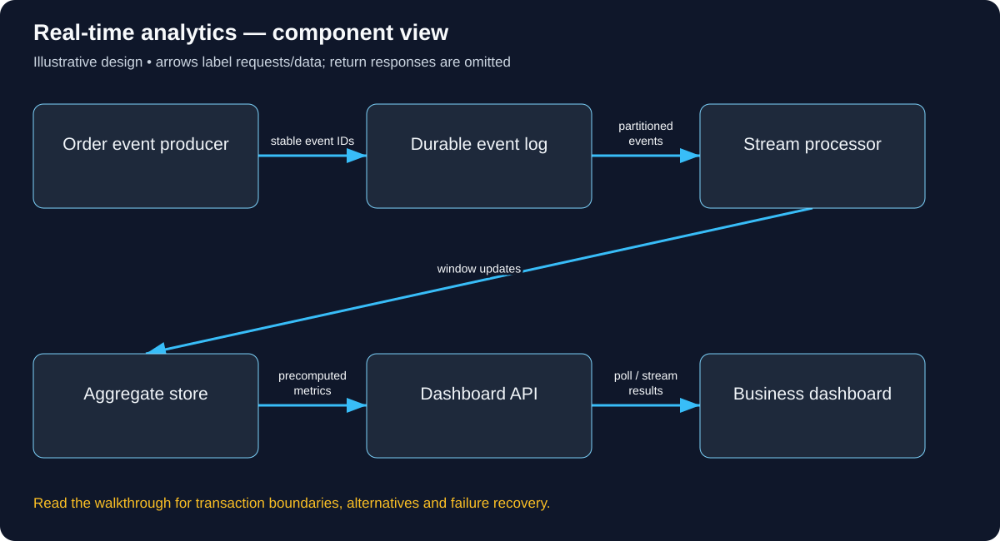

# Build Real-time analytics: follow the complete user journey

Read in order: each decision below follows from the same real-world situation. Domains ending in .example are reserved teaching names, not live services. These are illustrative designs, not descriptions of a company’s internal implementation.

## 1. Follow a late order event into a minute chart

Order 81 happened at 10:01:58 but its event arrives at 10:03 after a connection failure. The sales dashboard should place it according to the chosen event-time policy, not blindly count it as a new 10:03 sale. If the processor crashes and replays it, the total should not double. These two questions determine storage and processing rules.

## 2. Set up ingestion and dashboard access

The operator configures separate approved HTTPS endpoints such as events.learn.example and dashboard.learn.example with DNS/TLS. Producers authenticate as authorized workloads/clients and can publish only their permitted tenant/event classes. Dashboard viewers authenticate separately and can see only entitled aggregates. A broker topic name or a client-provided tenant field is not an access-control boundary by itself.

## 3. Record a trustworthy event

Emit stable event ID e81, order/tenant identity, event timestamp, schema version and amount/currency under a defined business contract. For transactional order events, use a committed outbox rather than publishing before the order exists. Validate schema, timestamp bounds and producer permission. Avoid mixing currencies into one meaningless summed number. Append to a durable log before acknowledging the chosen ingestion guarantee.

The concrete API/data vocabulary used in this journey:

```text
Event(id, event_time, tenant, order_value); Aggregate(tenant, window, version); GET /metrics?window=. Define event-time versus processing-time semantics.
```

A concrete request and observable response for this journey (illustrative API contract):

```http
GET /metrics/orders?from=2026-10-23T10:01:00Z&to=2026-10-23T10:02:00Z
Authorization: Bearer <authorized-dashboard-access-token>

HTTP/1.1 200 OK
{"windowStart":"2026-10-23T10:01:00Z","orderCount":14,"aggregateVersion":8,"status":"PROVISIONAL"}

A late permitted event may revise this window to version 9. Replaying an
already-applied event must not increase the count again. Tenant and currency
filters are derived/validated by the API; freshness metadata must distinguish
an unfinished window from a fully final value under the chosen policy.
```



Use this diagram to locate the responsibilities just introduced. Arrows show selected requests/data; the paragraphs distinguish return responses, alternatives and transaction boundaries.

## 4. Calculate a window

A processor reads partitioned events and groups them by tenant and event-time minute. Watermarks estimate progress; an allowed-lateness policy determines which old windows can be revised. For e81, update the 10:01 window if still permitted, or send it to an explicit correction/late-event path. A watermark is a processing policy, not proof no late event can ever arrive.

## 5. Commit output without duplicate counting

Keep processor progress/checkpoint and sink behavior compatible. If a crash occurs after aggregate output but before input progress is recorded, replay is possible. Use a transactional/idempotent sink strategy or event-ID deduplication with retention matching replay policy. A raw increment on every delivery can double totals. Published aggregate versions let downstream reads distinguish revisions.

## 6. Show freshness honestly

The dashboard API reads precomputed tenant-scoped aggregates and returns their window/version and freshness/progress information. Polling or streaming can update the browser. A last-updated label should distinguish no new sales from a stalled processor. If processing is behind, keep the last valid view with an explicit stale indication where permitted rather than displaying invented zero sales.

## 7. Recover and correct deliberately

Replay from durable input after processor failure and verify stable totals. Quarantine malformed events instead of blocking every partition indefinitely. Handle duplicate IDs, clock-skewed timestamps and late cancellation/correction events. On authorization failure deny the dashboard read. Monitor ingest errors, consumer lag, watermark delay, sink failures and user-visible freshness as separate signals.

## 8. Test the chart before adding streaming products

Start with a handful of timestamped events and write down the expected windows. Replay e81 twice, delay it across the lateness boundary, crash before/after sink commit and test another tenant’s dashboard query. At 5,000 events/second and 500 bytes/event, raw data is about 2.5 MB/second or 216 GB/day before replicas/indexes; that motivates retention and replay budgets rather than an unbounded log.

## Work the capacity assumption

At 5,000 events/second and 500 bytes/event, raw ingestion is 2.5 MB/second or about 216 GB/day before replicas and indexes. These are illustrative assumptions; measure the chosen implementation and peak distribution before treating them as capacity.

## Explain the journey back

If the processor replays a batch after a crash, how do totals avoid doubling? Then explain the hostname, caller identity, object-level permission, authoritative record, success acknowledgement and crash/retry behavior for this same action.

## Reference documentation

- [Authorization on protected operations](https://cheatsheetseries.owasp.org/cheatsheets/Authorization_Cheat_Sheet.html)
- [Event delivery semantics](https://kafka.apache.org/41/design/design/)

[All tutorials](README.md) · [Foundation lessons](../system-design-foundations.md)
