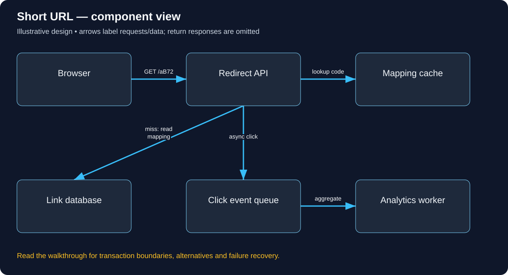

# Short URL: a worked design

**Real-world situation:** A college shares a long event-registration URL using /aB72.

This is an illustrative architecture, not a claim about a specific company’s implementation.

## What we need and why

Create links, redirect active links, expire/disable abuse. Redirect reads should stay fast; losing the mapping is worse than losing a click metric.

## API and data ownership

POST /links {targetUrl}; GET /{code}. Link(code unique, target, owner, expires_at, status). Reject unsafe URL schemes.

## Component diagram

Arrows show requests or emitted data. Responses generally return to callers and are omitted. Branches can be alternatives rather than steps that always run.

## Follow one request

Create validates and persists a unique mapping. Redirect checks cache, then database only on miss, verifies active status and returns 302 Location. The browser follows that Location; the API does not download the destination page. Analytics runs after the critical decision.

## Why these components exist

Cache descriptions/mappings according to an explicit freshness policy. Keep mutable redirects from being permanently cached. Use unique insertion and collision retries for codes.

## Failure walkthrough

Redis outage must not unleash unlimited fallback reads. Apply admission control. Define takedown propagation targets across caches.

## Capacity worked example

100M redirects/day ÷ 86,400 = about 1,157/second average; assume a separate peak factor, then estimate cache-miss load. These are illustrative numbers.

## Explain it back

What happens if a mapping is disabled while its cached redirect is still fresh?

[Beginner glossary and learning order](visual-learning-guide.md) · [All case studies](README.md)
