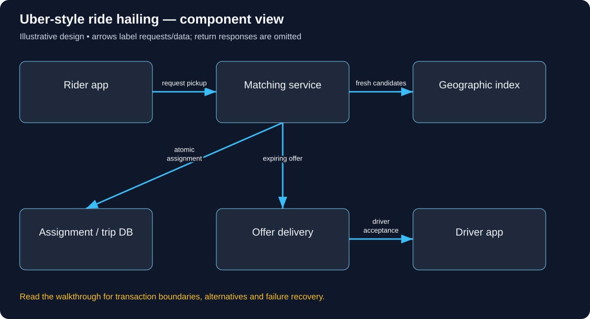

# Build Uber-style ride hailing: follow the complete user journey

Read in order: each decision below follows from the same real-world situation. Domains ending in .example are reserved teaching names, not live services. These are illustrative designs, not descriptions of a company’s internal implementation.

## 1. Follow a station pickup

Alice requests a car at a railway station. Driver D7 appears closest, but another rider is also trying to book D7. We need to find likely candidates quickly and then confirm exactly one valid assignment. Fresh-looking coordinates are a search hint; authoritative trip/driver state decides whether the assignment exists. A diagram that treats those as the same fact misses the core race.

## 2. How rider and driver apps connect

Both apps use the operator’s configured HTTPS origin, for example rides.learn.example, backed by owned DNS, edge bindings and TLS. Authenticated APIs carry durable requests; sockets or push carry timely updates. GPS selects a geographic search area inside the application, not a different DNS domain for every driver. Region routing can reduce latency, but ownership of a trip/driver must remain explicit during handoff.

## 3. Authenticate roles and validate a ride request

POST /rides includes pickup, destination, quote ID and an idempotency key. Derive rider identity from credentials. Validate supported area and quote terms. A driver session may update only its own authorized vehicle/location and accept offers addressed to that driver. Rider and driver permissions differ; guessing a trip ID must not reveal another passenger’s route or permit cancellation.

The concrete API/data vocabulary used in this journey:

```text
POST /rides; POST /offers/{id}/accept with expected state/version. DriverPosition(timestamp, coordinates), Trip(state, rider, driver, version), Assignment.
```

A concrete request and observable response for this journey (illustrative API contract):

```http
POST /rides
Authorization: Bearer <rider-access-token>
Idempotency-Key: ride-81
Content-Type: application/json

{"pickup":{"lat":26.14,"lon":91.74},"destinationRef":"station-east-gate","quoteId":"q17"}

HTTP/1.1 202 Accepted
{"tripId":"T81","state":"SEARCHING"}

POST /offers/O17/accept
Authorization: Bearer <authorized-driver-access-token>
Content-Type: application/json

{"expectedVersion":3}

HTTP/1.1 200 OK
{"tripId":"T81","state":"ACCEPTED","driverId":"D7","version":4}
```



Use this diagram to locate the responsibilities just introduced. Arrows show selected requests/data; the paragraphs distinguish return responses, alternatives and transaction boundaries.

## 4. Find candidates then send expiring offers

Drivers publish timestamped positions. A geographic index searches the pickup cell plus neighbors, expanding radius if needed. Discard stale/ineligible candidates and compute road ETAs for a bounded shortlist: distance across a river can be misleading. Send offers containing trip, driver, expiry and expected state/version. Choosing one candidate is not yet a successful booking.

## 5. Confirm one driver with guarded state

On acceptance, recheck expiry and availability. If trip and driver share a database boundary, conditionally reserve the available driver and move the pending trip to accepted in one transaction, with an outbox update. Roll back if either condition fails. If separately owned shards/services are involved, use an assignment owner or recoverable reservation protocol with fencing. Do not pretend a short Redis lock supplies a cross-service transaction.

## 6. Run the trip and price contract

Persist allowed transitions: accepted, arrived, started, completed or a permitted cancellation. Late acceptances and old client versions cannot rewind state. A quote has stored currency, terms, pricing-policy version and expiry. ETA is a prediction based on route/traffic and should communicate uncertainty. Local demand/supply can inform bounded, smoothed surge policy; the rider accepts recorded terms rather than an undocumented moving price.

## 7. Recover when phones and workers fail

If Alice loses connection after assignment commit, a retry/reconnect fetches the same durable trip. Duplicate offers cannot assign D7 twice. An expired offer is rejected even if the phone shows it. If the position store fails, avoid inventing nearby drivers; use a documented temporary-unavailable policy. Stop status-push delivery: clients can refresh durable state. A payment timeout after trip completion requires separate payment reconciliation, not changing the trip back to started.

## 8. Build and verify in stages

First test one region with a few drivers, neighbor-cell search, two competing riders, late acceptance, stale coordinates and forbidden trip reads. Then measure position write volume, candidate-search time, assignment conflicts and notification lag. Add geographic partitioning for fleet size and load, while retaining a clear owner for assignments and tested recovery during region failure.

## Work the capacity assumption

50,000 drivers updating every five seconds create 10,000 location writes/second; coalesce updates and expire old positions. These are illustrative assumptions; measure the chosen implementation and peak distribution before treating them as capacity.

## Explain the journey back

Why might the nearest driver in straight-line distance not have the shortest pickup ETA? Then explain the hostname, caller identity, object-level permission, authoritative record, success acknowledgement and crash/retry behavior for this same action.

## Reference documentation

- [Authorization on protected operations](https://cheatsheetseries.owasp.org/cheatsheets/Authorization_Cheat_Sheet.html)
- [Database concurrency and row locking](https://www.postgresql.org/docs/18/explicit-locking.html)

[All tutorials](README.md) · [Foundation lessons](../system-design-foundations.md)
