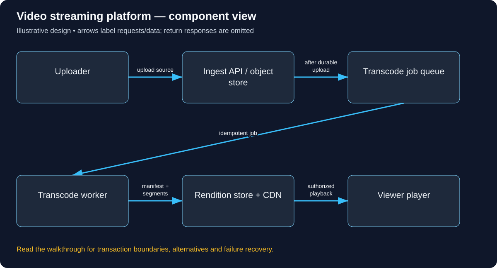

# Build Video streaming platform: follow the complete user journey

Read in order: each decision below follows from the same real-world situation. Domains ending in .example are reserved teaching names, not live services. These are illustrative designs, not descriptions of a company’s internal implementation.

## 1. Follow a teacher’s upload to a student’s playback

A teacher uploads a one-hour lecture. A student later presses Play on a slow mobile network. The upload file, encoded playback segments and metadata are different assets with different lifetimes. We first need to accept the source durably, produce playable versions and authorize a student to request them. Adding a CDN before defining those states does not explain how video becomes playable.

## 2. Set up the domains and delivery origins

The operator configures its web/API origin, for example video.learn.example, with owned DNS and TLS. A media hostname such as media.learn.example binds to a CDN whose origin is the rendition object store. DNS selects the service/edge; the video ID and segment path select data. Keep the source store private, lock down origin access and avoid a public bucket that bypasses playback authorization.

## 3. Authenticate and authorize the upload

The teacher signs in and requests POST /uploads with expected media metadata. The API checks upload permission and quota and issues short-lived upload authorization scoped to the teacher’s specific object key, method and limits. The client uploads directly to storage if appropriate, then the service verifies completion. Never accept arbitrary client claims that any object key belongs to that teacher. Store owner, course, source checksum and processing status.

The concrete API/data vocabulary used in this journey:

```text
POST /uploads issues scoped upload authorization; GET /videos/{id}/playback authorizes a manifest. Video(owner, status), Rendition(codec, bitrate, segments), Job.
```

A concrete request and observable response for this journey (illustrative API contract):

```http
POST /uploads
Authorization: Bearer <teacher-access-token>
Content-Type: application/json

{"courseId":"C7","filename":"lecture.mp4","contentType":"video/mp4"}

HTTP/1.1 201 Created
{"videoId":"V81","state":"AWAITING_UPLOAD","uploadAuthorization":"<short-lived-object-scoped-value>"}

GET /videos/V81/playback
Authorization: Bearer <entitled-student-access-token>

HTTP/1.1 200 OK
{"state":"READY","manifestUrl":"https://media.learn.example/V81/v3/master.m3u8?<scoped-credential>"}
```



Use this diagram to locate the responsibilities just introduced. Arrows show selected requests/data; the paragraphs distinguish return responses, alternatives and transaction boundaries.

## 4. Turn a source file into playable media

After durable upload, write a recoverable transcode intent. Workers probe/validate the source and create supported renditions at several bitrates. Split them into segments and produce a manifest describing those segments. Use versioned outputs and idempotent jobs; publish READY only after the required manifest/segments exist. Failed encoding stays PROCESSING/FAILED with retry status, not a broken public manifest.

## 5. Trace the student’s Play request

GET /videos/{id}/playback checks the student’s identity and current course entitlement. If permitted and READY, return an appropriately protected manifest/playback credential. The player fetches the manifest and media segments through the CDN and switches rendition based on measured bandwidth. The application API handles metadata/permission; the CDN carries most bytes. Every protected segment path must enforce the chosen credential/origin policy, not just the initial Play button.

## 6. Define authorization and revocation honestly

Playback credentials must be limited to permitted paths and time windows. A shareable signed media URL can be used by whoever possesses it until expiry; define acceptable revocation delay and stronger controls where needed. Expiring a credential mid-playback needs a refresh policy. Protect manifests as well as segments. A CDN HIT must not accidentally turn private content into anonymously reusable content.

## 7. Recover the student experience

Duplicate storage/job events should not create competing READY versions. Kill a worker halfway through: temporary outputs remain unpublished and retry safely resumes/replaces them. If a rendition is missing, avoid advertising it. If bandwidth drops, select a lower rendition instead of treating every stall as API failure. If auth is unavailable, fail closed for private videos. Track startup delay, buffering ratio, encode backlog and CDN errors separately.

## 8. Scale the right part

Start with a source store, metadata/permission API, worker and a tested player. Test unauthorized segment access, expired credentials, failed encoding and partial uploads. At 2 Mbit/second and 10,000 concurrent viewers, media delivery is about 20 Gbit/second before overhead. That points to CDN/object-storage delivery and encoding capacity, not sharding the small metadata table first.

## Work the capacity assumption

At 2 Mbit/second × 10,000 simultaneous viewers, delivery is about 20 Gbit/second before overhead. CDN bandwidth dominates, not metadata QPS. These are illustrative assumptions; measure the chosen implementation and peak distribution before treating them as capacity.

## Explain the journey back

Why should an upload succeed before every video rendition is ready? Then explain the hostname, caller identity, object-level permission, authoritative record, success acknowledgement and crash/retry behavior for this same action.

## Reference documentation

- [Authorization on protected operations](https://cheatsheetseries.owasp.org/cheatsheets/Authorization_Cheat_Sheet.html)
- [HTTP Live Streaming](https://developer.apple.com/streaming/)

[All tutorials](README.md) · [Foundation lessons](../system-design-foundations.md)
